## Introduction

In the previous assignments the agent decided everything by itself: where to patrol, where to hide, when to chase. That works, but it means every new thing an agent can do has to be built into the agent. **Smart Objects** turn that around. The knowledge of *how* to interact with something lives inside the object, not inside the agent. A valve knows how to be turned. A chair knows how to be sat on. The agent only needs to know that it *wants* to do a thing, find an object that offers it, and run whatever behavior the object hands back.

In this assignment you will build a **maintenance crew** made of two kinds of agents:

- a **human worker**, who turns valves and presses buttons, gets tired, and rests on a bench in the break area;
- a **maintenance robot**, which only handles valves, drains its battery, and recharges on a charging pad.

Both agents:

1. **Work**, by finding a nearby object they are allowed to use, walking to it, and running the interaction the object defines;
2. **Get worn out**, because every interaction tells the agent how much effort it took;
3. **Recover**, when they are worn out, by finding a free recovery spot (a seat for the human, a pad for the robot);
4. **Share** the objects, through a reservation system, so two agents never claim the same slot.

The agents' decisions live in **one State Tree** that both of them run. The behavior for each interaction lives **inside the smart object**, as a Gameplay Behavior, and the object talks back to whoever used it through a **Blueprint Interface**. The State Tree never mentions valves, buttons, humans or robots by name. Add a lever next week, or a third kind of agent, and the State Tree does not change at all.

::: {.callout-note}
## Prerequisites
This assignment assumes you completed **Assignment 03 (State Trees: AI Perception and EQS)**. State Tree basics (schema, selection, transitions, tasks, parameters, context binding) are only recapped here. The debugging section reuses the Rewind Debugger workflow from that assignment.
:::

### What you will build

```{mermaid}
%%| fig-cap: "Final structure of ST_Worker, the brain shared by both agents."
flowchart TD
    ROOT["<b>Root</b><br/>Try Select Children In Order<br/><i>Parameter: ClaimHandle</i>"]
    REC["<b>Recover</b><br/>Enter: STC_IsTired"]
    FINDR["<b>FindRecoverSlot</b><br/>STT_FindSmartObject (Need = Recover)"]
    USER["<b>UseRecoverSlot</b><br/>STT_UseSmartObject"]
    WORK["<b>Work</b>"]
    FINDW["<b>FindWorkSlot</b><br/>STT_FindSmartObject (Need = Work)"]
    DOW["<b>DoWork</b><br/>STT_UseSmartObject"]
    IDLE["<b>Idle</b> (fallback)<br/>Delay 2 s"]
    ROOT --> REC
    ROOT --> WORK
    ROOT --> IDLE
    REC --> FINDR
    REC --> USER
    WORK --> FINDW
    WORK --> DOW
```

The interaction itself is not in this tree. It lives in the object, and the object reports back to the agent through the interface:

```{mermaid}
%%| fig-cap: "Where things live. The agent runs a generic use; the object supplies the behavior and tells the agent what it cost."
flowchart LR
    subgraph AGENT["Agent"]
      A1["Which tag do I need?<br/>(GetWorkTag / GetRecoverTag)"] --> A2["Find and claim a slot"] --> A3["Move, align and use<br/>the slot"]
      A4["ApplyEffort / Recover<br/>(own energy or battery)"]
    end
    subgraph OBJECT["Smart Object"]
      B1["Slot + Activity Tag"] --> B2["Gameplay Behavior + Config<br/>(montage, effort cost)"]
    end
    A3 -. "runs" .-> B2
    B2 -. "BPI_Worker message" .-> A4
```

## Concepts {#sec-theory}

### Smart Objects {#sec-smartobjects}

A **Smart Object** is an actor with a **Smart Object Component**. The component points to a **Smart Object Definition**, a data asset that describes what the object offers through one or more **slots**.

| Term | Meaning |
|---|-----------------|
| **Slot** | A position where an agent can perform one activity. An object can have several. |
| **Activity Tag** | A Gameplay Tag on the slot (e.g. `Activity.Rest`) that says *what kind of thing* this slot is for. Agents filter by it. |
| **Behavior Definition** | What to actually do at the slot. Here, a **Gameplay Behavior** plus a **Config** with its data. This is where the object's knowledge lives. |
| **Claim** | A reservation. When an agent claims a slot, no other agent can use it until the claim is released. |
| **Claim Handle** | The token returned by a claim. You pass it to the "use" step and keep it until you release. |

The lifecycle every agent follows is always the same four steps: **find → claim → use → release**. Finding and claiming are spatial and bookkeeping; the *use* step is where the object's behavior runs; releasing frees the slot for the next agent.

::: {.callout-important}
### Why Gameplay Behavior (and not Gameplay Interactions) {#sec-behaviorchoice}

There are two supported frameworks to attach behavior to a smart object in Unreal 5:

- **Gameplay Behavior** (the `GameplayBehaviorSmartObjects` plugin). The slot points to a Gameplay Behavior class. This framework is stable, documented, and the one we use in this assignment.
- **Gameplay Interactions** (the `GameplayInteractions` plugin). The slot points to its own small **State Tree**. This is the newer, State Tree native approach, and conceptually the cleanest: a State Tree in the brain and a State Tree in the object. This framework is very recent, experimental and very little documentation is provided.

We build on Gameplay Behavior because it is stable and well documented. Gameplay Interactions is the direction Epic is heading and is worth knowing about, but it is not covered in this worksheet.

::: {.callout-note}

## The agent stays generic either way

Whichever system defines the behavior, the goal is the same: the agent's State Tree does not know what a valve is. It finds a slot by tag, claims it, and runs whatever behavior the slot carries. That decoupling is the whole reason smart objects exist.

:::
:::

### Blueprint Interfaces {#sec-interface}

The valve needs to tell whoever turned it *"that took 25 effort"*. But the valve must not know who that is: a human, a robot, or some agent nobody has built yet. If the valve cast the user to `BP_HumanWorker`, it would stop working for robots.

A **Blueprint Interface** solves this. It is a list of function signatures with no code. Any class can **implement** it and give each function its own body. Anyone can then **send a message** through the interface to any actor, without knowing its class:

- if the actor implements the interface, its version of the function runs;
- if it does not, the message is silently ignored.

In this assignment the interface `BPI_Worker` is the **contract every worker fulfils**:

| Function | Called by | Human implementation | Robot implementation |
|---|---|---|---|
| `ApplyEffort(Amount)` | Work objects | Loses `Amount` energy | Loses `Amount × 0.5` battery (efficient, but small battery) |
| `Recover(Amount)` | Recovery objects | Gains energy | Gains battery |
| `IsFullyRecovered()` | Recovery objects | Energy is full | Battery is full |
| `IsTired()` | The State Tree | Energy below its threshold | Battery below its threshold |
| `GetWorkTag()` | The State Tree | `Activity.Work` (valves **and** buttons) | `Activity.Work.Valve` (valves only) |
| `GetRecoverTag()` | The State Tree | `Activity.Rest` | `Activity.Recharge` |

Same message, different reaction. The object says *how hard the task was*; the agent decides *what that means for it*. That is the same separation smart objects give you, pointed the other way.

::: {.callout-note}
## Why not a common parent class?
Both agents are Characters, so a shared parent (`BP_WorkerBase`) with overridable functions would also work. The interface is the better fit here because the objects then depend on **no class hierarchy at all**: anything can opt in later (the player character, a drone, an NPC from another project) just by implementing `BPI_Worker`. Inheritance says *"is a worker"*; an interface says *"can act as a worker"*.
:::

### What lives where

| Lives in the **object** | Lives in the **agent** |
|---|---|
| The animation to play | Its energy or battery |
| How much effort the task costs | Its tiredness threshold |
| How fast you recover at this spot | How it reacts to effort (efficiency) |
| When the interaction is over | Which activities it is allowed to do |

If you ever catch yourself putting something from the left column into an agent, ask whether a second agent type would need a copy of it. If yes, it belongs in the object.

### State Tree recap

With the **StateTree AI Component** schema, the context gives you **Actor** and **AIController**. States are selected depth first, top to bottom, and are entered only if their **enter conditions** pass. Tasks run while their state is active; when a task finishes it completes its state.

This assignment adds two new ideas on top of that:

- **Custom State Tree tasks** written in Blueprint (`StateTreeTaskBlueprintBase`), which is how the agent talks to the Smart Object Subsystem.
- **Custom State Tree conditions** written in Blueprint (`StateTreeConditionBlueprintBase`), which is how the tree asks the agent "are you tired?" through the interface.

## Setting up the basis

### Starter project and plugins

Open the **starter project** provided for this assignment. It is based on the **Third Person** template and already contains the two worker characters, `BP_HumanWorker` and `BP_RobotWorker`, in the `ThirdPerson/Blueprints/AI` folder. You will give them their brains.

Go to **Edit → Plugins** and enable the following, then restart the editor when asked:

::: {.narrow-first}
| Plugin | Category |
|---|---|
| **Smart Objects** | Gameplay |
| **AI Behaviors** | Gameplay |
| **Gameplay Behavior Smart Objects** | Other |
| **State Tree** | Gameplay |
| **Gameplay State Tree** | Gameplay |
:::

The first three let a smart object carry a Gameplay Behavior; the last two provide the State Tree AI component and the tasks it runs.

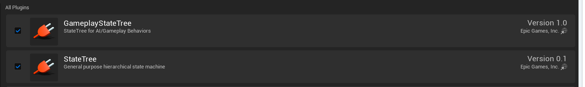{fig-align="center"}
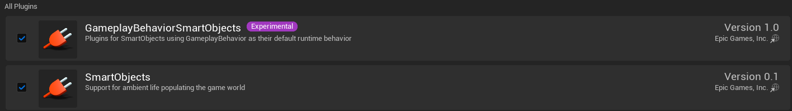{fig-align="center"}
{fig-align="center"}

::: {.callout-warning}
Some of these features are marked **Beta**. Beta means they are supported but can still change between engine versions. If you upgrade the project to a newer engine later, expect to re-check the node names in this worksheet.
:::

### Gameplay tags for activities

The agents will filter smart objects by what they offer. Go to **Edit → Project Settings → Project → GameplayTags → Manage Gameplay Tags**, and add:

- `Activity.Work.Valve`
- `Activity.Work.Button`
- `Activity.Rest`
- `Activity.Recharge`

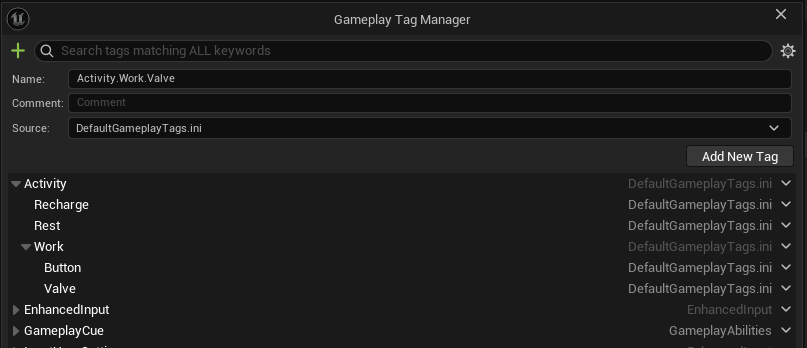{fig-align="center"}

The two work tags sit under a common `Activity.Work` parent. That matters: when the human filters for `Activity.Work`, it matches both valve and button slots, because tag matching includes children. The robot filters for `Activity.Work.Valve`, so it only ever matches valves.

### The worker interface

In the `ThirdPerson/Blueprints/AI` folder, right-click **Blueprint → Blueprint Interface** and name it **`BPI_Worker`**. Open it and add these functions:

::: {.narrow-first}
| Function | Inputs | Outputs |
|---|---|---|
| `ApplyEffort` | `Amount` (Float) | – |
| `Recover` | `Amount` (Float) | – |
| `IsFullyRecovered` | – | `Result` (Boolean) |
| `IsTired` | – | `Result` (Boolean) |
| `GetWorkTag` | – | `Tag` (Gameplay Tag) |
| `GetRecoverTag` | – | `Tag` (Gameplay Tag) |
:::

**Compile** and **Save**. The interface has no code: each agent supplies its own.

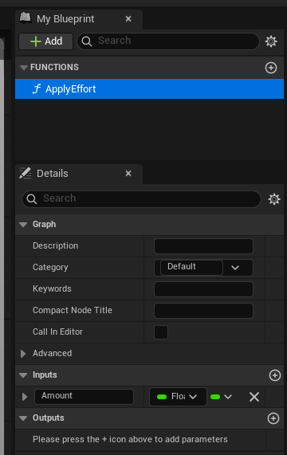{fig-align="center"}
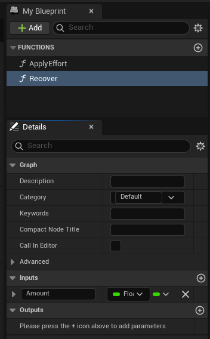{fig-align="center"}
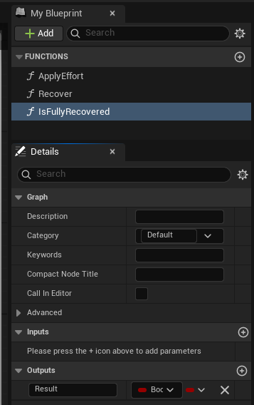{fig-align="center"}
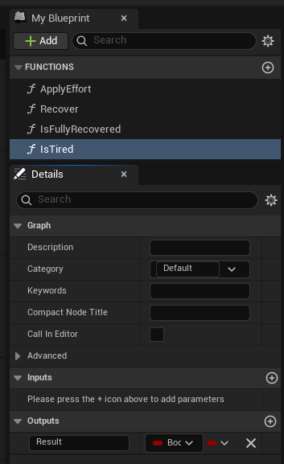{fig-align="center"}
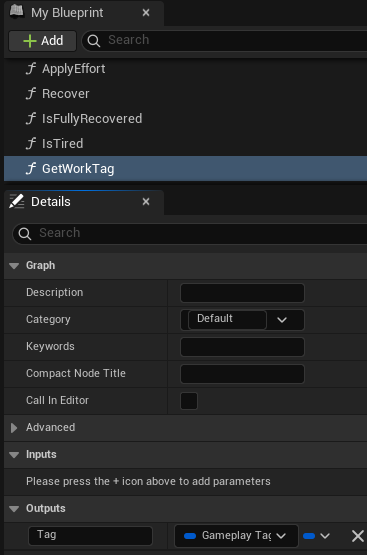{fig-align="center"}
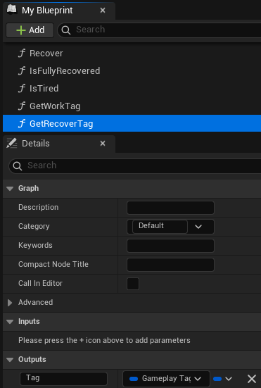{fig-align="center"}

### The AI controller

Inside the `AI` folder, create a new **Blueprint Class**, expand **ALL CLASSES**, search `AIController`, and name it **`AIC_Worker`**. Add a **StateTreeAI** component and leave **Start Logic Automatically** checked (there is no perception to wait for in this assignment). You will assign the State Tree after creating it.

Both agent types use this same controller.

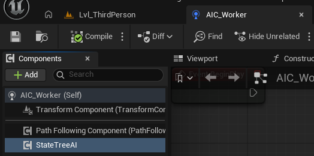{fig-align="center"}

### The human worker

Open **`BP_HumanWorker`** located at **`ThirdPerson/Blueprints/AI`**. The starter project has already prepared it:

- it uses the `SKM_Quinn_Simple` mesh;
- it has no camera and reads no player input;
- it has the `Energy` and `MaxEnergy` variables;
- it has an **energy bar** component that shows `Energy` above its head while the game runs.

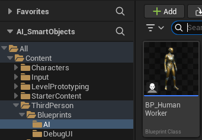{fig-align="center"}

::: {.callout-warning}
## Do not rename the provided variables
The energy bar reads `Energy` and `MaxEnergy` (and `Battery` and `MaxBattery` on the robot) by name. If you rename or delete them, the bar disappears.
:::

Finish the setup:

1. In **Class Defaults**, set **AI Controller Class** to `AIC_Worker` and **Auto Possess AI** to *Placed in World or Spawned*.
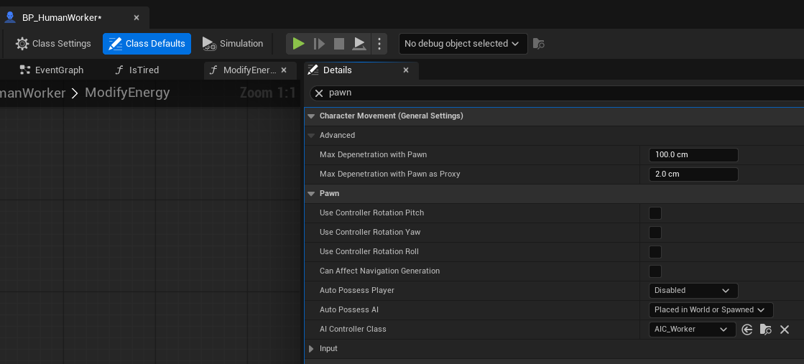{fig-align="center"}
2. In **Class Settings → Interfaces → Implemented Interfaces**, click **Add** and choose `BPI_Worker`.
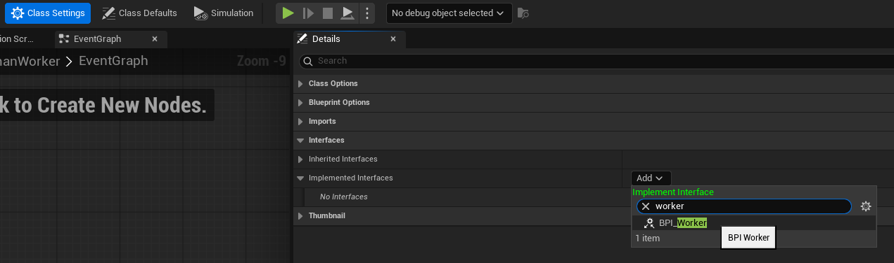{fig-align="center"}

#### Add the remaining variables:

::: {.narrow-first}
| Variable | Type | Default | Instance Editable | |
|---|---|---|---|---|
| `Energy` | Float | `100` | yes | already provided |
| `MaxEnergy` | Float | `100` | yes | already provided |
| `TiredThreshold` | Float | `30` | yes | **add** |
| `WorkTag` | Gameplay Tag | `Activity.Work` | yes | **add** |
| `RecoverTag` | Gameplay Tag | `Activity.Rest` | yes | **add** |
:::

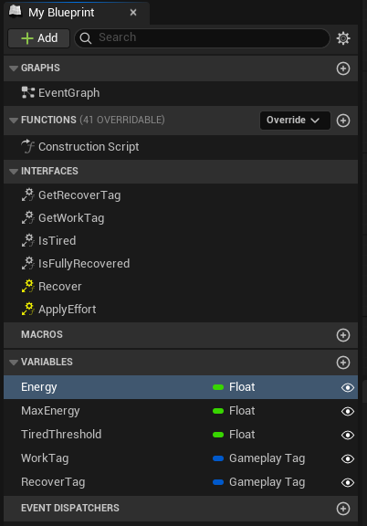{fig-align="center"}

#### Now implement the interface. 

Functions from the interface appear under **Interfaces** in the *My Blueprint* panel: double-click each of them to implement them. 
\

Functions **without outputs** (`ApplyEffort`, `Recover`) are implemented as **events**, while functions **with outputs** (`IsFullyRecovered`, `IsTired`, `GetWorkTag`, `GetRecoverTag`) are implemented as normal functions.

```{.text .node-chain}
Event ApplyEffort (Amount)
  └─► SET Energy = Clamp(Energy - Amount, 0, MaxEnergy)

Event Recover (Amount)
  └─► SET Energy = Clamp(Energy + Amount, 0, MaxEnergy)
```

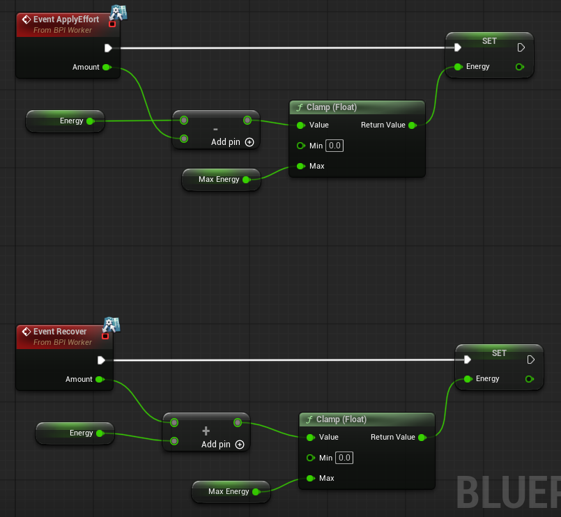{fig-align="center"}

```{.text .node-chain}
IsFullyRecovered  └─► Return (Energy >= MaxEnergy)
IsTired           └─► Return (Energy <= TiredThreshold)
GetWorkTag        └─► Return WorkTag
GetRecoverTag     └─► Return RecoverTag
```

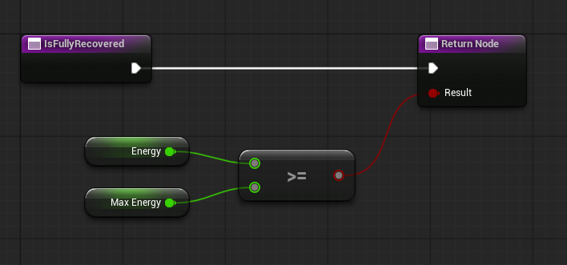{fig-align="center"}

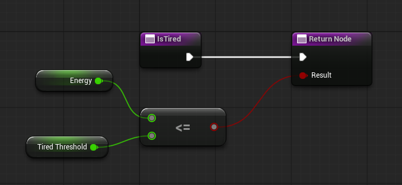{fig-align="center"}

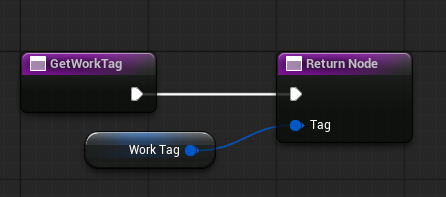{fig-align="center"}
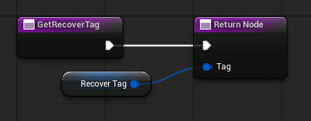{fig-align="center"}


**Compile** and **Save**.

### The maintenance robot

Open **`BP_RobotWorker`** located at **`ThirdPerson/Blueprints/AI`**.

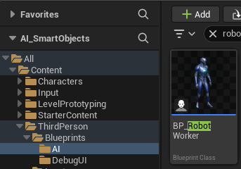{fig-align="center"}

Like the human, it is already prepared: it uses the `SKM_Manny_Simple` mesh with a robot material, has no camera or input, has the `Battery` and `MaxBattery` variables, and has its own energy bar.

::: {.callout-important}
## Two independent classes
`BP_RobotWorker` is **not** a child of `BP_HumanWorker`, and the human is not a child of the robot. The two agents share nothing except the interface they are about to implement, which is exactly the situation interfaces are for. Each one gives the same functions its own body.
:::

Finish the setup the same way as the human:

1. In **Class Defaults**, set **AI Controller Class** to `AIC_Worker` and **Auto Possess AI** to *Placed in World or Spawned*.
2. In **Class Settings → Interfaces → Implemented Interfaces**, click **Add** and choose `BPI_Worker`.

#### Add the remaining variables:

::: {.narrow-first}
| Variable | Type | Default | Instance Editable | |
|---|---|---|---|---|
| `Battery` | Float | `60` | yes | already provided |
| `MaxBattery` | Float | `60` | yes | already provided |
| `LowBatteryThreshold` | Float | `15` | yes | **add** |
| `EffortEfficiency` | Float | `0.5` | yes | **add** |
| `WorkTag` | Gameplay Tag | `Activity.Work.Valve` | yes | **add** |
| `RecoverTag` | Gameplay Tag | `Activity.Recharge` | yes | **add** |
:::

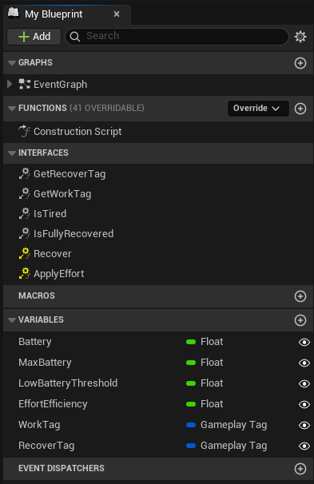{fig-align="center"}

#### Implement the interface for the robot:

```{.text .node-chain}
Event ApplyEffort (Amount)
  └─► SET Battery = Clamp(Battery - Amount * EffortEfficiency, 0, MaxBattery)

Event Recover (Amount)
  └─► SET Battery = Clamp(Battery + Amount, 0, MaxBattery)
```

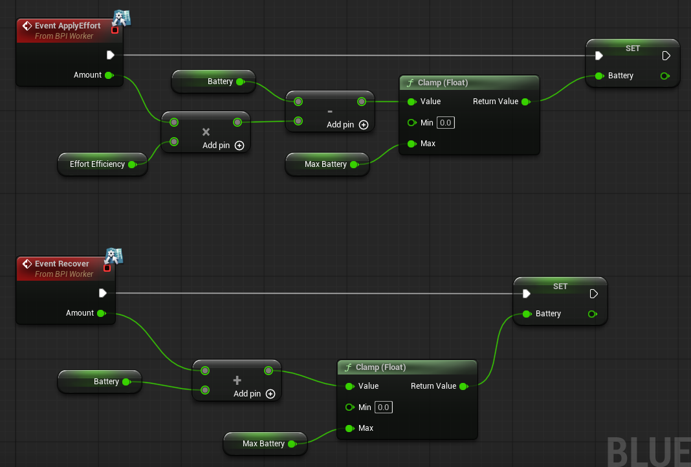{fig-align="center"}

```{.text .node-chain}
IsFullyRecovered  └─► Return (Battery >= MaxBattery)
IsTired           └─► Return (Battery <= LowBatteryThreshold)
GetWorkTag        └─► Return WorkTag
GetRecoverTag     └─► Return RecoverTag
```

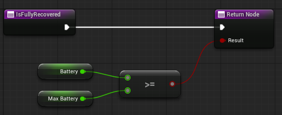{fig-align="center"}
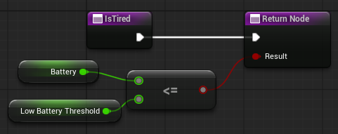{fig-align="center"}

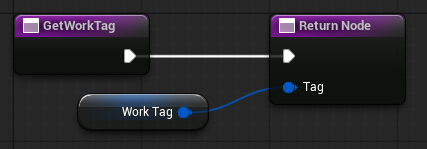{fig-align="center"}
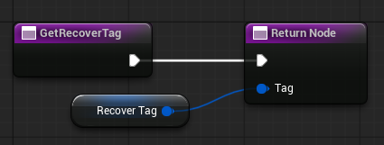{fig-align="center"}

**Compile** and **Save**.

#### Now drag two of each agent into the level.

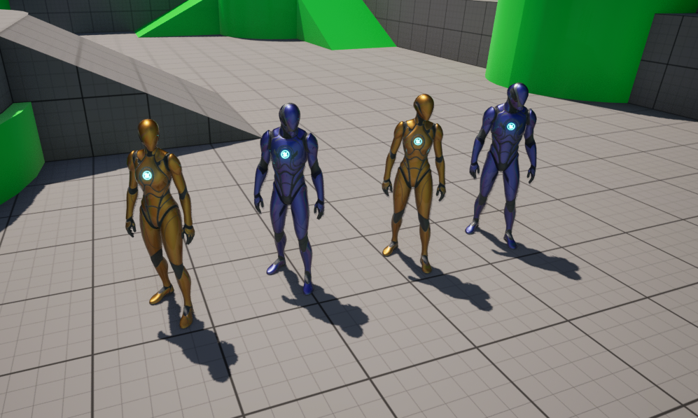{fig-align="center"}


### Navigation

Add a **Nav Mesh Bounds Volume** (**Quick Add → Volumes → Nav Mesh Bounds Volume**) and scale it to cover the floor. Press <span class="kbd">P</span> to confirm the walkable area is green. The agents need it to move to the slots.

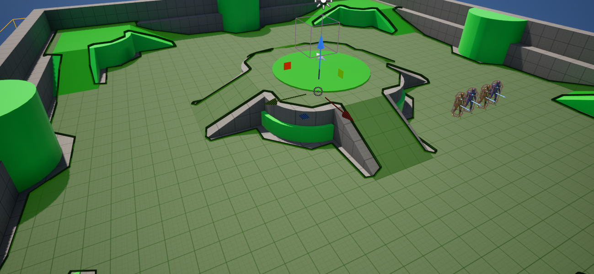{fig-align="center"}

## The behaviors (inside the object)

Each interaction is made of two pieces:

- a **Gameplay Behavior**: the *logic* (play the animation, report the effort, finish);
- a **Gameplay Behavior Config**: the *data fields* the behavior needs (which animation, how much effort) and which behavior to run.

Valves and buttons do the same thing with different data, so they share **one** behavior and **one** config class. The config class only declares *which* data a slot needs; the actual values (which montage, how much effort) are filled in **on each slot**, when you build the Smart Object Definitions. The same goes for the bench and the charging pad.

::: {.narrow-first}
| Behavior (logic) | Config (data fields) | Used by slots |
|---|---|---|
| `BP_SO_Behavior_Work` | `BP_SO_Config_Work` (`Montage`, `EffortCost`) | Valve, Button |
| `BP_SO_Behavior_Recover` | `BP_SO_Config_Recover` (`Montage`, `RecoveryRate`) | Bench seats, Charging pad |
:::

### The work config

Create a **Blueprint Class**, search **ALL CLASSES** for `Gameplay Behavior Config`, select **GameplayBehaviorConfig**, and name it **`BP_SO_Config_Work`**. 

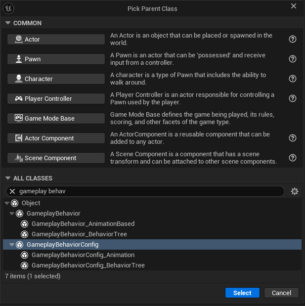{fig-align="center"}

Open the blueprint and **add two variables**:

::: {.narrow-first}
| Variable | Type | Default | Instance Editable |
|---|---|---|---|
| `Montage` | Anim Montage (object ref) | none | yes |
| `EffortCost` | Float | `10` | yes |
:::

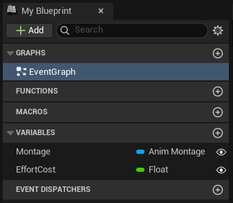{fig-align="center"}

**Instance Editable** is what makes these variables appear on each slot, so every slot can set its own values. The defaults are only used if a slot leaves them untouched.

You will set **Behavior Class** after creating the behavior.

### The work behavior

Create a **Blueprint Class**, search **ALL CLASSES** for `Gameplay Behavior`, select **GameplayBehavior**, and name it **`BP_SO_Behavior_Work`**.

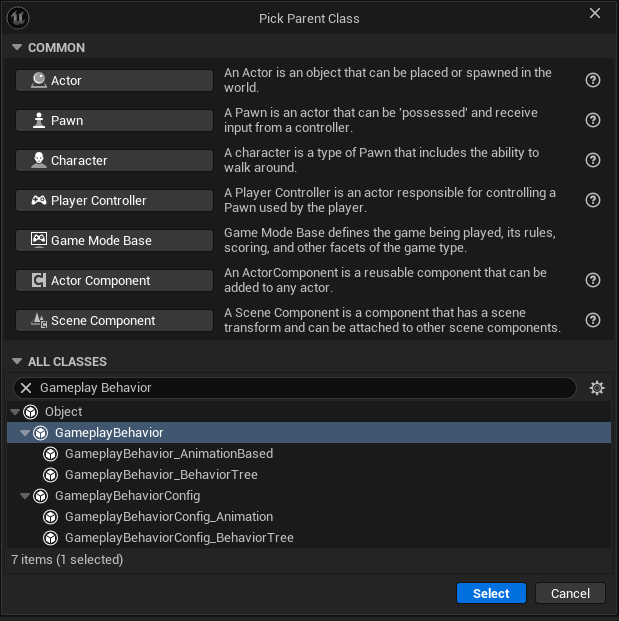{fig-align="center"}

Open it, click the **override** dropdown next to **Functions**, and override **`OnTriggeredCharacter`**. This runs when a character starts using the slot, and it receives the **Avatar** (the character), the **Config** (the data of this slot), and the **Smart Object Owner**.

Build this. It reads the slot's data from the config, plays the montage, reports the effort to the user through the interface, and ends the behavior:

```{.text .node-chain}
Event OnTriggeredCharacter (Avatar, Config, Smart Object Owner)
  └─► Cast To BP_SO_Config_Work (Config)          Cast Failed ──► EndBehavior (Avatar)
  └─► Play Anim Montage (Target = Avatar, Montage = As Config.Montage)   returns Duration
  └─► Delay (Duration)
  └─► ApplyEffort (Message)  Target = Avatar, Amount = As Config.EffortCost
  └─► EndBehavior (Target = self, Avatar = Avatar)
```

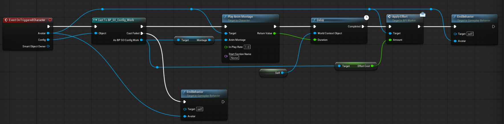{fig-align="center"}

Notice what the behavior does **not** do: it never casts the Avatar to `BP_HumanWorker` or `BP_RobotWorker`. It sends `ApplyEffort` as an interface **message** (the node shows an envelope icon), and whichever agent receives it decides what to do. A character that does not implement `BPI_Worker` simply ignores it.

::: {.callout-important}
## The behavior must end itself
A Gameplay Behavior runs until something calls **EndBehavior**. If you never end it, the agent's "use" step never returns and it stays stuck at the slot forever. Here, ending it after the montage is what lets the agent move on and release the slot. The effort is applied right before, so an agent only pays for work it actually finished. If you want to interrupt a behavior before it is over, you need some logic to call **EndBehavior** to perform the interruption.
:::

**Compile** and **Save**. Open `BP_SO_Config_Work` again and set **Behavior Class** to `BP_SO_Behavior_Work`.

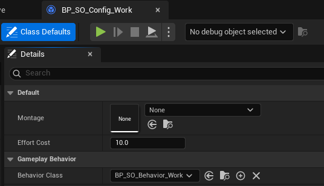{fig-align="center"}

The config is now complete. Notice that it holds no valve or button specific values: those will be set on the slots of each Smart Object Definition.

::: {.callout-tip}
## When inheritance is the better choice for configs
In this assignment each kind of object has **its own** Smart Object Definition, and every instance of that object in the level reuses it. So setting the values directly on the slot means setting them **once**, in one place.

That changes when you have **many** Smart Object Definitions whose slots share the same settings. Imagine ten different machines, all with a "heavy valve" slot. With per-slot values you would have to type the same montage and effort cost in ten definitions, and retune all ten whenever you change your mind. In that case it is better to create **child classes** of the config (e.g. `BP_SO_Config_HeavyValve`, with its defaults set to the heavy valve values) and pick that child in every slot that needs it. Changing the child's defaults then updates every slot that uses it, as long as the slot did not override the values.

Rule of thumb: values specific to **one** definition go on the slot; values **shared across many** definitions go in a config child class.
:::

### The recover config 

Similar to the previous steps (work config and behavior) you will now create the config and behavior for the recovery smart objects.

Create **`BP_SO_Config_Recover`** (parent **GameplayBehaviorConfig**), and add the following variables:

::: {.narrow-first}
| Variable | Type | Default | Instance Editable |
|---|---|---|---|
| `Montage` | Anim Montage (object ref) | none | yes |
| `RecoveryRate` | Float (per second) | `10` | yes |
:::

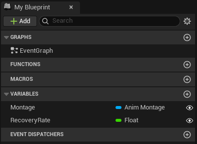{fig-align="center"}

### The recover behavior

Create **`BP_SO_Behavior_Recover`** (parent **GameplayBehavior**). Add two variables, `Avatar` (Character) and `RecoverConfig` (BP_SO_Config_Recover), and override **`OnTriggeredCharacter`**.

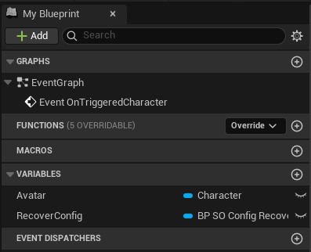{fig-align="center"}

Recovering is different from working: the agent should stay until **it** is fully recovered, not until an animation ends. So this behavior loops, asking the agent through the interface whether it is done:

```{.text .node-chain}
Event OnTriggeredCharacter (Avatar, Config, Smart Object Owner)
  └─► Cast To BP_SO_Config_Recover (Config)       Cast Failed ──► EndBehavior (Avatar)
  └─► SET RecoverConfig = As Config,  SET Avatar = Avatar
  └─► Branch (Is Valid (RecoverConfig.Montage))
        True  ──► Play Anim Montage (Target = Avatar, Montage = RecoverConfig.Montage) ──┐
        False ───────────────────────────────────────────────────────────────────────────┤
                                                                                          ▼
  └─► Delay (0.25)  ◄───────────────────────────────────────────┐
  └─► Recover (Message)  Target = Avatar,                      │
                         Amount = RecoverConfig.RecoveryRate * 0.25
  └─► Branch (IsFullyRecovered (Message, Target = Avatar))      │
        False ──────────────────────────────────────────────────┘
        True  ──► Stop Anim Montage (Target = Avatar)
                  └─► EndBehavior (Target = self, Avatar = Avatar)
```

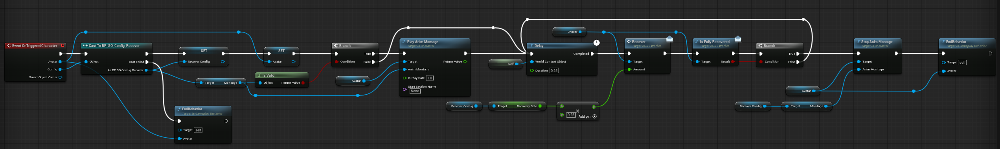{fig-align="center"}

Both outputs of the **Is Valid** branch must lead into the **Delay**. The montage is optional: the charging pad has none, and if the **False** pin is left unconnected the robot stops at the branch and never leaves the pad. **Stop Anim Montage** is safe to call even when nothing is playing.

The division of responsibility is the point of this graph: the **bench** decides how fast you recover and how long to keep checking; the **agent** decides when it is full.

**Compile** and **Save**. Go back to `BP_SO_Config_Recover` and set the **Behavior Class** property to `BP_SO_Behavior_Recover`. 

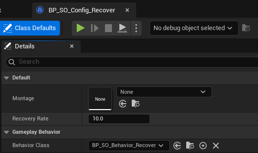{fig-align="center"}

## The Smart Objects

### The Smart Object actors

A smart object is any actor with a Smart Object Component pointing at a definition.

In the `AI` folder, create a **Blueprint Class** of type **Actor**, for each of our four smart objects. For each of them add static meshes to simulate their look (see screenshots for examples).

::: {.narrow-first}
| Actor | Components | Mesh |
|---|----|--------------|
| `BP_SO_Bench` | 1x Static Mesh Component | Bench mesh located at: **`Content\StarterContent\Props\SM_Bench.uasset`** |
| `BP_SO_Button` | 2x Static Mesh Component | A cube with **`scale (X=0.25,Y=0.25,Z=1.875)`** and **`location (X=0,Y=0,Z=90)`** for the **Pillar SM Component**. <br> Another cube, **child of the Pillar SM Component** with **`scale (X=0.6,Y=0.62,Z=0.06)`** and **`location (X=40,Y=0,Z=42.6)`** |
| `BP_SO_Charger` | 1x Static Mesh Component | A cylinder with `** scale (X=2,Y=2,Z=0.05)`** |
| `BP_SO_Valve` | 2x Static Mesh Component | A cylinder with `**scale  (X=0.23,Y=0.23,Z=0.66)`** and `**location (X=0,Y=0,Z=29.4)`** for the **Stand SM Component** <br> Another cylinder, **child of the Stand SM Component** with `**scale (X=3.62,Y=3.62,Z=0.17)`** and `**location (X=0,Y=0,Z=56.26)`** for the **valve handle**. |
:::

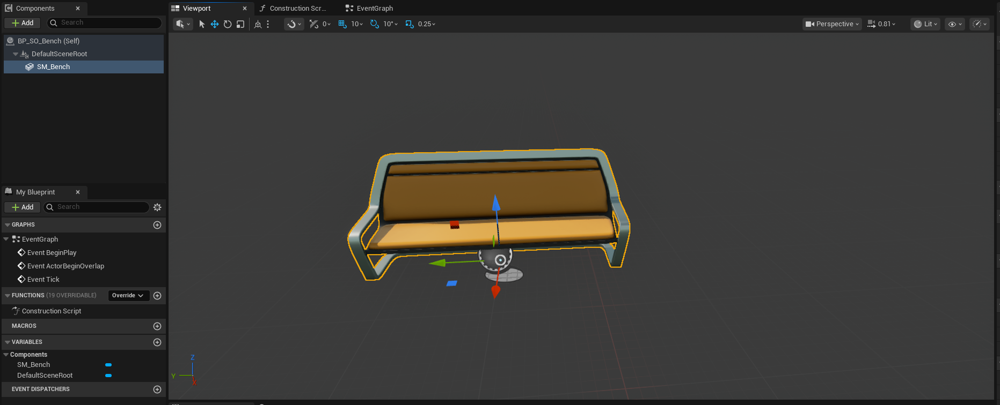{fig-align="center"}

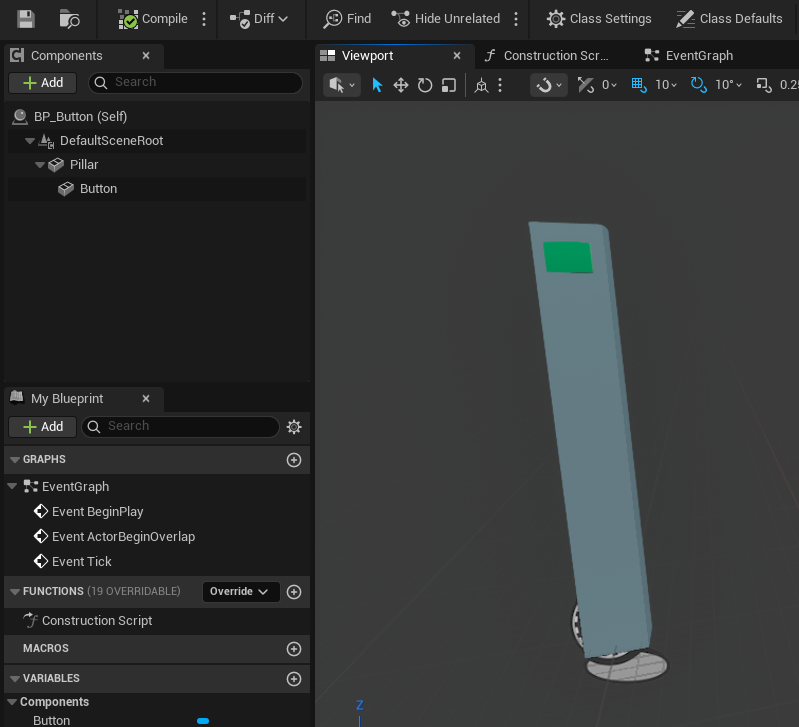{fig-align="center"}

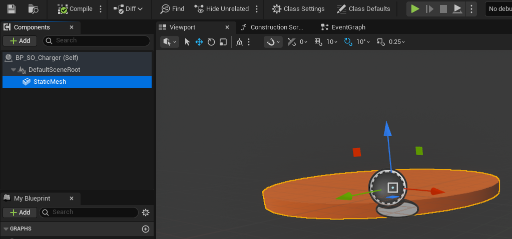{fig-align="center"}

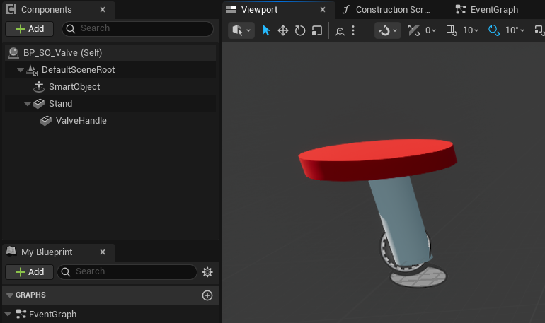{fig-align="center"}

::: {.callout-tip}
## Why are we creating the object blueprints before the Smart Object Definition
If you create the blueprint with its final look first, you can **use it as a preview** when creating the **Smart Object Definition**, this will make it easier for you to align the slots in the definitions, but also means that you will need to come back to these blueprints to add the Smart Object Definition Components.
:::

### The Smart Object Definitions

A definition describes the slots, attaches the behavior config to each one, and fills in that slot's data.

#### Bench Smart Object Definition

In the `AI` folder, right-click **Artificial Intelligence → SmartObject Definition** and name it **`SO_Def_Bench`**. Open it.

Open the **Preview Settings** tab and set the **Object Actor Class → BP_SO_Bench**. This is for preview purposes only.

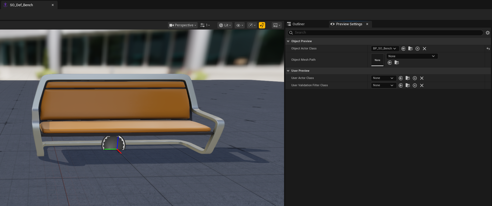{fig-align="center"}

Go back to the Outliner tab, and add a slot (the **+** on the **Slots** array) and configure it:

::: {.narrow-first}
| Slot property | Value |
|---|---|
| **Name** | `Seat` |
| **Activity Tags** | `Activity.Rest` |
| **Behavior Definitions** | one element: **Gameplay Behavior Smart Object Behavior Definition** |
| ↳ **Gameplay Behavior Config** | `BP_SO_Config_Recover` |
| ↳↳ **Montage** | `AM_SitTalk` |
| ↳↳ **Recovery Rate** | `10` |
:::

When you pick `BP_SO_Config_Recover` in the **Gameplay Behavior Config** dropdown, its instance editable variables appear right below it. That is where this slot's own data is set.

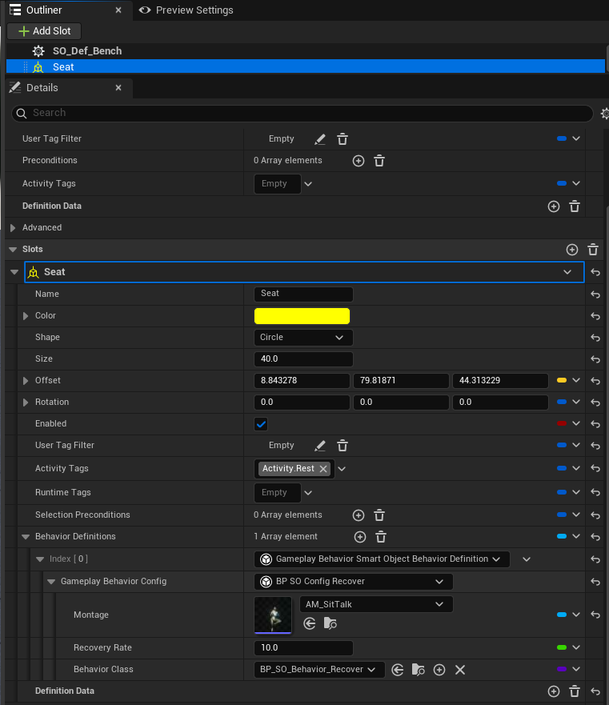{fig-align="center"}

::: {.callout-note}
## This is the encapsulation
Look at what the slot holds: a tag that says *what it is*, a config that says *what to do*, and the values that say *how*: which animation and how fast you recover. Nothing about humans or robots. Any agent that can find and claim this slot can use it, and the bench tells it how.
:::

Now duplicate the **Seat** slot, by clicking on the dropdown arrow to the right of the slot's properties.

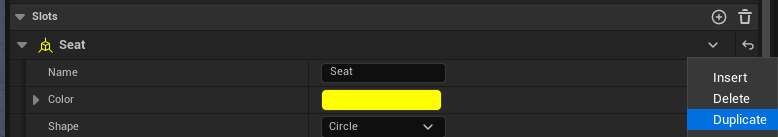{fig-align="center"}

This will make a new slot with the same properties, including the config values, so both seats stay identical. You can now position each slot on the bench.

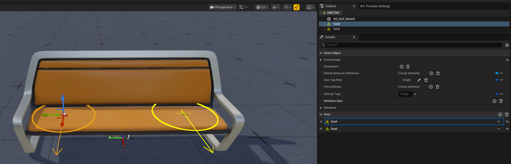{fig-align="center"}

::: {.callout-tip}
## The slot's arrow is the facing direction
Each slot is drawn with a **yellow arrow**. That arrow is the direction the agent will face when it uses the slot. On the bench, point the arrows away from the backrest; on the valve and button, point them at the object. If an agent later turns its back on what it is using, rotate the slot here, not the agent.
:::

#### Remaining Smart Object Definitions

Repeat the same process for the other 3 definitions:

::: {.narrow-first}
| Definition | Slots | Activity Tag | Config | Montage | Value |
|---|---|---|---|---|---|
| `SO_Def_Button` | 1 × `Button` | `Activity.Work.Button` | `BP_SO_Config_Work` | `AM_Button` | `EffortCost = 10` |
| `SO_Def_Valve` | 1 × `Valve` | `Activity.Work.Valve` | `BP_SO_Config_Work` | `AM_Valve` | `EffortCost = 25` |
| `SO_Def_Charger` | 1 × `Pad` | `Activity.Recharge` | `BP_SO_Config_Recover` | none | `RecoveryRate = 15` |
:::

Turning a valve is hard work; pressing a button is not. Both slots use the same behavior and the same config class: only the values on the slot differ. The charging pad has no montage: the robot just stands on it in its idle pose.

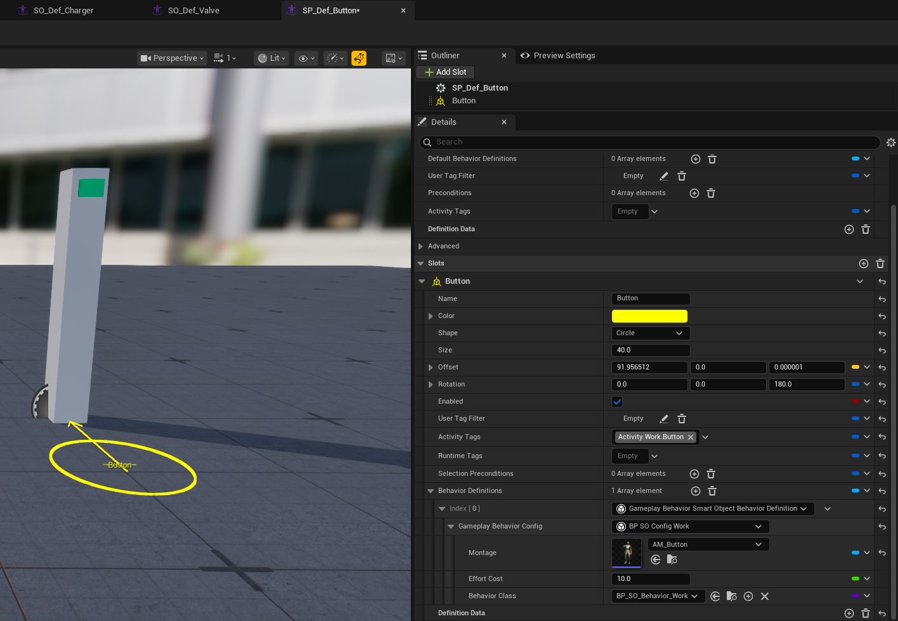{fig-align="center"}

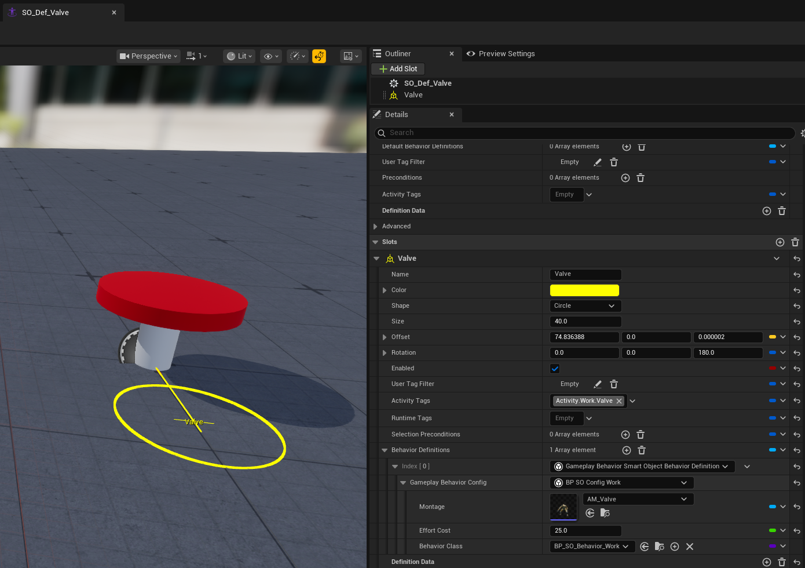{fig-align="center"}

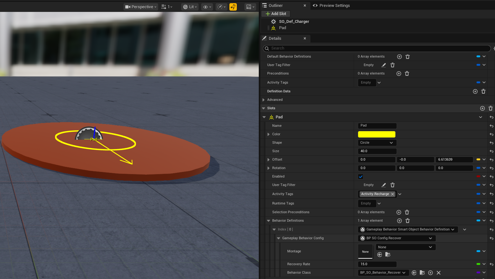{fig-align="center"}

### Adding the Smart Object Definition Component to the blueprints

For each smart object blueprint, open it:

1. **Add Component → Smart Object**. Select it and, in **Details → Smart Object**, set **Definition Asset** to the corresponding SO definition.
2. **Compile**, **Save**, and drag the blueprint into the level.

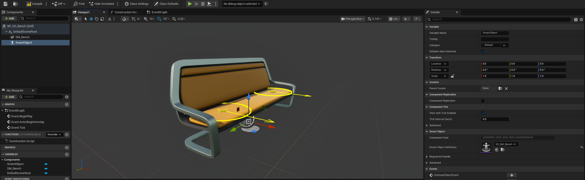{fig-align="center"}

Do the same for the remaining blueprints:

::: {.narrow-first}
| Actor | Definition |
|---|---|
| `BP_SO_Bench` | `SO_Def_Bench` |
| `BP_SO_Button` | `SO_Def_Button` | 
| `BP_SO_Charger` | `SO_Def_Charger` |
| `BP_SO_Valve` | `SO_Def_Valve` | 
:::

Place several valves and buttons around the level, one bench and one charging pad, with the nav mesh covering all of them.

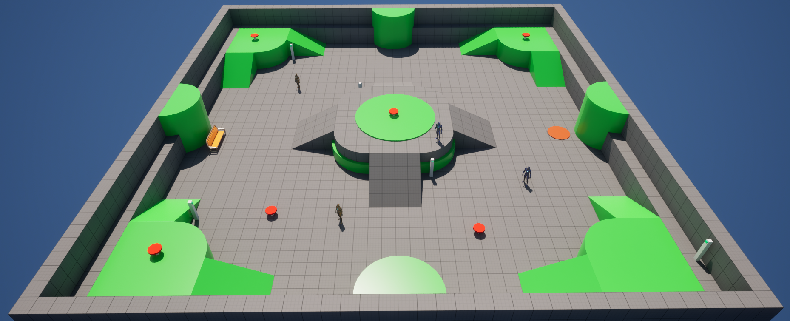{fig-align="center"}

## The State Tree tasks and condition

State Trees do not have built-in smart object tasks for an AIController pawn, so we write small Blueprint nodes that talk to the **Smart Object Subsystem** and to the agent's interface.

### The need enumeration

The tree needs to say *"find me something to work on"* or *"find me somewhere to recover"*, and let each agent translate that into its own tag. Right-click **Blueprint → Enumeration**, name it **`E_WorkerNeed`**, and add two entries: `Work` and `Recover`.

{fig-align="center"}

### STT_FindSmartObject

This task asks the agent which tag it needs, searches for a free slot with that tag, claims it, and outputs the claim handle.

Create a **Blueprint Class** from **`StateTreeTaskBlueprintBase`** and name it **`STT_FindSmartObject`**. Add these:

::: {.narrow-first}
| Member | Type | Category | Instance Editable |
|---|---|---|---|
| `Actor` | Actor (object ref) | **Context** (bound to the pawn) | – |
| `ClaimHandle` | SmartObjectClaimHandle | **Output** | – |
| `Need` | E_WorkerNeed | – | yes |
| `SearchExtent` | Vector | – | yes |
| `Query Box` | Box (Structure) | – | - |
| `ActivityTag` | Gameplay Tag | – | – |
| `Filter` | Smart Object Request Filter (Structure) | – | - |
| `Results` | SmartObjectRequestResult (Array) | – | – |
:::

`Need` and `SearchExtent` must be **Instance Editable**, otherwise they do not appear in the State Tree editor and you cannot set them per state. `ActivityTag` and `Results` are internal: they only store the tag returned by the agent and the list returned by **Find Smart Objects**. `QueryBox` and `Filter` are simply helper variables to keep things tidy.


{fig-align="center"}

Override **Event Enter State** and build:

```{.text .node-chain}
Event Enter State
  └─► Switch on E_WorkerNeed
        Work    ──► GetWorkTag (Message, Target = Actor)
        Recover ──► GetRecoverTag (Message, Target = Actor)          → ActivityTag
  └─► Get Actor Location (Actor)                                     → Center
  └─► Make Box (Min = Center - SearchExtent,
                Max = Center + SearchExtent)                         → QueryBox
  └─► Make SmartObjectRequestFilter
        Activity Requirements = (require ActivityTag)
        Behavior Definition Classes =
           [ GameplayBehaviorSmartObjectBehaviorDefinition ]
  └─► Make SmartObjectRequest (Query Box = QueryBox, Filter = Filter)
  └─► Find Smart Objects (Smart Object Subsystem)
        Request = Request, User Actor = Actor                        → Results
  └─► Branch (Is Valid Index (Results, 0))
        False ──► Finish Task (Success = false)
        True  ──► Get (Results[0])  [or a random item for variety]
                  └─► Break SmartObjectRequestResult                 → Slot Handle
                  └─► Mark Smart Object Slot As Claimed
                        (Slot Handle, User Actor = Actor,
                         Claim Priority = Normal)                     → Handle
                  └─► Branch (Is Valid Smart Object Claim Handle (Handle))
                        False ──► Finish Task (Success = false)
                        True  ──► SET ClaimHandle = Handle
                                  └─► Finish Task (Success = true)
```

::: {.callout-tip}
## Promote outputs to variables
For the variables in this blueprint that are not instance editable nor categorized and were not mentioned in the variables table above, you should right-click the output pins and promote them to variables.
:::

{fig-align="center"}

{fig-align="center"}

{fig-align="center"}

{fig-align="center"}

{fig-align="center"}

{fig-align="center"}

The task never mentions valves, benches or chargers. The human asking for `Recover` gets `Activity.Rest`; the robot asking for the same thing gets `Activity.Recharge`.

::: {.callout-important}
## Claim in Find, not in Use
This task does more than find: it **claims** (reserves) the slot the instant it finds it. This is what stops two agents grabbing the same slot. If you claimed later (at the "use" step) two agents could both pass the find step on the same free slot before either reserved it.
:::

### STT_UseSmartObject

This task moves the agent to the claimed slot, turns it to face the way the slot faces, and runs the object's behavior.

Create **`STT_UseSmartObject`** from `StateTreeTaskBlueprintBase`. Add:

::: {.narrow-first}
| Member | Type | Role |
|---|---|---|
| `AIController` | AIC_Worker | **Context** |
| `ClaimHandle` | SmartObjectClaimHandle | **Input** |
:::

Override **Event Enter State**:

```{.text .node-chain}
Event Enter State
  └─► Get Slot Transform (Smart Object Subsystem, Claim Handle = ClaimHandle)
                                                        → Slot Transform
  └─► Break Transform (Slot Transform)                  → Location, Rotation
  └─► AI MoveTo
        Pawn              = AIController.Get Controlled Pawn
        Destination       = Location
        Acceptance Radius = 10
        └─ On Fail    ──► Mark Smart Object Slot As Free (ClaimHandle)
                          └─► Finish Task (Success = false)
        └─ On Success ──► Set Actor Rotation
                            Target       = Controlled Pawn
                            New Rotation = (0, 0, Rotation.Yaw)
                          └─► Use Smart Object with Gameplay Behavior
                                Controller   = AIController
                                Claim Handle = ClaimHandle
                                Lock AILogic = false
                                └─ On Succeeded ──► Finish Task (Success = true)
                                └─ On Failed    ──► Finish Task (Success = false)
```

{fig-align="center"}

This is the find, claim, **move, align**, use lifecycle written out step by step. It returns success when the behavior calls `EndBehavior`: after the montage for valves and buttons, after full recovery for benches and chargers.

::: {.callout-important}
## Why not "Move To and Use Smart Object with Gameplay Behavior"?
There is a single node that does the move and the use in one go. It is convenient, but it only moves the agent to the slot's **location**: it ignores the slot's **rotation**, so the agent starts the animation facing whatever direction it arrived from. Splitting it into **AI MoveTo**, **Set Actor Rotation** and **Use Smart Object with Gameplay Behavior** (the version that does not move the agent) gives you the moment in between to turn the agent to face the way the slot's arrow points. Only the yaw is used, so the agent never tilts.
:::

::: {.callout-note}
## Releasing the slot
When the "use" step completes and the state exits, the claim is released automatically as the behavior ends, freeing the slot for another agent. If you ever claim a slot and then fail before using it, release it yourself with **Mark Smart Object Slot As Free** so it does not stay reserved forever. That is why the **On Fail** pin of **AI MoveTo** frees the slot before failing the task: if the agent cannot reach the slot, nobody else could use it either until it is released.
:::

### STC_IsTired

The tree needs to know when to switch from working to recovering. It cannot read `Energy` directly, because the robot has no `Energy`: it has `Battery`. So it asks through the interface.

Create a **Blueprint Class** from **`StateTreeConditionBlueprintBase`** and name it **`STC_IsTired`**. Add:

::: {.narrow-first}
| Member | Type | Role |
|---|---|---|
| `Actor` | Actor (object ref) | **Context** |
:::

Override the **Receive Test Condition** function:

```{.text .node-chain}
Function Receive Test Condition -> Bool
  └─► Return IsTired (Message, Target = Actor)
```

{fig-align="center"}

**Compile** and **Save** all three.

## The State Tree

Create a **State Tree** (right-click → **Artificial Intelligence → State Tree**), choose the **StateTree AI Component** schema, name it **`ST_Worker`**, and open it.

Select **ROOT** and, in **Asset Details → Schema**, set:

::: {.narrow-first}
| Property | Value |
|---|---|
| AI Controller Class | `AIC_Worker` |
| Context Actor Class | `Character` |
:::

::: {.callout-important}
## Why Character and not BP_HumanWorker
In Assignment 03 the context actor was the exact pawn class, so the tree could bind to its variables. Here **two unrelated classes** run the same tree, so the context must be a class they share: `Character`. The tree can no longer read `Energy` or `Battery` directly, and that is fine: everything it needs, it asks through `BPI_Worker`. Do **not** leave it on the default, or `Actor` resolves to the controller instead of the pawn and every interface message goes to the wrong object.
:::

In the root's **Details → Parameters**, add one parameter:

::: {.narrow-first}
| Name | Type |
|---|---|
| `ClaimHandle` | SmartObjectClaimHandle |
:::

This parameter is how the claim travels from the state that finds a slot to the state that uses it, exactly as `HidingLocation` did in Assignment 03.

Assign the tree: open `AIC_Worker`, select the **StateTreeAI** component, set **State Tree** to `ST_Worker`, **Compile** and **Save**.

{fig-align="center"}

### The structure

Build this hierarchy. **Root**, **Recover**, and **Work** all use **Try Select Children In Order**.

```
Root
├── Recover     (enter: STC_IsTired)
│   ├── FindRecoverSlot
│   └── UseRecoverSlot
├── Work
│   ├── FindWorkSlot
│   └── DoWork
└── Idle
```

#### Recover Branch
\
 **Recover** state configuration:

The following enter condition asks the agent whether it is worn out.

| Enter Condition | Settings |
|---|---|
| **STC_IsTired** | **Actor** → *Actor* (context, bound automatically) |

{fig-align="center"}

**FindRecoverSlot** state configuration:

| Task | Settings |
|---|--------|
| **STT_FindSmartObject** | `Need` = `Recover`;<br>`SearchExtent` = `(5000, 5000, 500)`;<br>`ClaimHandle` → bind output to *Parameters › ClaimHandle* |
\

| Transition | Trigger | Go to |
|---|---|---|
| 1 | On State Succeeded | `UseRecoverSlot` |
| 2 | On State Failed | `Idle` |

{fig-align="center"}

**UseRecoverSlot** state configuration:

| Task | Settings |
|---|---|
| **STT_UseSmartObject** | `ClaimHandle` → bind to *Parameters › ClaimHandle* |
\

| Transition | Trigger | Go to |
|---|---|---|
| 1 | On State Completed | `Root` |

The agent stays here until the recovery behavior decides it is done (by asking the agent `IsFullyRecovered`). Then the use completes, the slot is released, and the tree returns to **Root**.

{fig-align="center"}

#### Work Branch
\
**FindWorkSlot** state configuration:

| Task | Settings |
|---|---|
| **STT_FindSmartObject** | `Need` = `Work`; `SearchExtent` = `(5000, 5000, 500)`; `ClaimHandle` → *Parameters › ClaimHandle* |
\

| Transition | Trigger | Go to |
|---|---|---|
| 1 | On State Succeeded | `DoWork` |
| 2 | On State Failed | `Idle` |

{fig-align="center"}


**DoWork** state configuration:

| Task | Settings |
|---|---|
| **STT_UseSmartObject** | `ClaimHandle` → *Parameters › ClaimHandle* |
\

| Transition | Trigger | Go to |
|---|---|---|
| 1 | On State Completed | `Root` |

There is no "spend energy" step here. The object already reported the effort to the agent when the work finished.

{fig-align="center"}

#### Idle (fallback, when nothing was found)

| Task | Settings |
|---|---|
| **Delay** | **Duration** = `2.0` |
\

| Transition | Trigger | Go to |
|---|---|---|
| 1 | On State Completed | `Root` |

{fig-align="center"}

**Compile** and **Save**.

::: {.callout-note}
## How the priority reads
Because Root selects children in order and Recover is first, Recover wins the moment `STC_IsTired` passes. But the condition is only re-checked when the tree re-selects from Root, which happens between interactions. So an agent that becomes tired mid-task finishes its current valve or button, returns to Root, and *then* goes to recover. That is the finish-then-recover behavior: clean releases, no aborting a claimed slot halfway. Interrupting mid-use is Exercise 4.

A tired agent that finds no free recovery spot goes to **Idle** and tries again two seconds later. It never goes back to work while tired, because Recover is checked first.
:::

## Testing

Place two humans, two robots, three valves, two buttons, one bench and one charging pad. Play.

- Humans use both valves and buttons; robots only ever go to valves.
- After a few jobs, humans walk to the bench, sit and talk until recovered; robots walk to the pad and stand there until charged.
- Robots tire after more valve turns than you might expect from their small battery: their `EffortEfficiency` halves every cost.

{fig-align="center"}

Now the reservation system. With more agents than slots, no two agents should ever occupy the same slot. A valve claimed by one agent is never picked by another, even if it is the closest one: the second agent goes to another free valve, or idles if none is left. Two humans can sit on the bench at once (two seats); a third waits.

{fig-align="center"}

The energy bar above each agent shows its `Energy` or `Battery` dropping after every job and filling up again while it recovers.

{fig-align="center"}

::: {.callout-tip}
## Checkpoint
| Symptom | Likely cause |
|---|---|
| Agent walks to a slot but never animates | `Montage` left empty on the slot, or the behavior never calls `EndBehavior` |
| Agent animates facing the wrong way | Slot arrow in the definition points the wrong way, or `Set Actor Rotation` is not using the slot's yaw |
| Agent never reaches the slot (task fails on move) | Slot location is off the nav mesh: move the slot onto walkable ground, or raise the **Acceptance Radius** |
| Agent works but its energy or battery never drops | `EffortCost` left at `0` on the slot |
| Agent never finds anything | Slot activity tags don't match what `GetWorkTag` / `GetRecoverTag` return, or `SearchExtent` too small |
| Energy or battery never changes | Agent doesn't implement `BPI_Worker`, or the behavior calls the function instead of the **message** |
| Energy bar missing above an agent | One of the provided variables (`Energy`, `MaxEnergy`, `Battery`, `MaxBattery`) was renamed or deleted |
| Agent does not move at all | **AI Controller Class** on the agent is not set to `AIC_Worker` |
| Agent sits forever | `IsFullyRecovered` never returns true (check the comparison and `MaxEnergy` / `MaxBattery`), or `RecoveryRate` is `0` on the slot |
| Robot stays on the charging pad forever | **False** pin of the montage **Is Valid** branch in `BP_SO_Behavior_Recover` not connected to the **Delay** |
| Robot sits on the bench | Robot's `RecoverTag` is set to `Activity.Rest` instead of `Activity.Recharge` |
| Interface messages do nothing in the tree | Schema **Context Actor Class** isn't `Character`, so `Actor` is the controller |
:::

## Debugging with the Rewind Debugger

Debug this the same way you debugged perception in Assignment 03: record a session, then scrub the **State Tree** track for an agent. Here the things worth watching are the active state (Work vs Recover vs Idle), the **ClaimHandle** parameter (valid while a slot is held, cleared after release), and, by selecting the pawn, its **Energy** or **Battery** dropping after each job and climbing while recovering.

Open **Tools → Debug → Rewind Debugger** and **Rewind Debugger Details**, enable **Should Auto Record on PIE**, play for a full work and recover cycle, then select an agent and read its State Tree track. Compare a human and a robot side by side: same tree, same states, different timings. The full step by step for the Rewind Debugger is in Assignment 03; it is the same workflow.

You can also use the AI Debugger in-editor, use numpad key **7** to turn it on or off, it will outline smart objects in the level and give you information about objects being used.

{fig-align="center"}


## Final result

| State | Enter condition | Tasks | Transitions |
|---|---|---|---|
| **Root** | Try Select Children In Order · *Parameter:* `ClaimHandle` | – | – |
| **Recover** | `STC_IsTired` | – | – |
| ↳ **FindRecoverSlot** | – | STT_FindSmartObject (`Need = Recover`) → `ClaimHandle` | Succeeded → UseRecoverSlot · Failed → Idle |
| ↳ **UseRecoverSlot** | – | STT_UseSmartObject (`ClaimHandle`) | On Completed → Root |
| **Work** | – | – | – |
| ↳ **FindWorkSlot** | – | STT_FindSmartObject (`Need = Work`) → `ClaimHandle` | Succeeded → DoWork · Failed → Idle |
| ↳ **DoWork** | – | STT_UseSmartObject (`ClaimHandle`) | On Completed → Root |
| **Idle** | – | Delay 2 s | On Completed → Root |

{fig-align="center"}

```{mermaid}
%%| fig-cap: "Runtime view of any worker, human or robot."
stateDiagram-v2
    direction LR
    [*] --> Idle
    Idle --> FindWorkSlot : not tired
    FindWorkSlot --> DoWork : slot claimed
    DoWork --> Idle : done, effort applied by the object
    Idle --> FindRecoverSlot : tired
    FindRecoverSlot --> UseRecoverSlot : seat or pad claimed
    UseRecoverSlot --> Idle : fully recovered
```

## Exercises

1. **A multi-slot object with different behaviors.** Build one smart object, `BP_SO_Machine`, with two slots on the same definition: an `Operate` slot tagged `Activity.Work.Button` using the button values, and an `Inspect` slot tagged `Activity.Work.Valve` using the valve values. One object, two slots, two different interactions. Confirm that a robot only ever uses `Inspect` while a human can use either.

2. **Roles for humans.** Give `BP_HumanWorker` a role so that "operators" only use buttons and "mechanics" only use valves. Add a role enumeration and change `GetWorkTag` to return the right tag for the role. Neither the State Tree nor any smart object should change.

3. **Scoring instead of first found.** `STT_FindSmartObject` currently takes the first (or a random) result. Change it to prefer the **nearest** free slot, or the **least recently used**, so agents spread out across the objects instead of clustering.

4. **Interrupt mid-use.** Change the design from finish-then-recover to interrupt-and-recover: when an agent becomes tired *during* a job, it should abandon the slot and go recover immediately. You will need to release the claim partway through (with **Mark Smart Object Slot As Free**) and reason about the behavior that is cut off before it ends. Notice that, with the current design, an abandoned job costs nothing, because the object only applies the effort when the work finishes. Is that what you want?

5. **Wander between jobs.** Replace the `Idle` delay with a wander: pick a random reachable point (an EQS query, as in Assignment 03), move there, then return to Root.

6. **A third kind of worker.** Create a `BP_Apprentice` (a new class, not a child of `BP_HumanWorker`) that implements `BPI_Worker`: it only presses buttons, gets tired twice as fast, and rests on the bench. Add it to the level without touching the State Tree, the tasks or any smart object. If you had to change any of them, find out why.
