## Introduction

In the previous assignment the agent "saw" the player with a capsule trace written by hand. Unreal Engine has two systems that do this kind of work much better:

- **AI Perception** gives the agent *senses* (sight, hearing, damage, …) and tells it when it starts or stops perceiving something.
- **EQS (Environment Query System)** asks questions about the world, such as *"which nearby spot can the player not see?"*, by generating candidate points and scoring them with tests.

In this assignment you will build an NPC that:

1. **Idles** while it doesn't see the player;
2. **Hides**, when it sees the player, by running an EQS query that finds a nearby spot out of the player's sight, and moving there;
3. **Hides again** if the player can still see it when it arrives.

The decision logic is a **State Tree**. Perception feeds it through **State Tree Events**, and the EQS result reaches it through a **tree parameter**.

::: {.callout-note}
## Prerequisites
This assignment assumes you completed **Assignment 02 (State Trees: Patrol and Chase)**. State Tree basics (selection, transitions, tasks, bindings) are only recapped here.
:::

### What you will build

```{mermaid}
%%| fig-cap: "Final structure of ST_Runner."
flowchart TD
    ROOT["<b>Root</b><br/>Try Select Children In Order<br/><i>Parameter: HidingLocation</i>"]
    HIDE["<b>Hide</b><br/>Enter: AIController.IsPlayerVisible"]
    FIND["<b>FindHidingSpot</b><br/>Run Env Query → HidingLocation"]
    MOVE["<b>MoveToHidingSpot</b><br/>Move To (HidingLocation)"]
    IDLE["<b>Idle</b> (fallback)<br/>Delay 2 s"]
    ROOT --> HIDE
    ROOT --> IDLE
    HIDE --> FIND
    HIDE --> MOVE
    FIND -. "On Succeeded" .-> MOVE
    FIND -. "On Failed" .-> IDLE
    MOVE -. "On Completed" .-> ROOT
    IDLE -. "On Event: AI.Runner.PlayerSeen" .-> HIDE
```

And this is how information flows between the systems:

```{mermaid}
%%| fig-cap: "From the moment the agent sees the player until it starts moving to a hiding spot."
sequenceDiagram
    participant P as AIPerception
    participant C as AIC_Runner
    participant ST as ST_Runner (StateTreeAI)
    participant EQS as EQS_FindHidingLocation
    P->>C: On Target Perception Updated (Actor, Stimulus)
    C->>C: PlayerCharacter = Actor<br/>IsPlayerVisible = Successfully Sensed
    C->>ST: Send State Tree Event (AI.Runner.PlayerSeen)
    ST->>ST: Idle → Hide (enter condition reads IsPlayerVisible)
    ST->>EQS: Run Env Query (Querier = pawn)
    EQS->>C: EQS_Enemy_Context asks for PlayerCharacter
    EQS-->>ST: best location → Parameter HidingLocation
    ST->>ST: FindHidingSpot → MoveToHidingSpot (Move To HidingLocation)
```

## Concepts {#sec-theory}

### State Trees: quick recap

| Concept | Reminder |
|---|---------|
| **Selection** | Depth-first, children tried top to bottom; a state is entered only if its **enter conditions** pass |
| **Transitions** | Evaluated from the active leaf up to the root; the first one that passes wins |
| **Tasks** | Run while their state is active; when one finishes, the state completes (*Succeeded*/*Failed*) |
| **Context** | With the *StateTree AI Component* schema: **Actor** (the pawn) and **AIController** |
| **Bindings** | Tasks and conditions read parameters, context and outputs of other tasks through bindings |

This assignment adds three things you haven't used yet: **State Tree Events**, **bindings to properties of a context object**, and **property references**. They are explained in [Talking to a State Tree from outside](#sec-events).

\

### AI Perception {#sec-perception}

The **AI Perception** system gives pawns sensory data: where noises come from, whether the AI was damaged, or whether it sees something. It is made of:

- **AIPerception component** – added to the **AI Controller**. It is the *listener*: it holds the list of senses and fires events when perception changes.
- **Senses** – configured in the component's **Senses Config** array: *Sight*, *Hearing*, *Damage*, *Touch*, *Team*, *Prediction*.
- **Stimuli sources** – the actors that can be sensed. **Pawns are registered for Sight automatically**, so the player can be seen without extra setup. Other actors need an *AIPerceptionStimuliSource* component.

#### Main Sight Settings:

| Property | Meaning |
|---|------|
| **Sight Radius** | Distance at which a target starts being seen |
| **Lose Sight Radius** | Distance at which a seen target is lost (bigger than *Sight Radius* to avoid flickering) |
| **Peripheral Vision Half Angle** | Half of the vision cone angle (90° = a 180° cone) |
| **Detection by Affiliation** | Which teams can be seen: *Enemies*, *Neutrals*, *Friendlies* |
| **Max Age** | How long (seconds) a stimulus is remembered after it stops being sensed. `0` = forever |

::: {.callout-important}
## Detection by Affiliation in Blueprint projects
Teams are assigned through the C++ interface `IGenericTeamAgentInterface`. Without it, every actor is *Neutral*, so an AI that only detects *Enemies* sees nothing. In Blueprint-only projects, **enable all three flags** and decide in Blueprint which perceived actors matter (here: only the player character).
:::

#### AI Perception component events:

| Event | Fires when | Gives you |
|---|---|---|
| **On Perception Updated** | The set of perceived actors changes | An array of updated actors |
| **On Target Perception Updated** | A specific actor's perception changes (seen / lost) | The **Actor** and its **AIStimulus** |
| **On Target Perception Info Updated** | Same as above | An *ActorPerceptionUpdateInfo* struct (actor + stimulus) |
| **On Target Perception Forgotten** | A stimulus expires (after *Max Age*) | The **Actor** |

#### Useful fields of an **AIStimulus** (use *Break AIStimulus*):

| Field | Meaning |
|---|-------|
| **Successfully Sensed** | `true` when the target was just sensed, `false` when it was just lost |
| **Stimulus Location** | Where the stimulus happened (for sight: where the target was seen) |
| **Age** / **Expiration Age** | How old the stimulus is, and when it will be forgotten |
| **Tag** | Optional tag set by whoever produced the stimulus (e.g. a noise) |

\

### Environment Query System {#sec-eqs}

**EQS** collects data about the environment. A query **generates** candidate items (usually points in the world), runs **tests** on them, and returns the best item(s).

| Part | Description | In this assignment |
|---|-------|-----|
| **Generator** | Creates the candidate items | **Pathing Grid** around the querier (only reachable points) |
| **Querier** | The actor that runs the query | The AI pawn |
| **Context** | Tells the query *about* other things: a single actor/location or a set of them. `EnvQueryContext_Querier` is the default. | **EQS_Enemy_Context** → the player character |
| **Test** | Checks each item against a context | **Trace** (visible from the enemy?), **Distance** (to querier and to enemy) |

Each test has a **Test Purpose**:

| Test Purpose | Effect |
|---|---|
| **Filter Only** | Items that fail are discarded |
| **Score Only** | Every item gets a score; nothing is discarded |
| **Filter and Score** | Both |

Scores are normalized per test (0–1), shaped by the **Scoring Equation** (*Linear*, *Inverse Linear*, *Square*, …) and weighted by the **Scoring Factor**. The final score of an item is the sum over all tests.

The **Run Mode** decides what the query returns:

| Run Mode | Returns |
|---|---|
| **Single Best Item** | The item with the highest score |
| **Single Random Item from Best 5% / 25%** | A random item among the best ones (less predictable AI) |
| **All Matching** | Every item that passed the filters |

::: {.callout-tip}
## EQS Testing Pawn
An **EQSTestingPawn** placed in the level runs a query *in the editor*, without playing, and draws the results as colored spheres with their scores. You will use it to design the query before connecting it to the State Tree.
:::

\

### Talking to a State Tree from outside {#sec-events}

Perception lives in the **AI Controller**, but decisions live in the **State Tree**. Three mechanisms connect them.

**1. State Tree Events.** An event is a **Gameplay Tag** (plus an optional payload struct and an origin name) sent to a running tree with **Send State Tree Event** on the *StateTreeAI* component. A transition with trigger **On Event** and the same tag fires when the event arrives. This is the event-driven alternative to the *On Tick* transitions of Assignment 02: the tree reacts only when something happens.

**2. Binding to properties of a context object.** The schema's **AI Controller Class** is set to your controller class, so the controller's **Instance Editable** variables appear in the binding menu under *AIController*. A condition can read `AIController › IsPlayerVisible` directly, without a custom task.

**3. Property references.** Some tasks don't *output* a value, they *write* it into a property of the tree. The built-in **Run Env Query** task works this way: its **Result** is a *property reference* that you bind to a **tree parameter**, and the task writes the query result there when it finishes. Because the value lives in a parameter, **any** state can read it later, not only the state that ran the query.

::: {.callout-note}
## Outputs vs. parameters
A task **output** can only be read while the task's state is active (or by later tasks in the same state). A **parameter** written through a property reference persists for the whole tree. That is why `HidingLocation` is a parameter: it is found in one state (*FindHidingSpot*) and used in another (*MoveToHidingSpot*).
:::

\

## Setting up the basis

### Project and plugins

Create a new project based on the **Third Person** template (Blueprint) and name it **`ST_Perception`**.

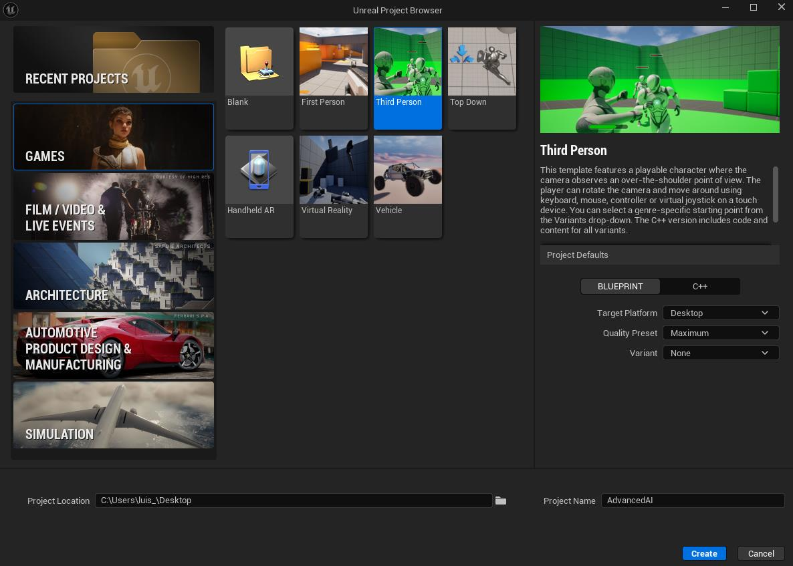{fig-align="center"}

Go to **Edit → Plugins** and make sure these plugins are enabled (restart the editor if asked):

- **StateTree**
- **Gameplay State Tree** (provides the *StateTree AI Component*, *Move To* and *Run Env Query* tasks)

::: {.callout-tip}
EQS and AI Perception are part of the engine's AI module and need no plugin. Older engine versions required enabling EQS in *Editor Preferences → Experimental*; UE5 doesn't.
:::

### The AI Character

In the **Content Drawer**, inside `ThirdPerson/Blueprints`, create a folder named **`AI`**.

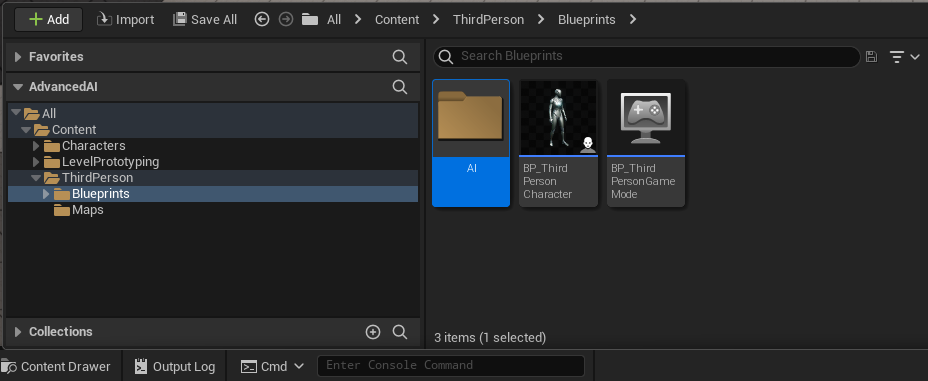{fig-align="center"}

**Copy** `BP_ThirdPersonCharacter` into the `AI` folder (drag it onto the folder and choose **Copy Here**).

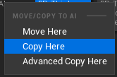{fig-align="center"}

Go to the **`AI`** folder and rename the copy to **`BP_AICharacter`**.

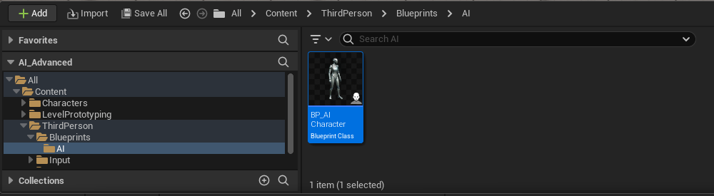{fig-align="center"}

Open `BP_AICharacter`:

1. In the **Event Graph**, select everything and press <span class="kbd">Delete</span>. The AI does not read player input.

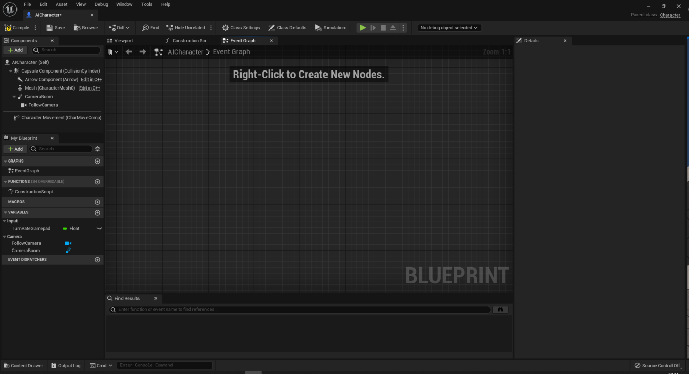{fig-align="center"}

2. In the **Components** panel, delete **CameraBoom** and **FollowCamera**.

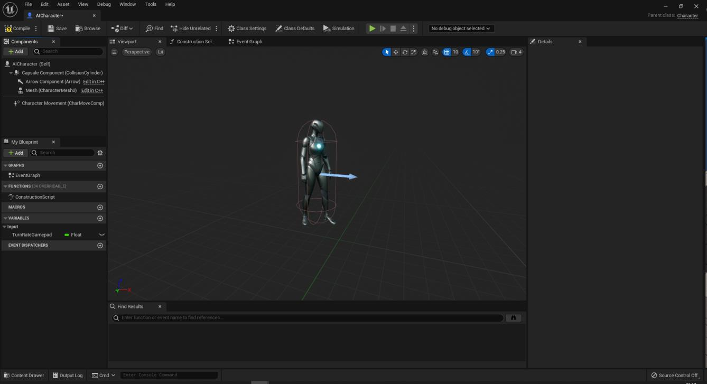{fig-align="center"}

3. **Compile** and **Save**.

### The AI Controller

In **Class Defaults**, the character's **AI Controller Class** is the default *AIController*:

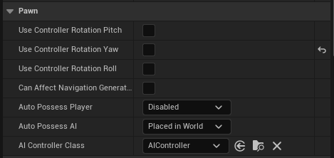{fig-align="center"}

You need a **new** AI Controller. Inside the `AI` folder, right-click **Blueprint Class**, expand **ALL CLASSES**, search for `AIController` and select it.

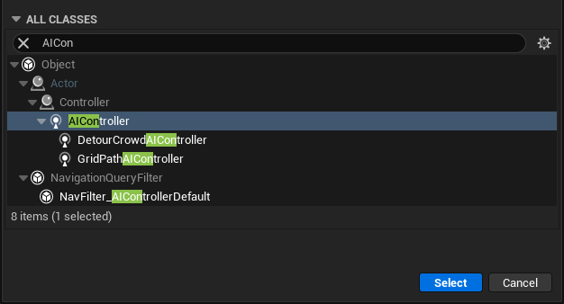{fig-align="center"}

Name the new blueprint **`AIC_Runner`**.

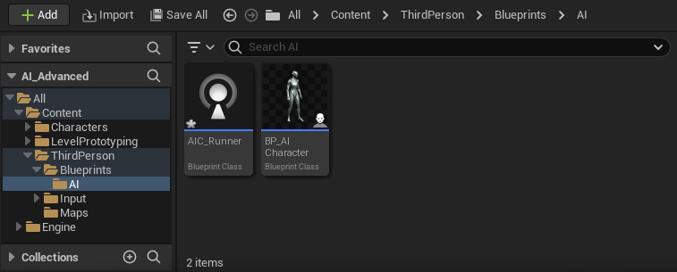{fig-align="center"}

Open `BP_AICharacter` again, go to **Class Defaults** and set **AI Controller Class** to `AIC_Runner`. Keep **Auto Possess AI** set to *Placed in World* (or *Placed in World or Spawned*).

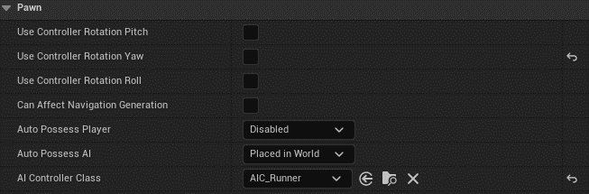{fig-align="center"}

**Compile**, **Save**, and drag `BP_AICharacter` into the level.

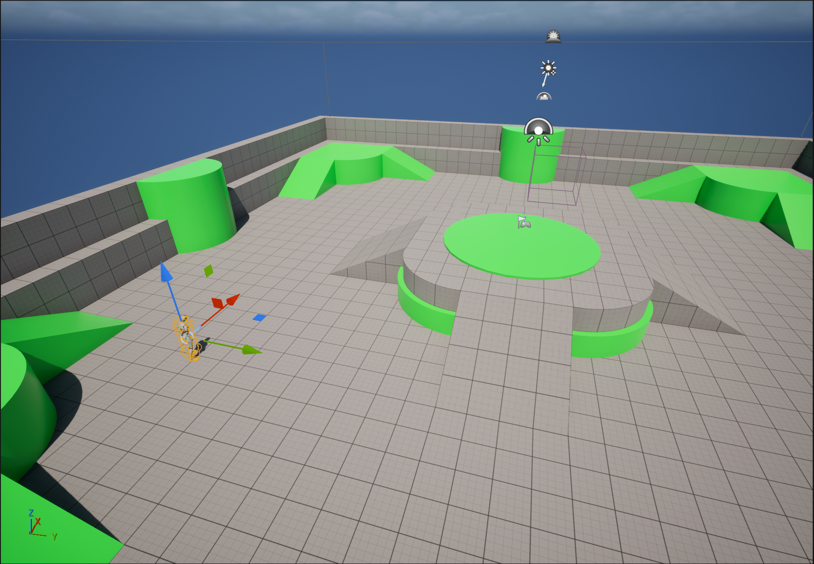{fig-align="center"}

### Navigation

Add a **Nav Mesh Bounds Volume** (**Quick Add → Volumes → Nav Mesh Bounds Volume**) and scale it to cover the whole floor. Press <span class="kbd">P</span> in the viewport to show the walkable area in green. Both **Move To** and the EQS **Pathing Grid** need it.

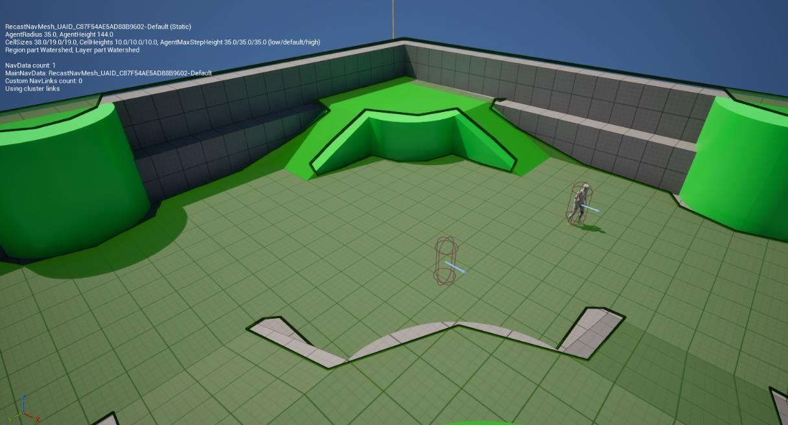{fig-align="center"}

## Adding the AIPerception component

Open **`AIC_Runner`** and add the component **AIPerception** (see [AI Perception](#sec-perception)).

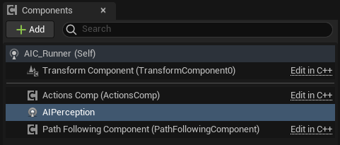{fig-align="center"}

Select the component and, in **Details → AI Perception → Senses Config**, add an element and set it to **AI Sight config**. Expand it and set:

| Property | Value |
|---|---|
| Sight Radius | `1000` |
| Lose Sight Radius | `1500` |
| Peripheral Vision Half Angle Degrees | `90` |
| Detection by Affiliation | ✔ Enemies, ✔ Neutrals, ✔ Friendlies |

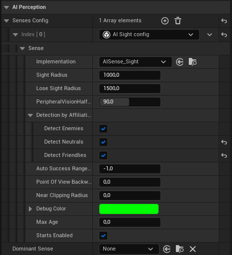{fig-align="center"}

**Compile** and **Save**.

The agent can now **see** you. To check it, press **Play**, look at the agent and press <span class="kbd">'</span> (apostrophe, next to the <span class="kbd">0</span> key) to open the **Gameplay Debugger**. Use the numeric keypad to toggle categories: <span class="kbd">NumPad 0</span> NavMesh, <span class="kbd">NumPad 1</span> AI, <span class="kbd">NumPad 3</span> EQS, <span class="kbd">NumPad 4</span> Perception.

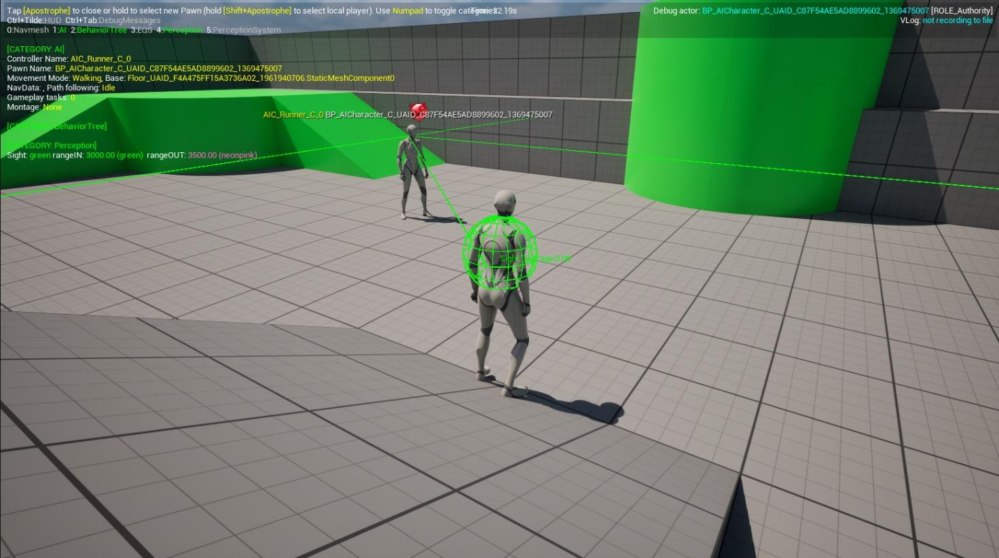{fig-align="center"}

## Sending perception to the State Tree

### Gameplay Tags

State Tree Events are identified by **Gameplay Tags** ([Talking to a State Tree from outside](#sec-events)).\
Go to **Edit → Project Settings → Project → GameplayTags**, click **Manage Gameplay Tags**.\
A new window will open, click on the **Green Plus Icon** to create a **new Gameplay Tag**.\

Create the following gameplay tags:

- `AI.Runner.PlayerSeen`
- `AI.Runner.PlayerLost`

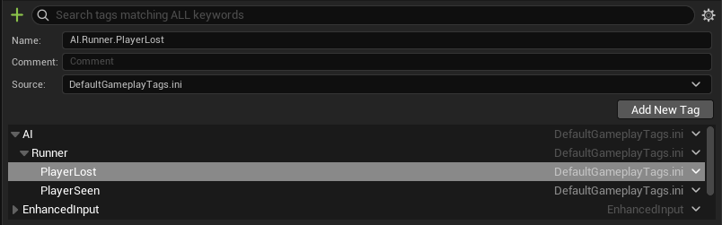{fig-align="center"}

::: {.callout-warning}
If a tag doesn't exist in Project Settings, **Send State Tree Event** does nothing and the transition never fires.
:::

### AI Controller variables

In **`AIC_Runner`**, create these variables and mark both as **Instance Editable** (eye icon), so the State Tree can bind to them:

| Variable | Type |
|---|---|
| `PlayerCharacter` | Actor (object reference) |
| `IsPlayerVisible` | Boolean |

### The StateTreeAI component

Still in `AIC_Runner`, **Add Component → StateTreeAI**.\
In its **Details**, uncheck **Start Logic Automatically**. 

You will assign the State Tree asset after creating it.

### On Target Perception Updated

Select the **AIPerception** component, right-click the Event Graph and choose **Add Event for AIPerception → Event Dispatchers → Add On Target Perception Updated**.

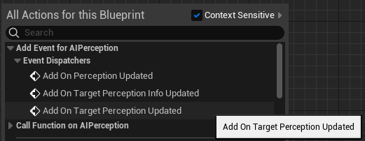{fig-align="center"}

Build the following logic. It only reacts to the **player character**, stores what happened in the controller variables, and then notifies the State Tree:

```{.text .node-chain}
Event On Possess
  └─► StateTreeAI.Start Logic
```

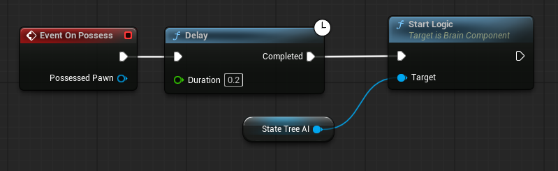{fig-align="center"}

```
On Target Perception Updated (AIPerception)  (Actor, Stimulus)
  └─► Branch (Actor == Get Player Character (Player Index 0))     False ──► end
  └─► SET PlayerCharacter = Actor
  └─► Break AIStimulus (Stimulus)
  └─► SET IsPlayerVisible = Successfully Sensed
  └─► StateTreeAI.Send State Tree Event
        Event = Make StateTreeEvent
                  Tag    = Select (IsPlayerVisible ? AI.Runner.PlayerSeen : AI.Runner.PlayerLost)
                  Origin = "AIC_Runner"
```

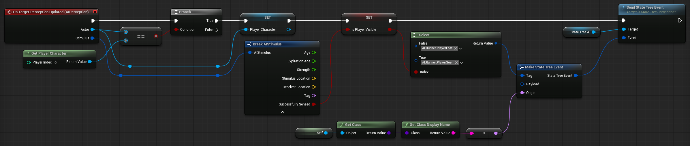{fig-align="center"}


::: {.callout-important}
## Order matters
Set the variables **before** sending the event. When the event reaches the tree, the *Hide* state's enter condition reads `IsPlayerVisible`; if it still holds the old value, the transition is rejected.
:::

::: {.callout-warning}
The **Target** of *Send State Tree Event* must be the **StateTreeAI component**, not the controller or the pawn.
:::

**Compile** and **Save**.

## Creating the State Tree

### The asset and its schema

In the `AI` folder created earlier, right-click **Artificial Intelligence → State Tree**, choose the **StateTree AI Component** schema, name it **`ST_Runner`** and open it.

Select **ROOT** and, in the **Asset Details** panel, under **Schema**:

| Property | Value                              |
|:---|:-----------------------------------------|
| AI Controller Class | `AIC_Runner`            |
| Context Actor Class | `BP_AICharacter`        |

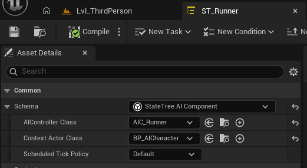{fig-align="center"}

::: {.callout-important}
Setting **AI Controller Class** to `AIC_Runner` is what makes `PlayerCharacter` and `IsPlayerVisible` available in the binding menus.
:::

### Tree parameter

In the root's **Details → Parameters**, add:

| Name | Type | Default |
|---|---|---|
| `HidingLocation` | Vector | `(0, 0, 0)` |

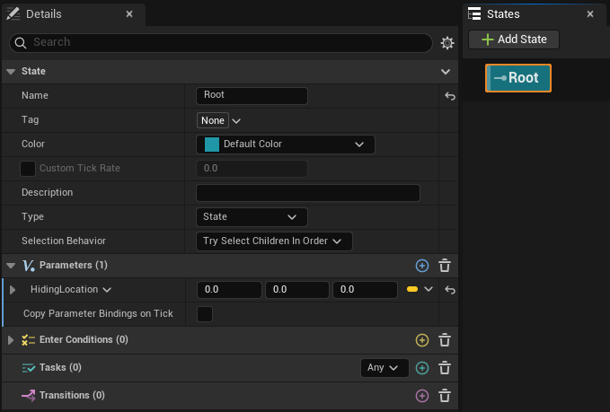{fig-align="center"}

### Assign the tree

Open `AIC_Runner`, select the **StateTreeAI** component and set **State Tree** to `ST_Runner`. **Compile** and **Save**.

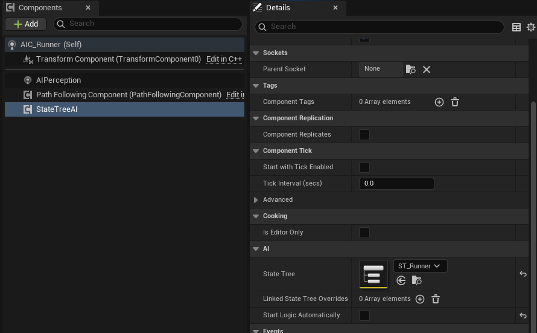{fig-align="center"}


### A first Idle state

In `ST_Runner`, add a child of **Root** named **`Idle`**:

| Task | Settings |
|---|------|
| **Delay** | **Duration** = `2.0` |
| **Debug Text** | **Text** = `Idle`, **Reference Actor** → bind to *Actor* (context) |

| Transitions | Trigger | Go to |
|---|---|---|
| 1 | On State Completed | `Root` |

**Compile** and **Save**.

::: {.callout-tip}
## Checkpoint 1
Play. The agent shows *Idle* above its head. Open the **State Tree Debugger** (**Window → Debugger** in the State Tree editor) and walk in front of the agent: the events `AI.Runner.PlayerSeen` and `AI.Runner.PlayerLost` should appear in the timeline. If they don't, check the Gameplay Tags and the target of *Send State Tree Event*.
:::

## Debugging: the Rewind Debugger {.sec-rewindDebugger}

State Tree debugging lives in the engine-wide **Rewind Debugger**, which records a slice of gameplay and lets you scrub back and forth through it. The State Tree track shows which state was active at every frame, together with the events, transitions, tasks and parameter values that drove it.

::: {.callout-note}
## A recorder, not a live window
The Rewind Debugger traces execution to a file while you play (through the `StateTreeDebug` trace channel). Because the data is recorded, you can pause, rewind and step frame by frame *after* the fact, instead of trying to catch a transition as it flashes past live.
:::

### Opening the Rewind Debugger

The Rewind Debugger is provided by the **Gameplay Insights** plugin, which is normally enabled by default. If the menu entries below are missing, enable it in **Edit → Plugins** and restart the editor.

From the menu bar, open two panels and dock them side by side:

- **Tools → Debug → Rewind Debugger** (the timeline and playback controls)
- **Tools → Debug → Rewind Debugger Details** (runtime values for the selected track)

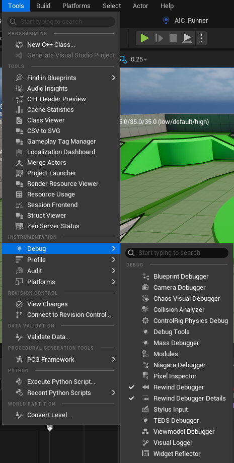{fig-align="center"}

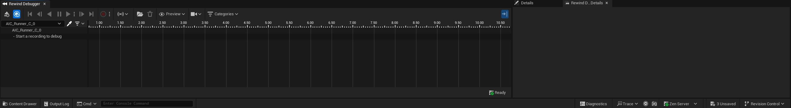{fig-align="center"}

### Recording a session

| # | Step |
|---|-------------|
| 1 | In the Rewind Debugger, enable **Should Auto Record on PIE** in its settings, so recording starts automatically with play. (Otherwise you must click **Record** in the playback controls yourself, right at the start of play.) |
| 2 | Press **Play** to start PIE. |
| 3 | Walk in front of the agent, then step out of its view, a couple of times, so both events fire. |
| 4 | Stop PIE (or press the **Record** button again to end the recording). The timeline now holds the whole session. |
\
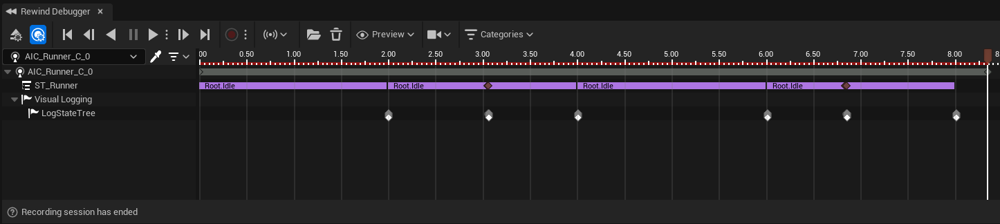{fig-align="center"}

::: {.callout-warning}
If the timeline stays empty or shows *"Start a recording to debug"*, you played without recording. Turn on **Should Auto Record on PIE**, or click **Record** before the events happen. The recording has to be active *while* perception changes.
:::

### Reading the State Tree track

1. Select the AI controller so its tracks load into the timeline. You could use the **eyedropper** in the Rewind Debugger and click the agent directly in the viewport, but since the AI Controller is not visible in the level, its easier to just pick it from the dropdown menu.
   
  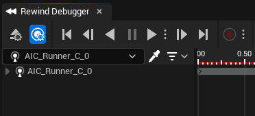{fig-align="center"}

2. Expand the controller's tracks until you reach the **State Tree** track.

  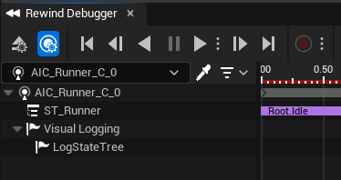{fig-align="center"}

3. **Scrub** the red playhead along the timeline. The State Tree track is split into colored segments, one per active state, so you can watch `Idle` hold and the tree react. However right now we only have one state.
   
  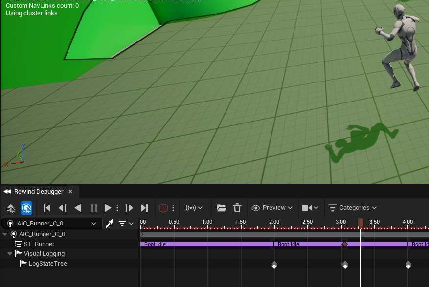{fig-align="center"}

4. Select the State Tree track and read the **Rewind Debugger Details** panel at the playhead position: the active state, the running task, the **events** received, the transitions that fired, and parameter values (later in this assignment, `HidingLocation`).
   
  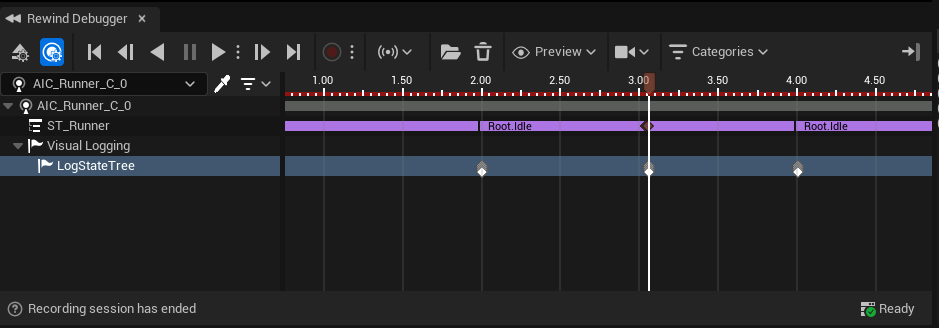{fig-align="center"}

  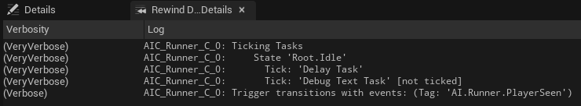{fig-align="center"}

::: {.callout-tip}
## Checkpoint 1
Play and record, then walk in and out of the agent's sight. On the State Tree track you should see `Idle` active, and in the details (and as markers on the timeline) the events **AI.Runner.PlayerSeen** and **AI.Runner.PlayerLost** as you enter and leave the vision cone. If no events appear, check that the Gameplay Tags exist in Project Settings and that the **Target** of *Send State Tree Event* is the **StateTreeAI component**.
:::

### Breakpoints (optional)

You can still break on a specific state: in the State Tree editor, right-click a state and choose **Break On Enter** or **Break On Exit**. PIE pauses when execution reaches it, which is useful once the tree grows past a handful of states.


## Environment Query System (EQS)

### Creating the query

Create a new Environment Query (right-click in the Content Drawer → **Artificial Intelligence → Environment Query**) and name it **`EQS_FindHidingLocation`**.

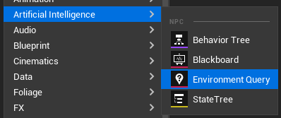{fig-align="center"}

### The EQS Testing Pawn

To see what the query does without playing, create a dummy pawn that runs it in the editor ([Environment Query System](#sec-eqs)). \
Create a new **Blueprint Class**, search **ALL CLASSES** for `EQS`, select **EQSTestingPawn** and name it **`EQS_TestingPawn`**.

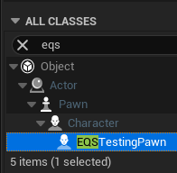{fig-align="center"}

Drag `EQS_TestingPawn` to the middle of the map:

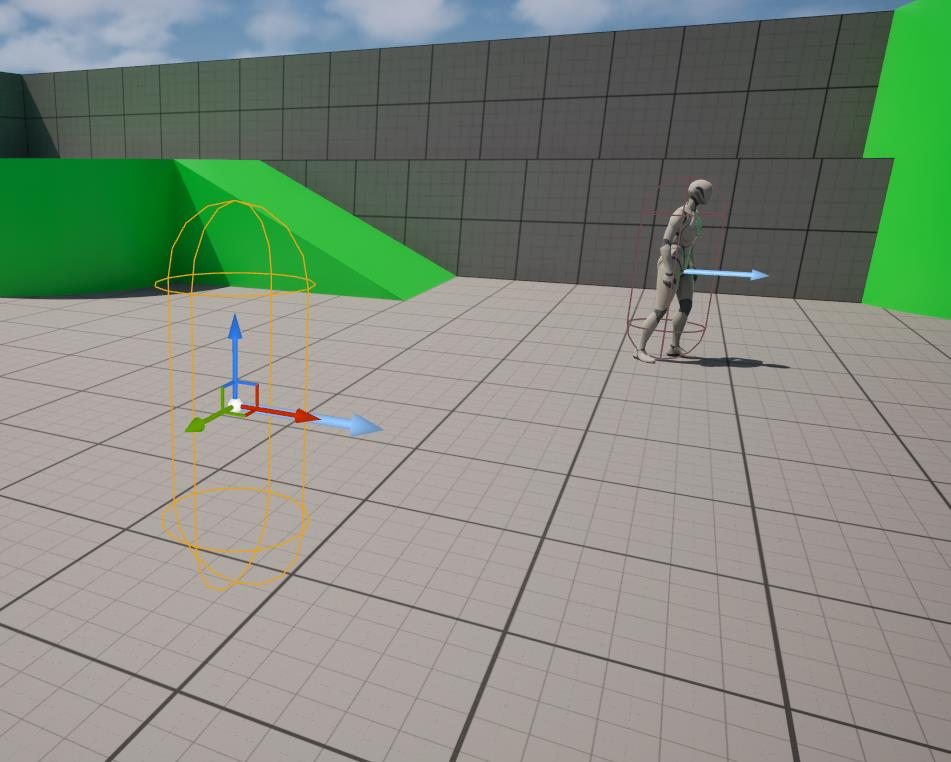{fig-align="center"}

With the testing pawn selected, in **Details → EQS**, set **Query Template** to `EQS_FindHidingLocation`. The pawn now runs the query in the editor.

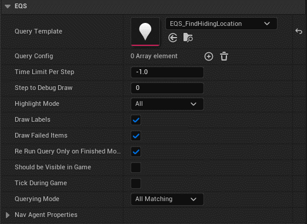{fig-align="center"}

### Generator: Pathing Grid

Open `EQS_FindHidingLocation`. It is empty: right-click the graph and add a **Pathing Grid** generator (it only generates points that can be reached on the navigation mesh).

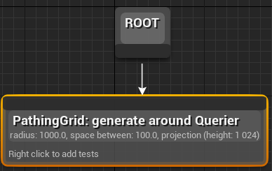{fig-align="center"}

Save it and select `EQS_TestingPawn`: a grid of spheres appears around it (*"generate around Querier"*).

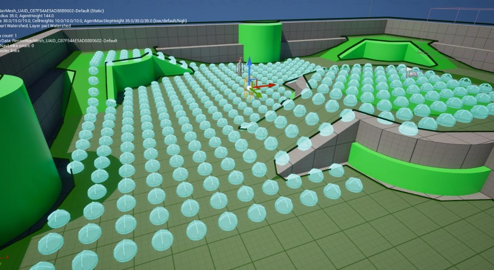{fig-align="center"}

::: {.callout-tip}
If the spheres float in the air instead of lying on the navigation mesh, move the testing pawn slightly. The query only re-runs when the pawn's construction script runs.
:::

In the Pathing Grid, set **GridHalfSize** = `1500` and **Space Between** = `150` for a bigger grid with more space between points:

::: {layout-ncol=2}
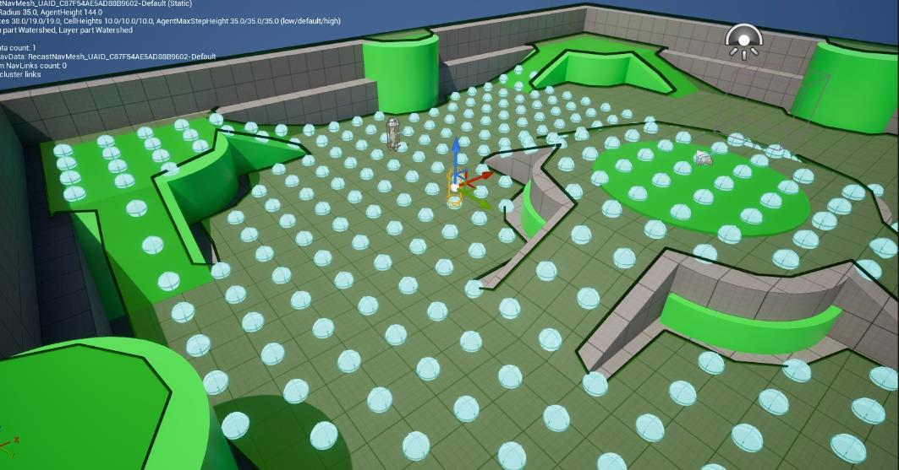

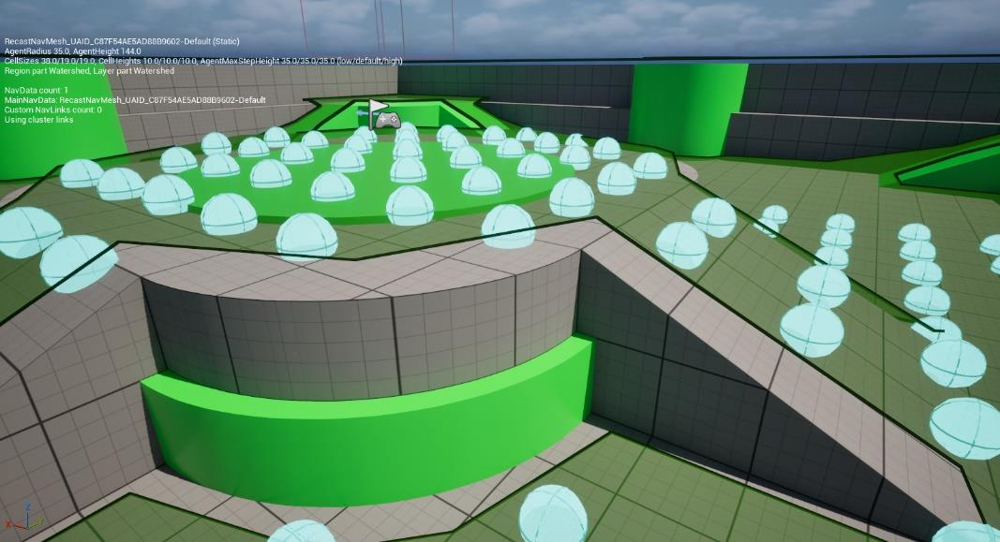
:::

### Test 1: Trace (hidden from the enemy)

A good hiding spot is one the **player cannot see**. We test that by tracing from each grid point to the player. Right-click the Pathing Grid → **Add Test → Trace**:

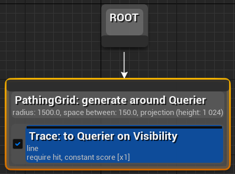{fig-align="center"}

The **Trace** test runs one line trace **per grid point**. For every sphere the
generator produced, it draws a line between that point and the **Context**, and
checks whether any geometry blocks it. A clear line means the point and the
context can see each other; a blocked line means they can't.

The Context defaults to **the Querier**, so out of the box each point is traced
against whoever is running the query: the **AI pawn** in game, or the
**EQS Testing Pawn** in the editor. That is why the first results tell you which
spots are visible *from the AI itself*, not from the player. The two **Height
Offset** values under **Advanced** lift each end of the line off the floor:
**Item Height Offset** raises the grid-point end, **Context Height Offset** raises
the context end.

::: {.callout-note}
A line trace is symmetric: if the point can see the context, the context can see
the point. So "hidden from X" and "X can't see this spot" are the same test. The
only thing that decides *who* the spot must be hidden from is the **Context**,
which is exactly what you change in the next step.
:::

In the level, points that are **not visible** from the testing pawn are green; visible ones are blue:

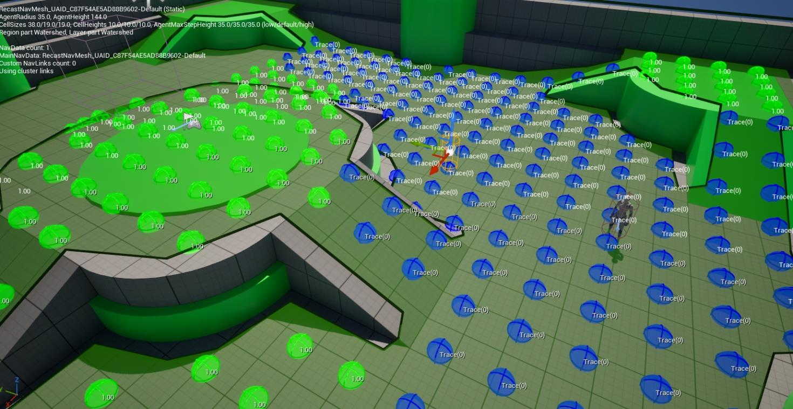{fig-align="center"}

But the trace currently goes **to the Querier** (here, the testing pawn; in game, the AI itself). The AI doesn't want spots hidden from *itself*; it wants spots hidden from the **enemy**. To trace to the player we need a **Context**.

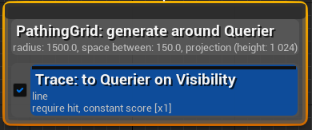{fig-align="center"}

### The Enemy Context

A **Context** is a class with functions you override to give information to tests. We need one that returns the player character.

Create a new **Blueprint Class**, search **ALL CLASSES** for `Context`, select **EnvQueryContext_BlueprintBase** and name it **`EQS_Enemy_Context`**.

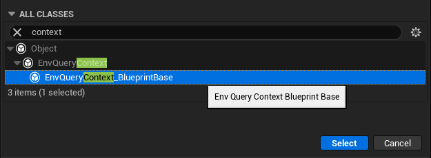{fig-align="center"}

Open it and override **Provide Single Actor**:

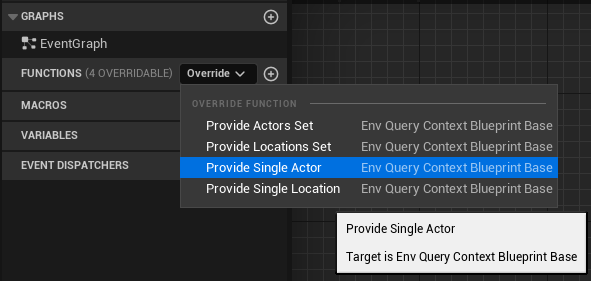{fig-align="center"}

The player character is stored in `AIC_Runner`, so the context asks the querier's controller for it:

```{.text .node-chain}
Provide Single Actor (Querier Object, Querier Actor)
  └─► Get AIController (Controlled Actor = Querier Actor)
  └─► Cast To AIC_Runner                               Cast Failed ──► Return Node (Resulting Actor = None)
  └─► Is Valid (As AIC Runner.PlayerCharacter)         Not Valid   ──► Return Node (Resulting Actor = None)
  └─► Return Node (Resulting Actor = As AIC Runner.PlayerCharacter)
```

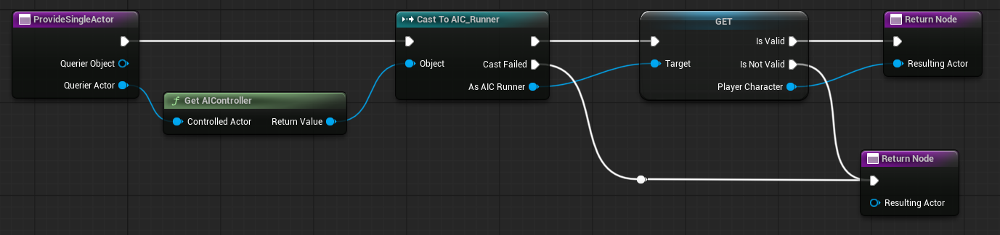{fig-align="center"}

**Compile** and **Save**.

Back in the EQS, select the **Trace** test and set **Context** to `EQS_Enemy_Context`:

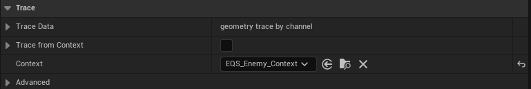{fig-align="center"}

By default the trace goes between the actors' **roots** (at their feet), so small obstacles block it. Under **Advanced**, set **Item Height Offset** = `180` (eye height at the hiding spot) and **Context Height Offset** = `90` (the player's chest, for a 1.80 m tall character):

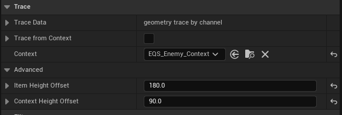{fig-align="center"}

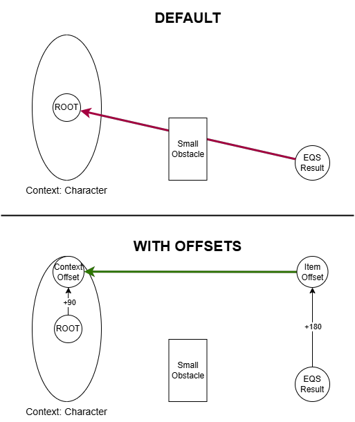{fig-align="center"}

### Testing the context in the editor

Look at the level now: every point is red.

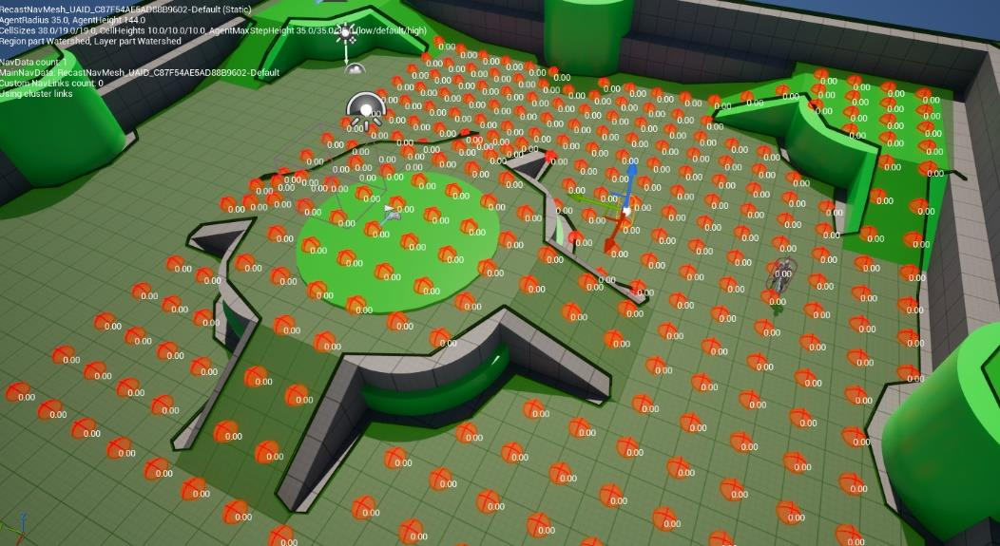{fig-align="center"}

That is because, **outside the game, there is no player character**, so the context returns nothing. For editor testing we will use the **Player Start** as the enemy when the querier is the testing pawn. 
\
Update the **Provide Single Actor** overriden function in the **EQS_Enemy_Context**:

```{.text .node-chain}
Provide Single Actor (Querier Object, Querier Actor)
  └─► Cast To EQSTestingPawn (Querier Object)
        Success     ──► Get Actor Of Class (PlayerStart) ──► Return Node (Resulting Actor)
        Cast Failed ──► (the in-game logic from before: AIC_Runner.PlayerCharacter)
```

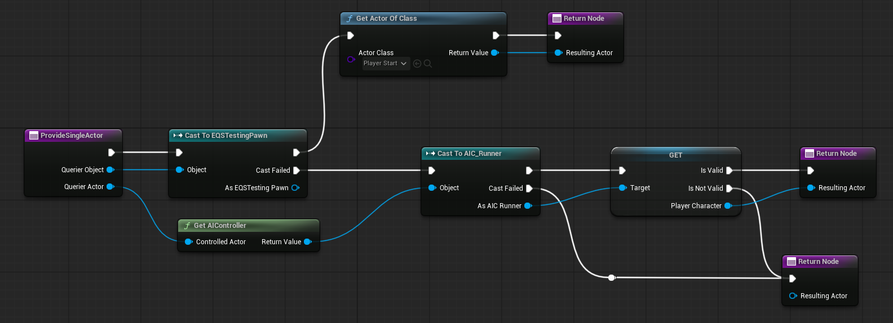{fig-align="center"}

If the querier is the **EQS Testing Pawn**, the **Player Start** is the enemy; otherwise the real **Player Character** is. The visibility check now works both in the editor and in game:

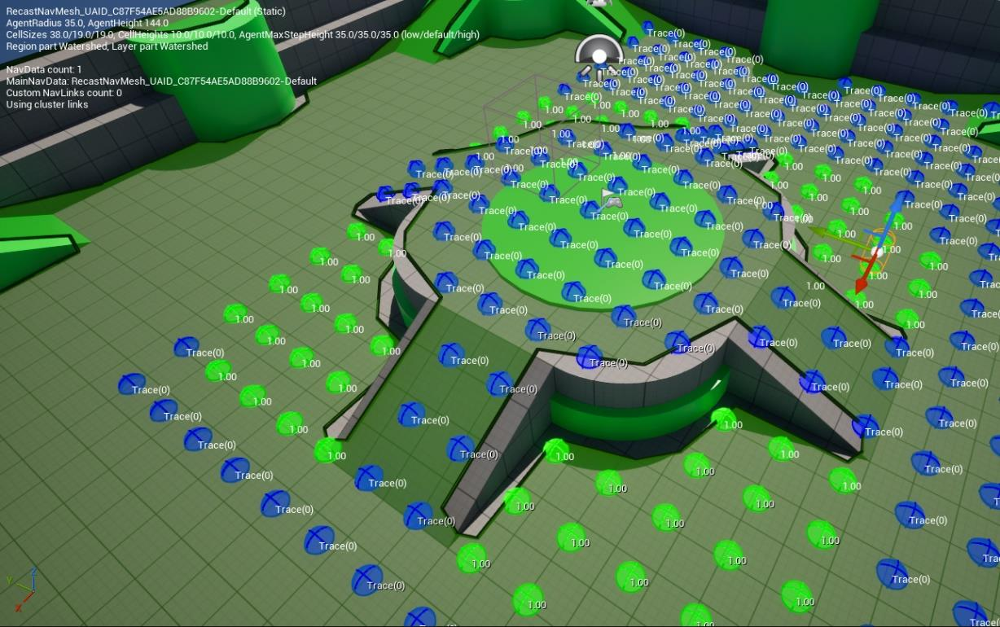{fig-align="center"}

So far you should have:

{fig-align="center"}

### Tests 2 and 3: Distance (close to me, far from the enemy)

We now only keep points the player cannot see. Among those, the best spots are **close to the agent** and **far from the enemy**.

Add a **Distance** test (right-click Pathing Grid → **Add Test → Distance**):

{fig-align="center"}

Set: **Test Purpose** = **Score Only** and **Scoring Equation** = **Inverse Linear**.
\ 
Leave **Distance To** as the Querier. Closer points get higher scores.

{fig-align="center"}

{fig-align="center"}

Points far from the testing pawn now look more yellow/orange (lower score):

{fig-align="center"}

Add a **second Distance** test with **Test Purpose** = **Score Only**, **Distance To** = `EQS_Enemy_Context`, and keep the **Linear** equation, so points far from the enemy score higher:

{fig-align="center"}

Each point's score is now the sum of the two distance scores:

{fig-align="center"}

To see only the **single best point**, select the testing pawn and set **Querying Mode** = **Single Best Item**. **Step to Debug Draw** shows the result after a specific test.

{fig-align="center"}

{fig-align="center"}

The query is done. Save it.

## Hide behavior

### The Hide states

In `ST_Runner`, add a child of **Root** named **`Hide`**, place it **above** *Idle*, and give it two children:

```
Root
├── Hide
│   ├── FindHidingSpot
│   └── MoveToHidingSpot
└── Idle
```

{fig-align="center"}

**Root** – *Selection Behavior*: **Try Select Children In Order**.

**Hide** – *Selection Behavior*: **Try Select Children In Order**.

#### **Hide** state configuration:

| Enter Condition | Settings |
|---|---------|
| **Bool Compare** | **Left** → bind to *AIController › IsPlayerVisible*; **Right** = `true` |

{fig-align="center"}

#### **FindHidingSpot** state configuration:

| Task | Settings |
|---|--------------|
| **Run Env Query** | **Query Template** = `EQS_FindHidingLocation`; **Run Mode** = *Single Best Item*; **Querier** → *Actor* (context, bound automatically); **Result** → bind to *Parameters › HidingLocation* |
| **Debug Text** | **Text** = `Finding spot`, **Reference Actor** → *Actor* |

| Transitions | Trigger | Go to |
|---|---|---|
| 1 | On State Succeeded | `MoveToHidingSpot` |
| 2 | On State Failed | `Idle` |

{fig-align="center"}

*Run Env Query* is **asynchronous**: it stays *Running* while EQS works, then **succeeds** after writing the best location into `HidingLocation`, or **fails** if no item passed the tests.

#### **MoveToHidingSpot** state configuration:

| Task | Settings |
|---|----------|
| **Move To** | **Destination** → bind to *Parameters › HidingLocation*; **Acceptable Radius** = `50` |
| **Debug Text** | **Text** = `Hiding`, **Reference Actor** → *Actor* |

| Transitions | Trigger | Go to |
|---|---|---|
| 1 | On State Completed | `Root` |

{fig-align="center"}

When the agent arrives, the tree goes back to **Root**. If the player can still see it, *Hide* is selected again and a new spot is found; otherwise the agent goes to *Idle*.

::: {.callout-note collapse="true"}
## If *Run Env Query* doesn't show a *Result* you can bind to a parameter
In some engine versions the *Run Env Query* result can't be bound to a parameter. Use a small custom task instead that stores the location in the controller:

1. Add a Vector variable `HidingLocation` (Instance Editable) to `AIC_Runner`.
2. Create **`STT_FindHidingLocation`** (*StateTreeTaskBlueprintBase*) with variables `Actor` (Actor, **Context**), `AIController` (AIC_Runner, **Context**) and `QueryTemplate` (Env Query, **Parameter**).
3. In **Event Enter State**:

```{.text .node-chain}
Event Enter State
  └─► Run EQS Query (Query Template = QueryTemplate, Querier = Actor, Run Mode = Single Best Item)
  └─► Bind Event to On Query Finished Event ──► Custom Event OnQueryFinished (Query Instance, Query Status)

OnQueryFinished
  └─► Get Query Results as Locations (Query Instance)
  └─► Branch (Length > 0)
        True  ──► SET AIController.HidingLocation = Results[0] ──► Finish Task (Succeeded = true)
        False ──► Finish Task (Succeeded = false)
```

4. Use it in *FindHidingSpot* instead of *Run Env Query*, and bind the *Move To* **Destination** to *AIController › HidingLocation*.
:::

### Reacting to the player from Idle

While the agent is in *Idle*, nothing re-selects the root for up to 2 seconds. To react **immediately**, add an event transition to the **Idle** state, above the existing one:

| Transitions | Trigger | Event Tag | Go to |
|---|---|---|---|
| 1 | On Event | `AI.Runner.PlayerSeen` | `Hide` |
| 2 | On State Completed | – | `Root` |

{fig-align="center"}

When the controller sends *PlayerSeen*, the transition tries to enter *Hide*. Its enter condition reads `IsPlayerVisible`, which the controller already set to `true`, so the agent starts hiding right away.

**Compile** and **Save**.

::: {.callout-tip}
## Checkpoint 2
Play and walk in front of the agent. It should notice you, show *Finding spot* for a moment, then run to a place you can't see and show *Hiding*. If you follow it and it sees you again when it arrives, it looks for a new spot.
:::

## Debugging

- **State Tree Debugger.** See [Debugging: the Rewind Debugger](#sec-rewindDebugger)

- **Gameplay Debugger.** Press <span class="kbd">'</span> and <span class="kbd">NumPad 3</span> to see the **EQS** grid and each point's result during play. Active State Tree states are shown in the **AI** category (<span class="kbd">NumPad 1</span>), and perception in <span class="kbd">NumPad 4</span>.

{fig-align="center"}

Press <span class="kbd">NumPad /</span> (Divide) to toggle the detailed table with the top results of the query and the score of each test:

{fig-align="center"}

::: {.callout-warning}
## Common problems
| Symptom | Likely cause |
|---|---|
| The agent never perceives the player | Only *Detect Enemies* checked (see [AI Perception](#sec-perception)), or Sight Radius too small |
| Events never reach the tree | Gameplay Tag missing in Project Settings, or *Send State Tree Event* target isn't the StateTreeAI component |
| Event arrives but *Hide* isn't entered | Variables set **after** sending the event, or `IsPlayerVisible` not Instance Editable / wrong binding |
| `IsPlayerVisible` doesn't appear in the binding menu | Schema's **AI Controller Class** isn't `AIC_Runner`, or variable not Instance Editable |
| *FindHidingSpot* always fails | `EQS_Enemy_Context` returns nothing (player not stored yet), or no nav mesh around the agent |
| The agent hides in places the player can see | Trace test still traces to the Querier, or the height offsets are missing |
| Every sphere is red in the editor | No enemy outside the game: add the *EQSTestingPawn → Player Start* branch to the context |
:::

## Final result

{fig-align="center"}

#### Configuration summary:

| State | Selection / Enter conditions | Tasks | Transitions |
|---|---|---|---|
| **Root** | Try Select Children In Order · *Parameter:* `HidingLocation` | – | – |
| **Hide** | `AIController.IsPlayerVisible` == true | – | – |
| ↳ **FindHidingSpot** | – | Run Env Query → `HidingLocation` | On Succeeded → MoveToHidingSpot · On Failed → Idle |
| ↳ **MoveToHidingSpot** | – | Move To (`HidingLocation`) | On Completed → Root |
| **Idle** | – | Delay 2 s | On Event `AI.Runner.PlayerSeen` → Hide · On Completed → Root |

```{mermaid}
%%| fig-cap: "Runtime view of the agent's behavior."
stateDiagram-v2
    direction LR
    [*] --> Idle
    Idle --> FindHidingSpot : PlayerSeen event
    FindHidingSpot --> MoveToHidingSpot : spot found
    FindHidingSpot --> Idle : no spot
    MoveToHidingSpot --> FindHidingSpot : arrived, still visible
    MoveToHidingSpot --> Idle : arrived, not visible
```

## Exercises

1. **Fix the "arrived but still seen" bug.** Follow the agent and stand where it
   runs to. When it reaches the hiding spot and you are *still* visible, it should
   look for a new spot, but instead it stays put until you step out of view and
   back in. Make it re-hide on arrival whenever the player can still see it.

   *Hints:*
   - The bug is not in the states, it is in `IsPlayerVisible`. The controller only
     writes that value inside *On Target Perception Updated*, which fires on a
     **change** (player gained or lost), not every frame. Arriving at a spot where
     the player was already visible produces no new "seen" value, so the bool is
     stale and `Hide`'s enter condition reads `false`.
   - The fix is to re-check **current** visibility at the moment of arrival instead
     of trusting the cached value. Do it **once, on arrival**, not every frame on
     Tick: polling on Tick works but throws away the event-driven design the rest
     of the assignment is built on.
   - One possible solution: before the tree re-selects `Root`, ask the **AIPerception** component
     for its currently perceived actors (*Get Currently Perceived Actors*, Sight
     sense) and set `IsPlayerVisible` from whether `PlayerCharacter` is in that list.
  
2. Create a folder **`AISearch`** inside the `AI` folder, and in it a new AI character named **`AI_Search`**, with its own controller and State Tree (`ST_Search`).
   a. `AI_Search` should **patrol** around the map (you can reuse the patrol states from Assignment 02).
   b. When `AI_Search` **sees** the player, it should move to him.
   c. When it **loses sight** of the player, it should move to the **last known position** where it saw him. Use the **AIStimulus** from the AIPerception component (*Stimulus Location* when *Successfully Sensed* becomes `false`).
   d. On arriving at the last known position, it should enter a **Searching** mode, looking for the player around that position for **20 seconds**. Use the **stimulus** from the AIPerception component, an **EQS** query to pick search points around the last known location, and the **Max Age** property of the sight sense.

   *Hints:*
   - Store `LastKnownLocation` in the controller and send an event such as `AI.Search.PlayerLost` when sight is lost.
   - A **Search** parent state with a *Delay* of 20 s and children that loop *find point → move → look around* ends the search automatically when the delay finishes (remember: a task on a parent state that finishes completes that state; see *Transition selection* in Assignment 02).
   - *On Target Perception Forgotten* (fired after **Max Age**) is a natural signal to give up the search.
