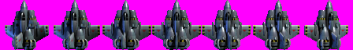
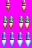
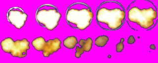
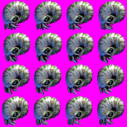
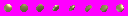
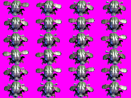

## Project

Using the C++ programming language (C++17 or later), the SDL3 library (window, OpenGL context, input), OpenGL with GLSL vertex and fragment shaders (rendering) and the Box2D physics engine (version 3.1 or later), you should create a simple two-dimensional (2D) Game Engine and, with it, a clone of the 2D space shooter **Xenon 2000: Project PCF**.

This is a **common project** of two courses. You develop **one** project, in **one** repository, and it is evaluated in both courses:

| Course | What is evaluated |
|--------|-------------------|
| **Advanced Game Programming Topics (ATGP)** | The **engine architecture**: classes, resource ownership, game loop, input, physics, actors and levels, animation |
| **Computer Graphics (CG)** | The **rendering pipeline**: OpenGL setup, shaders, textures, sprite sheets, transformations |

::: {.callout-note}
## Students enrolled in only one of the courses
- **Only ATGP:** you must still render through OpenGL, but only the engine architecture is graded.
- **Only CG:** you do not need to implement the game engine. Instead, implement the rendering pipeline and a test scene that renders all the game entities described below (spaceship, missiles, enemies, explosions, scrolling background), with their animations and transformations.
:::

## Game: Vertical Xenon 2000

For testing your Game Engine, you must use the assets of **Xenon 2000: Project PCF** and create a very simple **vertical scroller** clone of the game. You will need to load the sprite sheets of the spaceship, missiles, enemies, explosions and backgrounds.

As you can see in Figure 1, the magenta colour (RGB: 255, 0, 255) represents transparency, since these BMP files have no alpha channel.

### Spaceship

The spaceship moves according to keyboard or gamepad input. When the ship moves to the left, it plays the turning-left animation (the first three tiles of Figure 1); when it moves to the right, it plays the turning-right animation (the last three tiles of Figure 1).

### Missiles

The spaceship fires missiles when the player presses the Space bar on the keyboard, the X button on PlayStation controllers or the A button on Xbox controllers. Use the first row (light missiles) of the "missile.bmp" sprite sheet:

Every time a missile collides with an enemy, the missile is destroyed and an explosion is played, using the following sprite sheet:

### Loner

The Loner is an enemy that moves horizontally across the screen at a certain speed, and fires a projectile towards the spaceship every 2 seconds.

### Enemy Projectiles

The enemy projectiles are fired by Loners. They explode when they collide with the spaceship.

### Rusher

The Rusher is an enemy that moves vertically on the screen at a certain speed.

### Vertical Scroller

The game is a vertical scroller (see reference) with **at least two background layers** scrolling at different speeds, to achieve a parallax effect.

### Reference

You can use the following video as a reference: <https://youtu.be/eMWRH_69Xo4>

## Game Engine (evaluated in ATGP)

The Game Engine must follow the Object-Oriented paradigm and be as generic as possible, so it can be used to create other kinds of 2D games. The Game Engine and the Xenon clone must be **two separate build targets** (e.g. two CMake targets): the game links the engine as a library and must **not** include any SDL3, OpenGL or Box2D header directly — everything goes through the engine's public headers.

### Resource Management (RAII)

Every allocated resource must be freed when it is no longer needed; avoid resource/memory leaks at all costs. Every SDL, OpenGL and Box2D handle (`SDL_Window`, `SDL_GLContext`, shader programs, textures, VAOs/VBOs, `b2WorldId`, `b2BodyId`, ...) must be owned by a C++ class that acquires it in the constructor and releases it in the destructor. Nothing is destroyed by hand in `main()`.

A `ResourceManager` must cache textures and shaders, so that no file is loaded twice. Verify the absence of leaks with AddressSanitizer (`-fsanitize=address`) or a similar tool before submitting.

### Renderer Abstraction

All drawing goes through an abstract `Renderer` interface of the engine, implemented by an OpenGL back end. Actors describe *what* to draw (texture, sprite-sheet frame, position, rotation, scale); the renderer decides *how* to draw it.

### Game Loop

The game loop must separate game logic from rendering: in each iteration, first all actors are updated (input, logic, physics), and then all actors are rendered. Box2D must be stepped with a **fixed time step**, independent of the frame rate.

For more information, see the [Unity Execution Order Documentation](https://docs.unity3d.com/560/Documentation/Manual/ExecutionOrder.html), which briefly describes how the Unity game loop works.

### Input

An `InputManager` must abstract the keyboard and gamepads (Xbox and PlayStation), so that game code asks for actions (move, fire) rather than specific keys or buttons.

### Levels, Actors and Animation

- A `Level` owns its actors; actors are created and destroyed (e.g. missiles, explosions) without leaks or dangling pointers.
- Collisions between missiles, enemies, projectiles and the spaceship must use Box2D (e.g. sensor shapes and contact events).
- An animation system selects which sprite-sheet frame each actor shows and when (frame timing, looping vs. one-shot animations, the ship's turning states).

## Rendering Pipeline (evaluated in CG)

### OpenGL Setup

Use SDL3 to create the window and an **OpenGL 3.3 Core** (or later) context, and an OpenGL loader (e.g. GLAD). Sprites are drawn as textured quads using vertex array objects (VAO) and vertex buffer objects (VBO).

### Shaders

Write your own GLSL vertex and fragment shaders. Shader compilation and linking errors must be detected and reported (shader info log).

### Textures and Transparency

Load the BMP sprite sheets into OpenGL textures. The magenta colour must become transparent, either by converting it to alpha when loading the texture or by discarding those fragments in the fragment shader. Enable alpha blending.

### Sprite Sheets

Each animation frame is selected through **texture (UV) coordinates**: the renderer computes the UV rectangle of the requested frame inside the sprite sheet, without creating one texture per frame.

### Transformations

- **Projection:** use an orthographic projection matrix (e.g. `glm::ortho`), so the game works in pixel coordinates.
- **Model matrix:** each sprite has its own model matrix combining translation, rotation and scale, sent to the vertex shader as a uniform.
- At least one entity must visibly use rotation (e.g. enemy projectiles or explosions).

### Parallax Background

Render at least two background layers scrolling at different speeds, either by moving their UV coordinates (with `GL_REPEAT`) or by translating the layers.

## Toolchain

The project must build with CMake and fetch SDL3, Box2D, GLM and any other third-party library through vcpkg (a `vcpkg.json` manifest; no committed binaries or system-wide installs). It must build from a clean clone using the instructions in its `README.md`.

## Report

Together with the project, there must be **one** report in PDF format, with one section for each course:

- **Game Engine (ATGP):** class diagram of the engine, description of the implemented algorithms (game loop, resource management, input, animation, physics integration) and justification of the choices made
- **Rendering Pipeline (CG):** description of the rendering pipeline, the shaders, how textures and sprite-sheet frames are handled and the transformation matrices used
- All references (books, websites, etc.) on which the implementation was based
- Explicitly, the objectives achieved and not achieved

## Marks

### Advanced Game Programming Topics

| Criteria | Mark |
|----------|------|
| RAII wrapper classes (SDL window, GL context, GL resources, Box2D world/bodies) | 10% |
| Renderer abstraction (game never calls OpenGL directly) | 10% |
| Game loop (update/render separation, fixed physics time step) | 15% |
| Input abstraction (`InputManager`: keyboard + gamepad) | 10% |
| Resource manager (caching, no duplicate loads, no leaks) | 10% |
| Level / Actor ownership model | 15% |
| Animation system | 10% |
| Box2D collisions | 10% |
| Report (ATGP section) | 10% |

### Computer Graphics

| Criteria | Mark |
|----------|------|
| OpenGL context and setup (SDL3, VAO/VBO, draw loop) | 10% |
| Shader programs (compilation, linking, error reporting) | 15% |
| Texture loading, transparency and blending | 15% |
| Sprite-sheet frames via UV coordinates | 15% |
| Transformations (model matrix + orthographic projection) | 25% |
| Parallax background | 10% |
| Report (CG section) | 10% |

## Rules

1. **Deadline for submission:** *[to be announced]*
2. The work can be performed by groups of two students (projects with groups larger than two will not be accepted)
3. On the submission date, the project will be presented in an oral defense covering both courses
4. The project must be submitted to GitHub and shared with both professors as project collaborators
5. A project that does not build from a clean clone, following its `README.md`, will not be evaluated
