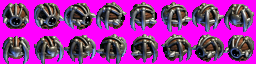

 
## What is SDL?
 
The Simple DirectMedia Layer (SDL) is a library designed to provide low level access to audio, keyboard, mouse, joystick, and graphics hardware via OpenGL, Vulkan, Metal and Direct3D. Since SDL is a library entirely written in C, it is also a cross-platform development library, supporting Windows, macOS, Linux, iOS, and Android. Given its portability and ease of use, SDL became increasingly popular over the years. It is used for video playback software, emulators, many games and also the most popular game engines. Thanks to the SDL library and its portability, most game engines can export the same game for several platforms.
 
::: {.callout-note}
## SDL version
This tutorial targets **SDL 3.4** (the current stable branch). A few functions used here — `SDL_LoadPNG()` and `SDL_SCALEMODE_PIXELART` — only exist since 3.4.0. The CMake setup in the next section fetches it for you through vcpkg. You can print the version you are actually linking against:
 
```cpp
int v = SDL_GetVersion();
std::cout << "SDL " << SDL_VERSIONNUM_MAJOR(v) << '.' << SDL_VERSIONNUM_MINOR(v)
          << '.' << SDL_VERSIONNUM_MICRO(v) << std::endl;
```
:::
 
::: {.callout-note}
## About rendering in this course
This tutorial uses SDL's built-in 2D renderer (`SDL_Renderer`). It is the right tool for learning the engine side of things — window, events, timing, sprites, animation — while the Computer Graphics course covers OpenGL. Design your engine so that the rendering back end sits behind your own `Renderer` class: the SDL renderer now, an OpenGL one later, with no change to the game code.
:::
 
## Setting Up the Project with CMake and vcpkg
 
Before writing any code we need a project that **compiles and links against SDL3**, and that does so the same way on every computer: yours, your group colleagues', and the one used to grade the project. Two tools do this for us. You only have to install them once; after that, starting a new project is a matter of copying three small text files.
 
### Why do we need these tools?
 
To use a library like SDL3 in C++, the compiler needs three things: the library's **headers** (`SDL3/SDL.h`), its compiled **binary** (`SDL3.lib`/`SDL3.dll` on Windows, `libSDL3.dylib` on macOS), and the **flags** that tell it where both are. Doing this by hand — downloading a zip, unpacking it somewhere, typing its paths into the Visual Studio or Xcode project settings — works on your computer and breaks on everyone else's, because their paths and versions are different.
 
| Tool | What it is | What it does for us |
|---|---|---|
| **CMake** | A *build system generator* | Reads a description of the project (`CMakeLists.txt`) and generates the real project for your platform: a Visual Studio project on Windows, an Xcode project on macOS, Makefiles/Ninja on Linux. One description, every IDE. |
| **vcpkg** | A *package manager* for C/C++ (by Microsoft, open source, works on Windows, macOS and Linux) | Reads the list of libraries your project needs (`vcpkg.json`), downloads their source code, compiles them with *your* compiler and hands them to CMake. It plays the same role as `pip` in Python, `npm` in JavaScript or NuGet in C#. |
 
: CMake and vcpkg
 
This is how the pieces fit together:
 
```
 vcpkg.json ──► vcpkg ──(downloads + compiles SDL3)──┐
                                                     ▼
 CMakeLists.txt ──────────────────────────────────► CMake ──► Visual Studio / Xcode project ──► sdl_tutorial.exe
 CMakePresets.json ─(tells CMake where vcpkg is)─────┘
```
 
You never run vcpkg directly to build: **CMake runs it for you** every time it configures the project. The only link between the two is one setting, `CMAKE_TOOLCHAIN_FILE`, which we write once in `CMakePresets.json`.
 
::: {.callout-note}
This section sets up a single-executable project for this tutorial. The *Toolchain: CMake, vcpkg and Continuous Build Checks* guide extends it later to the engine + game layout, sanitizers and automatic build checks that the course project requires.
:::
 
### Step 1 — Install the Prerequisites (once per computer)
 
**Windows**
 
- **Visual Studio Community** with the *Desktop development with C++* workload (you already have it from the C++ classes).
- **Git** — [git-scm.com](https://git-scm.com/downloads) (accept the defaults).
- **CMake** — [cmake.org/download](https://cmake.org/download/), Windows x64 installer. During installation, choose **"Add CMake to the system PATH"**.
 
**macOS**
 
- **Xcode** from the App Store, then the command-line tools: `xcode-select --install`
- **Homebrew** ([brew.sh](https://brew.sh)), then: `brew install cmake pkg-config`
 
Open a **new** terminal (PowerShell on Windows, Terminal on macOS) and check that everything is found:
 
```bash
git --version
cmake --version     # must be 3.22 or newer
```
 
### Step 2 — Install vcpkg (once per computer)
 
vcpkg is installed by downloading it with Git and running its bootstrap script, which downloads the `vcpkg` executable. Choose a short path with no spaces — the examples use `C:\vcpkg` on Windows and `~/vcpkg` on macOS.
 
**Windows (PowerShell):**
 
```powershell
cd C:\
git clone https://github.com/microsoft/vcpkg.git
cd vcpkg
.\bootstrap-vcpkg.bat
```
 
**macOS (Terminal):**
 
```bash
cd ~
git clone https://github.com/microsoft/vcpkg.git
cd vcpkg
./bootstrap-vcpkg.sh
```
 
Now tell your system where vcpkg is, through an **environment variable** called `VCPKG_ROOT`. Our project files use this variable instead of a fixed path, so the same files work on every computer.
 
**Windows (PowerShell):**
 
```powershell
setx VCPKG_ROOT "C:\vcpkg"
```
 
**macOS (Terminal):**
 
```bash
echo 'export VCPKG_ROOT="$HOME/vcpkg"' >> ~/.zshrc
```
 
Then **close every terminal and Visual Studio** and open them again — environment variables are only read when a program starts. Check that it worked:
 
```powershell
echo $env:VCPKG_ROOT      # Windows → C:\vcpkg
```
 
```bash
echo $VCPKG_ROOT          # macOS → /Users/<you>/vcpkg
```
 
::: {.callout-tip}
## Updating vcpkg
To get newer library versions later, run `git pull` inside the vcpkg folder. Projects that already have a baseline (see Step 4) keep using the versions they pinned until you update their baseline on purpose.
:::
 
### Step 3 — Create the Project Folder
 
From here on, the steps are repeated for **every new project**. Create this structure (empty files for now; we fill them in the following steps):
 
```
sdl-tutorial/
├── vcpkg.json           # Step 4: which libraries we need (SDL3)
├── CMakeLists.txt       # Step 5: how to build our program
├── CMakePresets.json    # Step 6: where vcpkg is
├── .gitignore           # Step 9
├── graphics/            # optional for now: galaxy2.bmp, drone.bmp, ...
└── src/
    └── main.cpp         # Step 7: a first test program
```
 
### Step 4 — `vcpkg.json`: Which Libraries We Need
 
This file is the project's **shopping list**. For this tutorial it has one item, `sdl3`:
 
```json
{
  "name": "sdl-tutorial",
  "version": "1.0.0",
  "dependencies": [
    "sdl3"
  ]
}
```
 
(`name` must be lowercase letters, digits and dashes.) Later in the course, adding Box2D is a matter of adding `"box2d"` to that list.
 
vcpkg also needs a **baseline**: an identifier of the vcpkg version to use, which pins the exact version of every library. Without it, an update to SDL could change your project overnight. You don't write it by hand — open a terminal **in the `sdl-tutorial` folder** and let vcpkg add it:
 
```powershell
# Windows (PowerShell)
& "$env:VCPKG_ROOT\vcpkg.exe" x-update-baseline --add-initial-baseline
```
 
```bash
# macOS
"$VCPKG_ROOT/vcpkg" x-update-baseline --add-initial-baseline
```
 
Open `vcpkg.json` again: it now has a line like `"builtin-baseline": "d64aa3825b1d52b799b424d48be2f7d5b42d42cf"` (your value will be different). Keep it, and commit it with the project, so everyone in the group gets exactly the same SDL version.
 
::: {.callout-warning}
If the command above says *"x-update-baseline … not found"* or similar, your vcpkg is very old: run `git pull` and the bootstrap script again (Step 2). And if CMake later fails with *"builtin-baseline … was not a valid commit sha"*, the baseline is missing or wrong — the error message itself prints a valid one: copy that 40-character value into `"builtin-baseline"`.
:::
 
### Step 5 — `CMakeLists.txt`: How to Build Our Program
 
```cmake
cmake_minimum_required(VERSION 3.22)
project(sdl_tutorial LANGUAGES CXX)
 
set(CMAKE_CXX_STANDARD 20)
set(CMAKE_CXX_STANDARD_REQUIRED ON)
set(CMAKE_CXX_EXTENSIONS OFF)
 
find_package(SDL3 3.4 CONFIG REQUIRED)   # fails early if SDL is older than 3.4
 
add_executable(sdl_tutorial src/main.cpp)
target_link_libraries(sdl_tutorial PRIVATE SDL3::SDL3)
 
if (MSVC)
  target_compile_options(sdl_tutorial PRIVATE /W4)
else()
  target_compile_options(sdl_tutorial PRIVATE -Wall -Wextra -Wpedantic)
endif()
 
# Copy the assets next to the executable after every build.
# (If you create the graphics folder later, run "cmake --preset default" again.)
if (EXISTS ${CMAKE_SOURCE_DIR}/graphics)
  add_custom_command(TARGET sdl_tutorial POST_BUILD
    COMMAND ${CMAKE_COMMAND} -E copy_directory
            ${CMAKE_SOURCE_DIR}/graphics
            $<TARGET_FILE_DIR:sdl_tutorial>/graphics)
endif()
 
# Run from the executable's folder inside the IDEs, so "graphics/..." is found
set_target_properties(sdl_tutorial PROPERTIES
  VS_DEBUGGER_WORKING_DIRECTORY "$<TARGET_FILE_DIR:sdl_tutorial>"
  XCODE_SCHEME_WORKING_DIRECTORY "$<TARGET_FILE_DIR:sdl_tutorial>")
```
 
Line by line: `project()` names the project; the three `set()` lines choose C++20; `find_package(SDL3 …)` asks for SDL3 — this is where vcpkg's copy is found; `add_executable()` says our program is built from `src/main.cpp`; `target_link_libraries()` links it with SDL3, which also gives it SDL's include folder. Every time you add a `.cpp` file to the project, add it to `add_executable()`.
 
The `if (EXISTS …)` guard matters with CMake 4: copying a folder that doesn't exist is an error there, so without it the very first build fails until you add the assets. The examples open files with relative paths such as `"graphics/galaxy2.bmp"`, which are resolved against the **working directory**, not the executable's location. The last two blocks make sure the `graphics` folder sits next to the executable and that Visual Studio and Xcode start the program from there. If an image fails to load with "Couldn't open graphics/…", the working directory is the first thing to check.
 
::: {.callout-note}
On Windows, the vcpkg toolchain copies `SDL3.dll` next to `sdl_tutorial.exe` automatically after each build — you don't need to copy any DLL by hand.
:::
 
### Step 6 — `CMakePresets.json`: Where vcpkg Is
 
This file is what connects CMake to vcpkg. It sets `CMAKE_TOOLCHAIN_FILE` to a script inside your vcpkg folder (found through the `VCPKG_ROOT` variable from Step 2), so you never have to type that path:
 
```json
{
  "version": 6,
  "configurePresets": [
    {
      "name": "default",
      "binaryDir": "${sourceDir}/build",
      "cacheVariables": {
        "CMAKE_TOOLCHAIN_FILE": "$env{VCPKG_ROOT}/scripts/buildsystems/vcpkg.cmake"
      }
    },
    {
      "name": "xcode",
      "inherits": "default",
      "generator": "Xcode",
      "binaryDir": "${sourceDir}/build-xcode"
    }
  ]
}
```
 
### Step 7 — `src/main.cpp`: a First Test
 
Before following the rest of the tutorial, check that the toolchain works with a minimal program. It needs no image files and should open a blue window and print the SDL version:
 
```cpp
#include <SDL3/SDL.h>
#include <SDL3/SDL_main.h>
#include <iostream>
 
int main([[maybe_unused]] int argc, [[maybe_unused]] char* argv[]) {
    if (!SDL_Init(SDL_INIT_VIDEO)) {
        std::cout << "SDL_Init failed: " << SDL_GetError() << std::endl;
        return 1;
    }
 
    int v = SDL_GetVersion();
    std::cout << "SDL " << SDL_VERSIONNUM_MAJOR(v) << '.' << SDL_VERSIONNUM_MINOR(v)
              << '.' << SDL_VERSIONNUM_MICRO(v) << " is working!" << std::endl;
 
    SDL_Window* window = SDL_CreateWindow("It works!", 640, 480, 0);
    SDL_Renderer* renderer = SDL_CreateRenderer(window, nullptr);
    if (window == nullptr || renderer == nullptr) {
        std::cout << "Window/Renderer Error: " << SDL_GetError() << std::endl;
        return 2;
    }
    SDL_SetRenderVSync(renderer, 1);
 
    bool isRunning = true;
    SDL_Event ev;
    while (isRunning) {
        while (SDL_PollEvent(&ev)) {
            if (ev.type == SDL_EVENT_QUIT) {
                isRunning = false;
            }
        }
        SDL_SetRenderDrawColor(renderer, 0x30, 0x60, 0xC0, 0xFF);   // blue
        SDL_RenderClear(renderer);
        SDL_RenderPresent(renderer);
    }
 
    SDL_DestroyRenderer(renderer);
    SDL_DestroyWindow(window);
    SDL_Quit();
    return 0;
}
```
 
Don't worry about understanding every line yet — each one is explained in the sections that follow. Once this runs, replace the contents of `main.cpp` with each example as you go through the tutorial.
 
### Step 8 — Generate, Build and Run
 
Open a terminal **in the `sdl-tutorial` folder** and run:
 
```bash
cmake --preset default      # 1. configure: runs vcpkg (builds SDL3 the first time) and generates the project in build/
cmake --build build         # 2. compile and link
```
 
Then run the program:
 
```powershell
.\build\Debug\sdl_tutorial.exe     # Windows
```
 
```bash
./build/sdl_tutorial                 # macOS
```
 
A blue window titled *It works!* should open, and the terminal should print `SDL 3.4.x is working!`. If it does, the whole toolchain is working.
 
The first `cmake --preset` takes a few minutes because vcpkg compiles SDL3; afterwards it is cached and only your code is rebuilt. During that first run vcpkg may print a CMake warning about unused variables (e.g. `SDL_UNIX_CONSOLE_BUILD`) while building SDL3 — it comes from vcpkg's own SDL3 recipe and can be ignored. Only lines starting with `CMake Error` matter.
 
You don't have to use the terminal every day. Both IDEs can do the same work:
 
**Visual Studio:** *File → Open → Folder…* and pick `sdl-tutorial`. Visual Studio detects `CMakeLists.txt` and `CMakePresets.json`, generates the project on its own, and lists `sdl_tutorial.exe` as a startup item — press **F5**. There is no `.sln` to create.
 
**Xcode:** generate an Xcode project and open it:
 
```bash
cmake --preset xcode
open build-xcode/sdl_tutorial.xcodeproj
```
 
Select the `sdl_tutorial` scheme and press **⌘R**. Re-run `cmake --preset xcode` whenever you add a `.cpp` file or edit `CMakeLists.txt`; Xcode does not see those changes on its own.
 
::: {.callout-note}
With warnings enabled, GCC/Clang report `argc` and `argv` as unused in the examples. That is expected: SDL needs the full `main(int argc, char* argv[])` signature. Silence it with `[[maybe_unused]]` on both parameters if it bothers you.
:::
 
### Step 9 — `.gitignore`
 
```
build*/
vcpkg_installed/
.vs/
out/
CMakeUserPresets.json
```
 
Commit `CMakeLists.txt`, `CMakePresets.json`, `vcpkg.json`, `src/` and `graphics/`; never commit the build folders or the libraries vcpkg downloaded.
 
### When Something Goes Wrong
 
Read the **first** line that starts with `CMake Error` — the rest is usually a consequence of it.
 
| Error message (or symptom) | Cause | Fix |
|---|---|---|
| `cmake` / `git` is not recognized | Not installed, or not in the PATH | Step 1; reopen the terminal |
| `Could not find toolchain file: /scripts/buildsystems/vcpkg.cmake` (path starts with `/scripts`) | `VCPKG_ROOT` is not set in this terminal | Step 2; close and reopen the terminal / Visual Studio |
| `builtin-baseline … was not a valid commit sha` | Baseline missing or wrong in `vcpkg.json` | Step 4; or copy the hash printed in the error |
| `Could not find a package configuration file provided by "SDL3"` | CMake ran without vcpkg (e.g. `cmake -S . -B build` instead of the preset) | Use `cmake --preset default`; if needed delete `build/` and retry |
| `Cannot find source file: src/main.cpp` | The file doesn't exist or is in the wrong folder | Step 7 |
| `unresolved external symbol WinMain` / `SDL_main` | `#include <SDL3/SDL_main.h>` missing in the file with `main()` | Add the include |
| The program starts, but images fail with `Couldn't open graphics/…` | Wrong working directory, or `graphics/` created after configuring | Re-run `cmake --preset default` and rebuild |
| Lots of text about building `sdl3` the first time | Normal: vcpkg compiles SDL3 once | Wait; it is cached afterwards |
 
: Common setup errors
 
When in doubt, delete the `build/` folder and run Step 8 again: it is always regenerated from the three project files, so deleting it is safe.
 
## Using SDL3 Library
 
To work with SDL you first need to initialize the various SDL subsystems you want to use. This is done through the `SDL_Init()` function, which takes a set of flags for specifying the subsystems you'd like to initialize.
 
```cpp
#include <SDL3/SDL.h>
 
bool SDL_Init(SDL_InitFlags flags);
void SDL_Quit(void);
```
 
Those flags may be any of the following OR'd together:
 
| Flag | Description |
|------|-------------|
| `SDL_INIT_AUDIO` | Audio subsystem |
| `SDL_INIT_VIDEO` | Video subsystem |
| `SDL_INIT_JOYSTICK` | Joystick subsystem |
| `SDL_INIT_HAPTIC` | Haptic (force feedback) subsystem |
| `SDL_INIT_GAMEPAD` | Gamepad subsystem |
| `SDL_INIT_EVENTS` | Events subsystem |
| `SDL_INIT_SENSOR` | Sensor subsystem |
| `SDL_INIT_CAMERA` | Camera subsystem |
 
: SDL_Init() subsystem flags
 
For instance, if you want to initialize the video system, you could do that by doing so:
 
```cpp
SDL_Init(SDL_INIT_VIDEO);
```
 
Also, if you'd like to initialize two or more subsystems, you can do the following way:
 
```cpp
SDL_Init(SDL_INIT_VIDEO | SDL_INIT_AUDIO);
```
 
For now, we'll just need the video subsystem but we'll add more flags as we require more features. The event handling system is initialized automatically when the video system is, even if not explicitly requested by itself. If everything goes ok `SDL_Init()` will return `true`, if not we must print out the error and quit:
 
```cpp
#include <iostream>
#include <SDL3/SDL.h>
#include <SDL3/SDL_main.h>
 
int main(int argc, char* argv[]) {
    if (!SDL_Init(SDL_INIT_VIDEO)) {
        std::cout << "Video Initialization Error: " << SDL_GetError() << std::endl;
        return 1;
    }
 
    /* ... */
 
    SDL_Quit();
    return 0;
}
```
 
::: {.callout-important}
## `SDL_main.h`
In SDL3, `SDL.h` no longer pulls in `SDL_main.h`. Include `<SDL3/SDL_main.h>` **in the one source file that defines `main()`** (and only there). It provides the correct platform entry point (e.g. `WinMain` on Windows GUI builds, the app delegate on iOS) and forwards it to your standard `main()`. Forgetting it is the classic "unresolved external `WinMain`" linker error. `SDL_main.h` also offers a second way to structure a program, the **main callbacks**, where SDL owns the game loop; it is covered at the end of this tutorial. For brevity, the remaining snippets omit the includes, but the complete programs keep them.
:::
 
Or, if you prefer, an object-oriented version using modern C++:
 
```cpp
#include <exception>
#include <iostream>
#include <string>
#include <SDL3/SDL.h>
#include <SDL3/SDL_main.h>
 
class InitError : public std::exception {
public:
    InitError() : msg(SDL_GetError()) {}
    explicit InitError(const std::string& m) : msg(m) {}
    ~InitError() noexcept override = default;
 
    const char* what() const noexcept override {
        return msg.c_str();
    }
 
private:
    std::string msg;
};
 
class SDL {
public:
    explicit SDL(SDL_InitFlags flags = SDL_INIT_VIDEO) {
        if (!SDL_Init(flags)) {
            throw InitError();
        }
    }
 
    ~SDL() {
        SDL_Quit();
    }
 
    // Delete copy constructor and assignment operator
    SDL(const SDL&) = delete;
    SDL& operator=(const SDL&) = delete;
};
 
int main(int argc, char** argv) {
    try {
        SDL sdl(SDL_INIT_VIDEO);
 
        /* ... */
 
        return 0;
    }
    catch (const InitError& err) {
        std::cerr << "Error while initializing SDL: " << err.what() << std::endl;
    }
 
    return 1;
}
```
 
Here, SDL is a concrete class that makes a call to `SDL_Init()` inside its constructor. If any error occurs during the initialization of the subsystems specified by flags, an `InitError` exception is thrown. Since `InitError` is an exception (is a subclass of `std::exception`) it can be thrown and caught like so. Since the sdl variable is a concrete type, its destructor is executed automatically when it reaches the end of its scope and, thus, making a call to the `SDL_Quit()` function.
 
### Creating a Window
 
The `SDL_CreateWindow()` function creates a window with the specified title, dimensions, and flags. (In SDL3 there are no position parameters any more: the window is centred by default, and you can move it afterwards with `SDL_SetWindowPosition()`.)
 
```cpp
#include <SDL3/SDL.h>
 
SDL_Window* SDL_CreateWindow(const char* title, int w, int h, SDL_WindowFlags flags);
void SDL_DestroyWindow(SDL_Window* window);
```
 
This function has the following parameters:
 
| Parameter | Description |
|-----------|-------------|
| `const char* title` | The title of the window, in UTF-8 encoding |
| `int w` | The width of the window, in screen coordinates |
| `int h` | The height of the window, in screen coordinates |
| `SDL_WindowFlags flags` | 0, or one or more SDL_WindowFlags OR'd together |
 
: SDL_CreateWindow() function parameters
 
The flags parameter can be any of the following OR'd together:
 
| Flag | Description |
|------|-------------|
| `SDL_WINDOW_FULLSCREEN` | Fullscreen window |
| `SDL_WINDOW_OPENGL` | Window usable with OpenGL context |
| `SDL_WINDOW_VULKAN` | Window usable with Vulkan instance |
| `SDL_WINDOW_HIDDEN` | Window is not visible |
| `SDL_WINDOW_BORDERLESS` | No window decoration |
| `SDL_WINDOW_RESIZABLE` | Window can be resized |
| `SDL_WINDOW_MINIMIZED` | Window is minimized |
| `SDL_WINDOW_MAXIMIZED` | Window is maximized |
| `SDL_WINDOW_HIGH_PIXEL_DENSITY` | Window should be created in high-DPI mode if supported |
 
: SDL_CreateWindow() flags
 
In this tutorial we pass `0` (no flags): we draw with SDL's own renderer, so we don't need an OpenGL-capable window. Use `SDL_WINDOW_OPENGL` only when you create an OpenGL context yourself.
 
This function returns the window that was created or `nullptr` in case of failure:
 
```cpp
#include <SDL3/SDL.h>
#include <SDL3/SDL_main.h>
#include <iostream>
 
int main(int argc, char* argv[]) {
    SDL_Window* window = nullptr;
 
    if (!SDL_Init(SDL_INIT_VIDEO)) {
        std::cout << "Video Initialization Error: " << SDL_GetError() << std::endl;
        return 1;
    }
 
    window = SDL_CreateWindow("TAPJ", 640, 480, 0);
 
    if (window == nullptr) {
        std::cout << "Window Creation Error: " << SDL_GetError() << std::endl;
        return 2;
    }
 
    SDL_Delay(2000);
 
    SDL_DestroyWindow(window);
    SDL_Quit();
 
    return 0;
}
```
 
Note that before `SDL_Quit()`, we call `SDL_DestroyWindow()`. This call is to avoid resource leaks: free the allocated resources when window was created and then destroy it.
 
::: {.callout-note}
On some platforms (notably Wayland on Linux) a window is only actually shown once something has been drawn into it and events have been processed, so this two-second "empty window" may not appear. It will in the next examples, which draw and run an event loop.
:::
 
### Working with Images
 
For loading an image and displaying it to the window, you need a SDL Surface. You think of a SDL surface as a canvas. Each SDL window has a SDL surface built into it: that is why you see a blank background when you create a window. With that canvas you can paint a color into it or we can load an image onto it. Also, you can paint other canvases onto other canvases, and so on.
 
For displaying an image, first you need to load it onto a surface and then, paint it onto the window surface. Since SDL 3.4, the core library loads both **BMP** and **PNG** files — no SDL_image needed:
 
```cpp
#include <SDL3/SDL.h>
 
SDL_Surface* SDL_GetWindowSurface(SDL_Window* window);
SDL_Surface* SDL_LoadBMP(const char* file);
SDL_Surface* SDL_LoadPNG(const char* file);   // SDL 3.4+
bool SDL_BlitSurface(SDL_Surface* src, const SDL_Rect* srcrect,
                     SDL_Surface* dst, const SDL_Rect* dstrect);
bool SDL_UpdateWindowSurface(SDL_Window* window);
```
 
| | BMP | PNG |
|---|---|---|
| Loader | `SDL_LoadBMP()` | `SDL_LoadPNG()` (SDL 3.4+) |
| File size | Uncompressed (large) | Compressed (small) |
| Transparency | No — needs a **color key** (see Color Keying) | Yes — real per-pixel **alpha channel** |
 
: BMP vs PNG
 
The Xenon assets provided for the project are BMPs, so the examples below use `SDL_LoadBMP()`. If you use PNG assets of your own, just swap the loader: everything else stays the same.
 
::: {.callout-warning}
`SDL_LoadPNG()` is a convenience loader meant for **trusted** files (your own game assets). It is not hardened against malicious input — never use it to open images downloaded from users or the internet.
:::
 
Example usage:
 
```cpp
#include <iostream>
#include <SDL3/SDL.h>
#include <SDL3/SDL_main.h>
 
int main(int argc, char* argv[]) {
    SDL_Window* window = nullptr;
    SDL_Surface* windowSurface = nullptr;
    SDL_Surface* image = nullptr;
 
    if (!SDL_Init(SDL_INIT_VIDEO)) {
        std::cout << "Video Initialization Error: " << SDL_GetError() << std::endl;
        return 1;
    }
 
    window = SDL_CreateWindow("SDL TAPJ", 640, 480, 0);
    if (window == nullptr) {
        std::cout << "Window creation Error: " << SDL_GetError() << std::endl;
        return 2;
    }
 
    windowSurface = SDL_GetWindowSurface(window);
    image = SDL_LoadBMP("graphics/galaxy2.bmp");
 
    if (image != nullptr) {
        SDL_BlitSurface(image, nullptr, windowSurface, nullptr);
        SDL_UpdateWindowSurface(window);
        SDL_Delay(2000);
    }
 
    SDL_DestroySurface(image);   // safe to call with nullptr
    SDL_DestroyWindow(window);
 
    SDL_Quit();
 
    return 0;
}
```
 
When a SDL window is created with `SDL_CreateWindow()`, a new surface is created with the optimal format for the window, if necessary. This surface will be freed when the window is destroyed by calling `SDL_DestroyWindow()`. Do not free this surface.
 
::: {.callout-note}
The surface will be invalidated if the window is resized. After resizing a window this function must be called again to return a valid surface.
:::
 
`SDL_BlitSurface()` performs a fast surface copy to a destination surface. `SDL_UpdateWindowSurface()` copies the window surface to the screen. For further details about these and other SDL3 functions, please go to: [https://wiki.libsdl.org/SDL3/](https://wiki.libsdl.org/SDL3/)
 
### Game Loop
 
The game loop consists of a loop (typically a while) performing all the game logic and updating the window surface, at each iteration. Even the simplest loop must drain the event queue every frame (see the next section): if you never call `SDL_PollEvent()`, the operating system considers the application unresponsive and you cannot even close the window.
 
```cpp
int main(int argc, char* argv[]) {
    SDL_Window* window = nullptr;
    SDL_Init(SDL_INIT_VIDEO);
 
    window = SDL_CreateWindow("SDL window", 640, 480, 0);
 
    bool isRunning = true;
    SDL_Event ev;
 
    while (isRunning) {
        /* 1. Input: process every pending event */
        while (SDL_PollEvent(&ev)) {
            if (ev.type == SDL_EVENT_QUIT) {
                isRunning = false;
            }
        }
 
        /* 2. Update: game logic goes here */
 
        /* 3. Render */
        SDL_UpdateWindowSurface(window);
    }
 
    SDL_DestroyWindow(window);
    SDL_Quit();
 
    return 0;
}
```
 
### Event Loop
 
During each frame update, several events might occur. For example, if you pressed a key and moved the mouse, SDL will store those two events on the event queue. Thus, at each frame update or game loop iteration, there might be several events on the event queue. In order to handle all the events that have occurred since the last frame update, you need to retrieve them, one by one from the event queue: event loop. This way, you can choose what to do when an event happens.
 
```cpp
#include <SDL3/SDL.h>
 
bool SDL_PollEvent(SDL_Event* event);
```
 
By calling `SDL_PollEvent()` at each frame update, it will give you the list of events that happened. For instance, if you pressed a key and moved the mouse you have two events on the event queue. With the event loop, you can get each event that is in the queue and process it. While we still have events on the event queue, we will process those events:
 
```cpp
while (isRunning) {
    while (SDL_PollEvent(&ev)) {
        if (ev.type == SDL_EVENT_QUIT) {
            isRunning = false;
        }
    }
    SDL_UpdateWindowSurface(window);
}
```
 
In this specific case, `SDL_EVENT_QUIT` event type means that the user has pressed the close button of the SDL window.
 
::: {.callout-note}
The code for error handling has been omitted for brevity.
:::
 
#### Handling Keyboard Events
 
Besides handling the quit button, if you also want to handle keyboard events, you can do it like so:
 
```cpp
int main(int argc, char* argv[]) {
    // Creating and initializing variables
    SDL_Window* window = nullptr;
    SDL_Surface* windowSurface = nullptr;
    SDL_Surface* image1 = nullptr;
    SDL_Surface* image2 = nullptr;
    SDL_Surface* image3 = nullptr;
    SDL_Surface* currentImage = nullptr;
 
    SDL_Init(SDL_INIT_VIDEO);
 
    window = SDL_CreateWindow("SDL window", 640, 480, 0);
    windowSurface = SDL_GetWindowSurface(window);
 
    image1 = SDL_LoadBMP("test.bmp");
    image2 = SDL_LoadBMP("test1.bmp");
    image3 = SDL_LoadBMP("test2.bmp");
 
    currentImage = image1;
 
    bool isRunning = true;
    SDL_Event ev;
 
    while (isRunning) {
        while (SDL_PollEvent(&ev)) {
            // Getting the quit and the keyboard events
            if (ev.type == SDL_EVENT_QUIT) {
                isRunning = false;
            }
            else if (ev.type == SDL_EVENT_KEY_DOWN) {
                switch (ev.key.key) {
                    case SDLK_ESCAPE:
                        isRunning = false;
                        break;
                    case SDLK_1:
                        currentImage = image1;
                        break;
                    case SDLK_2:
                        currentImage = image2;
                        break;
                    case SDLK_3:
                        currentImage = image3;
                        break;
                }
            }
        }
 
        // Drawing the current image to the window
        SDL_BlitSurface(currentImage, nullptr, windowSurface, nullptr);
        SDL_UpdateWindowSurface(window);
    }
 
    // Freeing the memory
    SDL_DestroySurface(image1);
    SDL_DestroySurface(image2);
    SDL_DestroySurface(image3);
    SDL_DestroyWindow(window);
 
    SDL_Quit();
 
    return 0;
}
```
 
::: {.callout-tip}
## Key *codes* vs *scan* codes
`ev.key.key` (an `SDL_Keycode`, e.g. `SDLK_A`) is the **character** printed on the key and depends on the keyboard layout. `ev.key.scancode` (an `SDL_Scancode`, e.g. `SDL_SCANCODE_A`) is the **physical position** of the key. Use key codes for text-like shortcuts ("press 1, 2, 3") and scancodes for movement, so that WASD stays in the same place on a Portuguese, French (AZERTY) or German (QWERTZ) keyboard. Holding a key also generates repeated `KEY_DOWN` events; check `ev.key.repeat` if you only want the first one.
:::
 
::: {.callout-note}
For better code readability, the error handling code has not been included. However, you should always perform error check.
:::
 
#### Handling Mouse Events
 
Similarly, for handling both mouse events and the quit event you can do the following event loop (note that in SDL3 mouse coordinates are `float`):
 
```cpp
while (SDL_PollEvent(&ev)) {
    // Getting the quit and the mouse events
    if (ev.type == SDL_EVENT_QUIT) {
        isRunning = false;
    }
    else if (ev.type == SDL_EVENT_MOUSE_MOTION) {
        if (ev.motion.x < 200.0f) {
            currentImage = image1;
        }
        else if (ev.motion.x < 400.0f) {
            currentImage = image2;
        }
        else {
            currentImage = image3;
        }
    }
}
```
 
#### Using Joystick and Gamepad Controllers
 
In order for SDL to also detect Joystick and/or Gamepad events, you must initialize the joystick subsystem, besides the video subsystem:
 
```cpp
SDL_Init(SDL_INIT_VIDEO | SDL_INIT_JOYSTICK);
 
int numJoysticks = 0;
SDL_JoystickID* joysticks = SDL_GetJoysticks(&numJoysticks);
 
std::cout << "Number of joysticks: " << numJoysticks << std::endl;
 
if (numJoysticks > 0) {
    SDL_Joystick* joystick = SDL_OpenJoystick(joysticks[0]);
 
    if (joystick == nullptr) {
        std::cout << "Unable to open Joystick: " << SDL_GetError() << std::endl;
    }
    else {
        std::cout << "Name: " << SDL_GetJoystickName(joystick) << std::endl;
        std::cout << "Num Axes: " << SDL_GetNumJoystickAxes(joystick) << std::endl;
        std::cout << "Num Buttons: " << SDL_GetNumJoystickButtons(joystick) << std::endl;
        std::cout << "Num Hats: " << SDL_GetNumJoystickHats(joystick) << std::endl;
 
        SDL_CloseJoystick(joystick);
    }
}
 
SDL_free(joysticks);
```
 
For instance, if you have a PlayStation 4 controller plugged into your computer, this code has the following output:
 
```
Number of joysticks: 1
Name: Wireless Controller
Num Axes: 6
Num Buttons: 14
Num Hats: 1
```
 
::: {.callout-warning}
A joystick only generates events while it is **open**. In the snippet above it is closed straight away to keep the example short; in a game you keep the `SDL_Joystick*` open for as long as you want its events.
:::
 
Similarly, the event loop for handling joystick data should be like so:
 
```cpp
while (SDL_PollEvent(&ev)) {
    // Getting the quit and the joystick events
    if (ev.type == SDL_EVENT_QUIT) {
        isRunning = false;
    }
    else if (ev.type == SDL_EVENT_JOYSTICK_AXIS_MOTION) {
        if (ev.jaxis.axis == 5) {
            std::cout << ev.jaxis.value << std::endl;
            if (ev.jaxis.value < -8000) {
                currentImage = image2;
            }
            else if (ev.jaxis.value > 8000) {
                currentImage = image3;
            }
        }
    }
}
```
 
Also, if you want to handle joystick button events:
 
```cpp
while (SDL_PollEvent(&ev)) {
    // Getting the quit and the joystick events
    if (ev.type == SDL_EVENT_QUIT) {
        isRunning = false;
    }
    else if (ev.type == SDL_EVENT_JOYSTICK_BUTTON_DOWN) {
        if (ev.jbutton.button == 0) {
            currentImage = image2;
        }
        else if (ev.jbutton.button == 10) {
            currentImage = image3;
        }
    }
}
```
 
#### The Gamepad API
 
The Gamepad API works on top of the Joystick API. However, with this one, instead of manually setting and mapping each axis or button values, the Gamepad already maps each button and axis to a standardized controller layout. This way, the same game, even in different operating systems, will behave the same way.
 
```cpp
SDL_Init(SDL_INIT_VIDEO | SDL_INIT_GAMEPAD);
 
int numGamepads = 0;
SDL_JoystickID* gamepads = SDL_GetGamepads(&numGamepads);   // only devices SDL recognises as gamepads
 
for (int i = 0; i < numGamepads; ++i) {
    SDL_Gamepad* gamepad = SDL_OpenGamepad(gamepads[i]);
 
    if (gamepad != nullptr) {
        const char* name = SDL_GetGamepadName(gamepad);
        char* mapping = SDL_GetGamepadMapping(gamepad);
 
        std::cout << "Gamepad " << i << " is named '"
                  << (name ? name : "Unknown") << "'" << std::endl;
 
        if (mapping) {
            std::cout << "Gamepad " << i << " is mapped as \""
                      << mapping << "\"" << std::endl;
            SDL_free(mapping);
        }
 
        SDL_CloseGamepad(gamepad);
    }
}
 
SDL_free(gamepads);
```
 
If you need to inspect *every* joystick and decide which ones are gamepads, use `SDL_GetJoysticks()` together with `SDL_IsGamepad(id)`.
 
You can also add custom mappings:
 
```cpp
// Add a custom mapping
SDL_AddGamepadMapping("custom_mapping_string_here");
 
// Get the string representation of a button
const char* buttonName = SDL_GetGamepadStringForButton(SDL_GAMEPAD_BUTTON_SOUTH);
std::cout << "South button is: " << buttonName << std::endl;
 
// Get the string representation of an axis
const char* axisName = SDL_GetGamepadStringForAxis(SDL_GAMEPAD_AXIS_LEFTX);
std::cout << "Left X axis is: " << axisName << std::endl;
```
 
**Buttons** are discrete actions ("fire", "jump"), so they are handled as *events*:
 
```cpp
while (SDL_PollEvent(&ev)) {
    if (ev.type == SDL_EVENT_QUIT) {
        isRunning = false;
    }
    else if (ev.type == SDL_EVENT_GAMEPAD_BUTTON_DOWN) {
        if (ev.gbutton.button == SDL_GAMEPAD_BUTTON_SOUTH) {
            currentImage = image2;
        }
        else if (ev.gbutton.button == SDL_GAMEPAD_BUTTON_EAST) {
            currentImage = image3;
        }
    }
}
```
 
**Axes** (sticks, triggers) are continuous: movement must be applied *every frame*, not only when the stick moves. An axis event only arrives when the value **changes** — if you hold the stick still to the right, no new events arrive and a ship moved inside the event loop would stop. So read the axis *state* in the update step instead:
 
```cpp
// update step — once per frame, after the event loop
Sint16 lx = SDL_GetGamepadAxis(gamepad, SDL_GAMEPAD_AXIS_LEFTX);   // -32768 .. 32767
constexpr Sint16 DEAD_ZONE = 8000;
 
if (lx < -DEAD_ZONE || lx > DEAD_ZONE) {
    float stick = lx / 32767.0f;                    // normalise to [-1, 1]
    playerPosition.x += stick * moveSpeed * deltaTime;
}
```
 
This is the same rule as for the keyboard (`SDL_GetKeyboardState()`, see the Final Code): **events for actions, state for movement.**
 
::: {.callout-note}
### Gamepad Button Mapping
 
SDL3 uses positional button names (where the button *is*), not the label printed on it:
 
- `SDL_GAMEPAD_BUTTON_SOUTH` - A on Xbox, Cross on PlayStation, B on Nintendo
- `SDL_GAMEPAD_BUTTON_EAST` - B on Xbox, Circle on PlayStation, A on Nintendo
- `SDL_GAMEPAD_BUTTON_WEST` - X on Xbox, Square on PlayStation, Y on Nintendo
- `SDL_GAMEPAD_BUTTON_NORTH` - Y on Xbox, Triangle on PlayStation, X on Nintendo
 
This ensures consistent behavior across different controller types. Use `SDL_GetGamepadButtonLabel()` if you need to show the right glyph on screen.
:::
 
::: {.callout-tip}
Gamepads can be plugged in and removed while the game is running. Handle `SDL_EVENT_GAMEPAD_ADDED` (open it with `SDL_OpenGamepad(ev.gdevice.which)`) and `SDL_EVENT_GAMEPAD_REMOVED` (close it). Gamepads already connected at start-up also arrive as `ADDED` events, so this one code path covers both cases — a good job for an `InputManager` class in your engine.
:::
 
 
### Drawing Optimized Surfaces
 
Until now, you have been drawing raw surfaces. Raw surfaces are not optimized for blitting. The function `SDL_ConvertSurface()` copies the existing src surface into a new one that is optimized for blitting to a surface in a specified pixel format.
 
```cpp
#include <SDL3/SDL.h>
 
SDL_Surface* SDL_ConvertSurface(SDL_Surface* src, SDL_PixelFormat format);
```
 
The following function reads a bmp file from filePath and optimizes it for the window surface pixel format. This way, the returned surface corresponds to an optimized surface with the specified bmp file:
 
```cpp
SDL_Surface* OptimizedSurface(const std::string& filePath, SDL_Surface* windowSurface) {
    SDL_Surface* optimizedSurface = nullptr;
    SDL_Surface* surface = SDL_LoadBMP(filePath.c_str());
 
    if (surface == nullptr) {
        std::cout << "Error loading surface: " << SDL_GetError() << std::endl;
    }
    else {
        optimizedSurface = SDL_ConvertSurface(surface, windowSurface->format);
        if (optimizedSurface == nullptr) {
            std::cout << "Error converting surface: " << SDL_GetError() << std::endl;
        }
    }
 
    SDL_DestroySurface(surface);
 
    return optimizedSurface;
}
```
 
This function can be used as follows:
 
```cpp
int main(int argc, char* argv[]) {
    // Initializing and loading variables
    SDL_Window* window = nullptr;
    SDL_Surface* windowSurface = nullptr;
    SDL_Surface* currentImage = nullptr;
 
    SDL_Init(SDL_INIT_VIDEO);
 
    window = SDL_CreateWindow("SDL window", 640, 480, 0);
    windowSurface = SDL_GetWindowSurface(window);
    currentImage = OptimizedSurface("graphics/galaxy2.bmp", windowSurface);
 
    SDL_Rect drawingRect{0, 0, 640, 480};
 
    bool isRunning = true;
    SDL_Event ev;
 
    while (isRunning) {
        while (SDL_PollEvent(&ev)) {
            // Getting the events
            if (ev.type == SDL_EVENT_QUIT) {
                isRunning = false;
            }
        }
 
        SDL_BlitSurfaceScaled(currentImage, nullptr, windowSurface, &drawingRect,
                              SDL_SCALEMODE_LINEAR);
        SDL_UpdateWindowSurface(window);
    }
 
    SDL_DestroySurface(currentImage);
    SDL_DestroyWindow(window);
 
    SDL_Quit();
 
    return 0;
}
```
 
The `SDL_BlitSurfaceScaled()` function performs a scaled surface copy to a destination surface. The parameter src corresponds to the structure to be copied from, srcrect is the SDL_Rect structure representing the rectangle area to be copied (or `nullptr` to copy the entire surface), dst corresponds to the blit target and dstrect to the SDL_Rect structure representing the rectangle that is copied into, or `nullptr` to copy into the entire surface.
 
### SDL Texture
 
SDL Textures resemble SDL surfaces. However, there is one key difference: a **surface lives in RAM and is drawn by the CPU**, whereas a **texture lives in video memory and is drawn by the GPU**. An SDL_Texture is a structure that contains an efficient, driver-specific representation of pixel data. For working with textures, you need to create a 2D rendering context for a window.
 
```cpp
#include <SDL3/SDL.h>
 
SDL_Renderer* SDL_CreateRenderer(SDL_Window* window, const char* name);
SDL_Texture* SDL_CreateTextureFromSurface(SDL_Renderer* renderer, SDL_Surface* surface);
```
 
The function `SDL_CreateRenderer()` creates a 2D rendering context for a window. The window parameter is the window where rendering is displayed, and name is the name of the rendering driver to initialize, or `nullptr` to let SDL pick the best one available (Direct3D on Windows, Metal on macOS, OpenGL/Vulkan on Linux). `SDL_GetRendererName()` tells you which one you got.
 
::: {.callout-warning}
A window uses **either** the window surface (`SDL_GetWindowSurface()` + `SDL_UpdateWindowSurface()`) **or** a renderer — never both. From this section on, everything is drawn through the renderer.
:::
 
`SDL_CreateTextureFromSurface()` creates a texture from an existing surface. The renderer parameter corresponds to the rendering context and surface is the SDL_Surface structure containing the pixel data used to fill the texture.
 
Similarly with the function for reading bmp image files into optimized surfaces, we can use the following function to load textures from bmp files:
 
```cpp
SDL_Texture* LoadTexture(const std::string& filePath, SDL_Renderer* renderTarget) {
    SDL_Texture* texture = nullptr;
    SDL_Surface* surface = SDL_LoadBMP(filePath.c_str());   // or SDL_LoadPNG()
 
    if (surface == nullptr) {
        std::cout << "Error loading surface: " << SDL_GetError() << std::endl;
    }
    else {
        texture = SDL_CreateTextureFromSurface(renderTarget, surface);
        if (texture == nullptr) {
            std::cout << "Error creating texture: " << SDL_GetError() << std::endl;
        }
        else {
            SDL_SetTextureScaleMode(texture, SDL_SCALEMODE_PIXELART);  // crisp pixel art (SDL 3.4+)
        }
    }
 
    SDL_DestroySurface(surface);
 
    return texture;
}
```
 
::: {.callout-tip}
## Scale modes
`SDL_SCALEMODE_LINEAR` (the default) blurs pixel art when it is scaled. `SDL_SCALEMODE_NEAREST` keeps it sharp but can make pixels uneven at non-integer scales or while moving. `SDL_SCALEMODE_PIXELART` (new in SDL 3.4) keeps pixels sharp *and* smooths those edges — the best choice for sprites like the Xenon assets. On SDL 3.2 use `SDL_SCALEMODE_NEAREST`.
:::
 
This function can be used as follows:
 
```cpp
int main(int argc, char* argv[]) {
    // Initializing and loading variables
    SDL_Window* window = nullptr;
    SDL_Texture* currentImage = nullptr;
    SDL_Renderer* renderTarget = nullptr;
 
    SDL_Init(SDL_INIT_VIDEO);
 
    window = SDL_CreateWindow("SDL window", 640, 480, 0);
    renderTarget = SDL_CreateRenderer(window, nullptr);
    currentImage = LoadTexture("graphics/galaxy2.bmp", renderTarget);
 
    bool isRunning = true;
    SDL_Event ev;
 
    while (isRunning) {
        while (SDL_PollEvent(&ev)) {
            // Getting the events
            if (ev.type == SDL_EVENT_QUIT) {
                isRunning = false;
            }
        }
 
        SDL_RenderClear(renderTarget);
        SDL_RenderTexture(renderTarget, currentImage, nullptr, nullptr);
        SDL_RenderPresent(renderTarget);
    }
 
    SDL_DestroyTexture(currentImage);
    SDL_DestroyRenderer(renderTarget);
    SDL_DestroyWindow(window);
 
    SDL_Quit();
 
    return 0;
}
```
 
Note the following lines of code, inside the game loop:
 
```cpp
SDL_RenderClear(renderTarget);
SDL_RenderTexture(renderTarget, currentImage, nullptr, nullptr);
SDL_RenderPresent(renderTarget);
```
 
The function `SDL_RenderClear()` clears the current rendering target using the renderTarget draw color; `SDL_RenderTexture()` copies a portion of the texture to the current rendering target; and `SDL_RenderPresent()` updates the screen with any rendering performed since the previous call.
 
::: {.callout-note}
Destroy resources in the reverse order of creation: textures first, then the renderer, then the window. Your engine's RAII wrappers get this right for free if the members are declared in creation order (C++ destroys members in reverse declaration order).
:::
 
::: {.callout-tip}
## Resolution independence
Call `SDL_SetRenderLogicalPresentation(renderTarget, 640, 480, SDL_LOGICAL_PRESENTATION_LETTERBOX)` once after creating the renderer and you can always draw in a fixed 640×480 coordinate space: SDL scales the result to whatever the real window size is (fullscreen, high-DPI, resized) and adds black bars if the aspect ratio differs.
:::
 
### Sprite Animation
 
Let's consider the following image as our sprite sheet (file **drone.bmp**):
 

 
This image has 256 pixels width and 64 pixels height. Furthermore, it consists in a grid of 8 x 2 frames. This means that each frame has 32 pixel width and 32 pixel height. This way, we can do the following:
 
```cpp
currentImage = LoadTexture("drone.bmp", renderTarget);
 
float textureWidth, textureHeight;
SDL_GetTextureSize(currentImage, &textureWidth, &textureHeight);
 
float frameWidth = textureWidth / 8;
float frameHeight = textureHeight / 2;
 
SDL_FRect playerRect{0, 0, frameWidth, frameHeight};
```
 
The `SDL_GetTextureSize()` function queries the texture and fills textureWidth and textureHeight with the corresponding width and height of the drone sprite sheet texture. This way, by dividing the textureWidth by 8 and the textureHeight by 2, we know the size of each frame (recall that the drone.bmp file contains a grid of 8x2 frames).
 
By using the following game loop, we have the drone sprite animation:
 
```cpp
while (isRunning) {
    while (SDL_PollEvent(&ev)) {
        // Getting the events
        if (ev.type == SDL_EVENT_QUIT) {
            isRunning = false;
        }
    }
 
    frameTime++;
 
    if (frameTime >= 15) {
        frameTime = 0;
        playerRect.x += frameWidth;
        if (playerRect.x >= textureWidth) {
            playerRect.x = 0;
            playerRect.y += frameHeight;
            if (playerRect.y >= textureHeight) {
                playerRect.y = 0;
            }
        }
    }
 
    SDL_RenderClear(renderTarget);
    SDL_RenderTexture(renderTarget, currentImage, &playerRect, &playerPosition);
    SDL_RenderPresent(renderTarget);
}
```
 
Here is the entire code of the `main()` function:
 
```cpp
int main(int argc, char* argv[]) {
    SDL_Window* window = nullptr;
    SDL_Texture* currentImage = nullptr;
    SDL_Renderer* renderTarget = nullptr;
 
    SDL_FRect playerRect;
    SDL_FRect playerPosition{0, 0, 32, 32};
 
    float frameWidth, frameHeight;
    float textureWidth, textureHeight;
    int frameTime = 0;
 
    SDL_Init(SDL_INIT_VIDEO);
 
    window = SDL_CreateWindow("SDL window", 640, 480, 0);
    renderTarget = SDL_CreateRenderer(window, nullptr);
 
    SDL_SetRenderVSync(renderTarget, 1);
 
    currentImage = LoadTexture("drone.bmp", renderTarget);
 
    SDL_GetTextureSize(currentImage, &textureWidth, &textureHeight);
 
    frameWidth = textureWidth / 8;
    frameHeight = textureHeight / 2;
 
    playerRect.x = playerRect.y = 0;
    playerRect.w = frameWidth;
    playerRect.h = frameHeight;
 
    SDL_SetRenderDrawColor(renderTarget, 0xFF, 0, 0, 0xFF);
 
    bool isRunning = true;
    SDL_Event ev;
 
    while (isRunning) {
        while (SDL_PollEvent(&ev)) {
            // Getting the events
            if (ev.type == SDL_EVENT_QUIT) {
                isRunning = false;
            }
        }
 
        frameTime++;
 
        if (frameTime >= 15) {
            frameTime = 0;
            playerRect.x += frameWidth;
            if (playerRect.x >= textureWidth) {
                playerRect.x = 0;
                playerRect.y += frameHeight;
                if (playerRect.y >= textureHeight) {
                    playerRect.y = 0;
                }
            }
        }
 
        SDL_RenderClear(renderTarget);
        SDL_RenderTexture(renderTarget, currentImage, &playerRect, &playerPosition);
        SDL_RenderPresent(renderTarget);
    }
 
    SDL_DestroyTexture(currentImage);
    SDL_DestroyRenderer(renderTarget);
    SDL_DestroyWindow(window);
 
    SDL_Quit();
 
    return 0;
}
```
 
Note that the render target was created with vsync enabled:
 
```cpp
SDL_SetRenderVSync(renderTarget, 1);
```
 
By using vsync, we are "locking" our game loop to be synchronized with our refresh rate. For instance, if our refresh rate is 60 frames per second (60 fps), and since we are updating the animation at intervals of 15 frames, this means that our animation is updated every quarter of second, i.e.: 250 milliseconds. However, on a 144 Hz monitor the same drone would animate more than twice as fast, and on slower hardware it would crawl, because the animation speed is directly tied to the FPS. To tackle the problem of different refresh rates, so that the animation runs equally on different computers with different hardware, we should use timers.
 
### Working with Timers
 
SDL offers two clocks: `SDL_GetTicks()` (milliseconds) and `SDL_GetTicksNS()` (nanoseconds). Milliseconds are too coarse for a game loop: at 144 Hz a frame lasts 6.94 ms, so an integer millisecond clock alternates between 6 and 7 ms and the movement jitters. We'll use the nanosecond clock.
 
To deal with timers, let's make the following changes to the previous code: first, change the type of the frameTime variable from int to float; then, add the following variables:
 
```cpp
float frameTime = 0;
Uint64 prevTime = 0;
Uint64 currentTime = SDL_GetTicksNS();  // initialise *before* the loop
float deltaTime = 0;
```
 
::: {.callout-warning}
If `currentTime` starts at 0, the first iteration computes a `deltaTime` equal to the whole time elapsed since SDL was initialised (possibly hundreds of milliseconds) and every moving object jumps on the first frame. Always take the first timestamp before entering the loop.
:::
 
Now, change the game loop to the following:
 
```cpp
const float FRAME_DURATION = 0.25f;   // seconds per animation frame
 
while (isRunning) {
    prevTime = currentTime;
    currentTime = SDL_GetTicksNS();
    deltaTime = (currentTime - prevTime) / 1e9f;   // nanoseconds -> seconds
 
    while (SDL_PollEvent(&ev)) {
        // Getting the events
        if (ev.type == SDL_EVENT_QUIT) {
            isRunning = false;
        }
    }
 
    frameTime += deltaTime;
 
    while (frameTime >= FRAME_DURATION) {
        frameTime -= FRAME_DURATION;   // keep the leftover, don't reset to 0
        playerRect.x += frameWidth;
        if (playerRect.x >= textureWidth) {
            playerRect.x = 0;
            playerRect.y += frameHeight;
            if (playerRect.y >= textureHeight) {
                playerRect.y = 0;
            }
        }
    }
 
    SDL_RenderClear(renderTarget);
    SDL_RenderTexture(renderTarget, currentImage, &playerRect, &playerPosition);
    SDL_RenderPresent(renderTarget);
}
```
 
The animation is still being updated at every 250 milliseconds. However, this is not dependent on the refresh rate. In older computers, the animation will still be updated at every 250 milliseconds.
 
Two details matter here. First, `frameTime -= FRAME_DURATION` instead of `frameTime = 0`: resetting to zero throws away the time that overshot the threshold, so the animation slowly drifts slower than intended. Second, the `while` instead of `if`: if a single frame takes longer than 250 ms (a hiccup, a breakpoint), the animation advances as many frames as it should have, instead of only one.
 
::: {.callout-tip}
For very fine measurements (profiling), `SDL_GetPerformanceCounter()` / `SDL_GetPerformanceFrequency()` give you the raw high-resolution counter. Physics (Box2D) additionally needs a *fixed* time step — see the Box2D guide.
:::
 
### Color Keying
 
As you noticed, bmp files don't have transparency. This means that one specific color must be set to be considered as transparent during blitting. This is done using the `SDL_SetSurfaceColorKey()` function:
 
```cpp
#include <SDL3/SDL.h>
 
bool SDL_SetSurfaceColorKey(SDL_Surface* surface, bool enabled, Uint32 key);
```
 
The surface parameter corresponds to the surface structure to update, the enabled parameter should be `true` to enable color key and `false` to disable color key, and the key parameter corresponds to the transparent pixel.
 
By taking into account that the color in the drone.bmp that should be mapped to transparent is the RGB color (255, 0, 255), we will add the following line of code to the LoadTexture() function, just before the `SDL_CreateTextureFromSurface()`:
 
```cpp
SDL_SetSurfaceColorKey(surface, true, SDL_MapSurfaceRGB(surface, 255, 0, 255));
texture = SDL_CreateTextureFromSurface(renderTarget, surface);
```
 
::: {.callout-note}
PNG files loaded with `SDL_LoadPNG()` already carry an alpha channel, so they need no color key: `SDL_CreateTextureFromSurface()` enables alpha blending on the texture automatically. Your `ResourceManager` can therefore apply the color key only to `.bmp` files.
:::
 
## Final Code
 
Here's a complete example using SDL3:
 
```cpp
#include <SDL3/SDL.h>
#include <SDL3/SDL_main.h>
#include <iostream>
#include <string>
 
SDL_Texture* LoadTexture(const std::string& filePath, SDL_Renderer* renderTarget) {
    SDL_Texture* texture = nullptr;
    SDL_Surface* surface = SDL_LoadBMP(filePath.c_str());
 
    if (surface == nullptr) {
        std::cout << "Error loading surface: " << SDL_GetError() << std::endl;
    }
    else {
        SDL_SetSurfaceColorKey(surface, true, SDL_MapSurfaceRGB(surface, 255, 0, 255));
        texture = SDL_CreateTextureFromSurface(renderTarget, surface);
        if (texture == nullptr) {
            std::cout << "Error creating texture: " << SDL_GetError() << std::endl;
        }
        else {
            SDL_SetTextureScaleMode(texture, SDL_SCALEMODE_PIXELART);
        }
    }
 
    SDL_DestroySurface(surface);
 
    return texture;
}
 
int main(int argc, char* argv[]) {
    SDL_Window* window = nullptr;
    SDL_Texture* currentImage = nullptr;
    SDL_Texture* background = nullptr;
    SDL_Renderer* renderTarget = nullptr;
 
    SDL_FRect playerRect;
    SDL_FRect playerPosition{0, 0, 32, 32};
 
    float frameWidth, frameHeight;
    float textureWidth, textureHeight;
    float frameTime = 0;
    const float FRAME_DURATION = 0.1f;
 
    Uint64 prevTime = 0;
    Uint64 currentTime = 0;
    float deltaTime = 0;
 
    float moveSpeed = 200.0f;   // pixels per second
    const bool* keyState = nullptr;
 
    if (!SDL_Init(SDL_INIT_VIDEO)) {
        std::cout << "Video Initialization Error: " << SDL_GetError() << std::endl;
        return 1;
    }
 
    window = SDL_CreateWindow("SDL window", 640, 480, 0);
    renderTarget = SDL_CreateRenderer(window, nullptr);
    if (window == nullptr || renderTarget == nullptr) {
        std::cout << "Window/Renderer Error: " << SDL_GetError() << std::endl;
        return 2;
    }
    SDL_SetRenderVSync(renderTarget, 1);
 
    currentImage = LoadTexture("graphics/drone.bmp", renderTarget);
    background = LoadTexture("graphics/galaxy2.bmp", renderTarget);
 
    SDL_GetTextureSize(currentImage, &textureWidth, &textureHeight);
 
    frameWidth = textureWidth / 8;
    frameHeight = textureHeight / 2;
 
    playerRect.x = playerRect.y = 0;
    playerRect.w = frameWidth;
    playerRect.h = frameHeight;
 
    SDL_SetRenderDrawColor(renderTarget, 0xFF, 0, 0, 0xFF);
 
    bool isRunning = true;
    SDL_Event ev;
 
    currentTime = SDL_GetTicksNS();  // first timestamp, before the loop
 
    while (isRunning) {
        prevTime = currentTime;
        currentTime = SDL_GetTicksNS();
        deltaTime = (currentTime - prevTime) / 1e9f;
 
        // 1. Input — events (discrete actions)
        while (SDL_PollEvent(&ev)) {
            if (ev.type == SDL_EVENT_QUIT) {
                isRunning = false;
            }
            else if (ev.type == SDL_EVENT_KEY_DOWN && ev.key.key == SDLK_ESCAPE) {
                isRunning = false;
            }
        }
 
        // 2. Update — state (continuous movement)
        keyState = SDL_GetKeyboardState(nullptr);
        if (keyState[SDL_SCANCODE_RIGHT] || keyState[SDL_SCANCODE_D]) {
            playerPosition.x += moveSpeed * deltaTime;
        }
        if (keyState[SDL_SCANCODE_LEFT] || keyState[SDL_SCANCODE_A]) {
            playerPosition.x -= moveSpeed * deltaTime;
        }
 
        frameTime += deltaTime;
 
        while (frameTime >= FRAME_DURATION) {
            frameTime -= FRAME_DURATION;
            playerRect.x += frameWidth;
            if (playerRect.x >= textureWidth) {
                playerRect.x = 0;
                playerRect.y += frameHeight;
                if (playerRect.y >= textureHeight) {
                    playerRect.y = 0;
                }
            }
        }
 
        // 3. Render
        SDL_RenderClear(renderTarget);
        SDL_RenderTexture(renderTarget, background, nullptr, nullptr);
        SDL_RenderTexture(renderTarget, currentImage, &playerRect, &playerPosition);
        SDL_RenderPresent(renderTarget);
    }
 
    SDL_DestroyTexture(currentImage);
    SDL_DestroyTexture(background);
    SDL_DestroyRenderer(renderTarget);
    SDL_DestroyWindow(window);
 
    SDL_Quit();
 
    return 0;
}
```
 
Pressing left and right at the same time now cancels out (each key is tested independently), and `A`/`D` work on any keyboard layout because they are scancodes.
 
::: {.callout-important}
## From this code to an engine
This `main()` is deliberately procedural so that every SDL call is visible. Your engine must not look like this. Every raw `SDL_*` pointer above (`SDL_Window`, `SDL_Renderer`, `SDL_Texture`) becomes a concrete class that acquires the resource in its constructor and releases it in its destructor; the loop becomes `Game::run()`; the sprite-sheet arithmetic becomes an `Animation` class; the keyboard/gamepad code becomes an `InputManager`; and `LoadTexture()` becomes a `ResourceManager` that never loads the same file twice.
:::
 
## Alternative: SDL Main Callbacks
 
Everything so far uses the **classic model**: you write `main()`, and *you* own the game loop. SDL3 also offers a second model, the **main callbacks**, in which *SDL* owns the loop and calls four functions that you provide.
 
### Why does it exist?
 
Some platforms don't let a program sit in its own `while` loop. In a web browser (Emscripten) the page would freeze; on iOS the operating system wants to tell the app when to draw the next frame. With callbacks, SDL runs the loop in whatever way the platform requires, and the same source code works everywhere. On desktop, SDL simply runs an ordinary loop for you.
 
### The four callbacks
 
You opt in by defining `SDL_MAIN_USE_CALLBACKS` **before** including `SDL_main.h`, and you **don't** write `main()`:
 
```cpp
#define SDL_MAIN_USE_CALLBACKS 1   // must come before SDL_main.h
#include <SDL3/SDL.h>
#include <SDL3/SDL_main.h>
 
SDL_AppResult SDL_AppInit(void** appstate, int argc, char* argv[]);
SDL_AppResult SDL_AppEvent(void* appstate, SDL_Event* event);
SDL_AppResult SDL_AppIterate(void* appstate);
void          SDL_AppQuit(void* appstate, SDL_AppResult result);
```
 
Each callback replaces one part of the classic program:
 
| Callback | Called… | Classic-loop equivalent |
|---|---|---|
| `SDL_AppInit` | once, at start-up | everything before the `while` (init, window, renderer, loading) |
| `SDL_AppEvent` | once **per event** | the body of `while (SDL_PollEvent(&ev))` |
| `SDL_AppIterate` | once **per frame** | the rest of the loop body: update + render |
| `SDL_AppQuit` | once, at the end — **always**, even if `SDL_AppInit` failed | the cleanup after the loop |
 
: Main callbacks vs the classic loop
 
The first three return an `SDL_AppResult`, which is how you control the loop you no longer own:
 
| Value | Meaning |
|---|---|
| `SDL_APP_CONTINUE` | keep running |
| `SDL_APP_SUCCESS` | stop and exit with success (replaces `isRunning = false`) |
| `SDL_APP_FAILURE` | stop and exit with an error (replaces `return 1`) |
 
: SDL_AppResult values
 
After `SDL_AppQuit` returns, SDL calls `SDL_Quit()` for you.
 
### Where does the state live? `appstate`
 
In the classic version, the window, renderer, textures and timers were local variables of `main()`. With callbacks there is no single function they can live in, so we group them in one struct and let SDL carry a pointer to it between calls:
 
1. `SDL_AppInit` creates the struct and stores its address in `*appstate`.
2. SDL passes that same pointer to every `SDL_AppEvent`, `SDL_AppIterate` and `SDL_AppQuit` call.
3. Each callback converts it back with `static_cast<AppState*>(appstate)`.
4. `SDL_AppQuit` destroys it.
 
`appstate` is a `void*` because SDL is a C library and knows nothing about your types — the same "user data" pattern you will meet again in Box2D. Using `std::unique_ptr` makes the ownership explicit: `release()` hands the object to SDL in `SDL_AppInit`, and `SDL_AppQuit` adopts it back into a `unique_ptr`, which deletes it.
 
### Final Code, Ported to Callbacks
 
This is the program from **Final Code**, with exactly the same behaviour. `LoadTexture()` is unchanged.
 
```cpp
#define SDL_MAIN_USE_CALLBACKS 1
#include <SDL3/SDL.h>
#include <SDL3/SDL_main.h>
#include <exception>
#include <memory>
#include <string>
 
SDL_Texture* LoadTexture(const std::string& filePath, SDL_Renderer* renderTarget) {
    SDL_Texture* texture = nullptr;
    SDL_Surface* surface = SDL_LoadBMP(filePath.c_str());
 
    if (surface == nullptr) {
        SDL_Log("Error loading surface: %s", SDL_GetError());
    }
    else {
        SDL_SetSurfaceColorKey(surface, true, SDL_MapSurfaceRGB(surface, 255, 0, 255));
        texture = SDL_CreateTextureFromSurface(renderTarget, surface);
        if (texture == nullptr) {
            SDL_Log("Error creating texture: %s", SDL_GetError());
        }
        else {
            SDL_SetTextureScaleMode(texture, SDL_SCALEMODE_PIXELART);
        }
    }
 
    SDL_DestroySurface(surface);
 
    return texture;
}
 
// Everything that used to be a local variable of main()
struct AppState {
    SDL_Window*   window       = nullptr;
    SDL_Renderer* renderTarget = nullptr;
    SDL_Texture*  currentImage = nullptr;
    SDL_Texture*  background   = nullptr;
 
    SDL_FRect playerRect{};
    SDL_FRect playerPosition{0, 0, 32, 32};
 
    float frameWidth = 0, frameHeight = 0;
    float textureWidth = 0, textureHeight = 0;
    float frameTime = 0;
    Uint64 currentTime = 0;
 
    static constexpr float FRAME_DURATION = 0.1f;
    static constexpr float MOVE_SPEED = 200.0f;   // pixels per second
 
    AppState() = default;
    AppState(const AppState&) = delete;
    AppState& operator=(const AppState&) = delete;
 
    ~AppState() {   // reverse order of creation
        SDL_DestroyTexture(currentImage);
        SDL_DestroyTexture(background);
        SDL_DestroyRenderer(renderTarget);
        SDL_DestroyWindow(window);
    }
};
 
SDL_AppResult SDL_AppInit(void** appstate, [[maybe_unused]] int argc,
                          [[maybe_unused]] char* argv[]) {
    try {
        if (!SDL_Init(SDL_INIT_VIDEO)) {
            SDL_Log("Video Initialization Error: %s", SDL_GetError());
            return SDL_APP_FAILURE;
        }
 
        auto state = std::make_unique<AppState>();
 
        state->window = SDL_CreateWindow("SDL window", 640, 480, 0);
        state->renderTarget = SDL_CreateRenderer(state->window, nullptr);
        if (state->window == nullptr || state->renderTarget == nullptr) {
            SDL_Log("Window/Renderer Error: %s", SDL_GetError());
            return SDL_APP_FAILURE;   // 'state' is destroyed here: no leak
        }
        SDL_SetRenderVSync(state->renderTarget, 1);
 
        state->currentImage = LoadTexture("graphics/drone.bmp", state->renderTarget);
        state->background   = LoadTexture("graphics/galaxy2.bmp", state->renderTarget);
 
        SDL_GetTextureSize(state->currentImage, &state->textureWidth, &state->textureHeight);
        state->frameWidth  = state->textureWidth / 8;
        state->frameHeight = state->textureHeight / 2;
        state->playerRect  = {0, 0, state->frameWidth, state->frameHeight};
 
        SDL_SetRenderDrawColor(state->renderTarget, 0xFF, 0, 0, 0xFF);
 
        state->currentTime = SDL_GetTicksNS();   // first timestamp
 
        *appstate = state.release();   // SDL now holds the pointer
        return SDL_APP_CONTINUE;
    }
    catch (const std::exception& e) {
        SDL_Log("Initialization failed: %s", e.what());
        return SDL_APP_FAILURE;
    }
}
 
// 1. Input — called once per event (discrete actions)
SDL_AppResult SDL_AppEvent([[maybe_unused]] void* appstate, SDL_Event* event) {
    if (event->type == SDL_EVENT_QUIT) {
        return SDL_APP_SUCCESS;
    }
    if (event->type == SDL_EVENT_KEY_DOWN && event->key.key == SDLK_ESCAPE) {
        return SDL_APP_SUCCESS;
    }
    return SDL_APP_CONTINUE;
}
 
// 2. + 3. Update and render — called once per frame
SDL_AppResult SDL_AppIterate(void* appstate) {
    auto* state = static_cast<AppState*>(appstate);
 
    Uint64 prevTime = state->currentTime;
    state->currentTime = SDL_GetTicksNS();
    float deltaTime = (state->currentTime - prevTime) / 1e9f;
 
    // Update — state (continuous movement)
    const bool* keyState = SDL_GetKeyboardState(nullptr);
    if (keyState[SDL_SCANCODE_RIGHT] || keyState[SDL_SCANCODE_D]) {
        state->playerPosition.x += AppState::MOVE_SPEED * deltaTime;
    }
    if (keyState[SDL_SCANCODE_LEFT] || keyState[SDL_SCANCODE_A]) {
        state->playerPosition.x -= AppState::MOVE_SPEED * deltaTime;
    }
 
    state->frameTime += deltaTime;
    while (state->frameTime >= AppState::FRAME_DURATION) {
        state->frameTime -= AppState::FRAME_DURATION;
        state->playerRect.x += state->frameWidth;
        if (state->playerRect.x >= state->textureWidth) {
            state->playerRect.x = 0;
            state->playerRect.y += state->frameHeight;
            if (state->playerRect.y >= state->textureHeight) {
                state->playerRect.y = 0;
            }
        }
    }
 
    // Render
    SDL_RenderClear(state->renderTarget);
    SDL_RenderTexture(state->renderTarget, state->background, nullptr, nullptr);
    SDL_RenderTexture(state->renderTarget, state->currentImage,
                      &state->playerRect, &state->playerPosition);
    SDL_RenderPresent(state->renderTarget);
 
    return SDL_APP_CONTINUE;
}
 
// Cleanup — always called, even if SDL_AppInit failed (appstate is then nullptr)
void SDL_AppQuit(void* appstate, [[maybe_unused]] SDL_AppResult result) {
    std::unique_ptr<AppState> state(static_cast<AppState*>(appstate));
    // ~unique_ptr deletes the AppState, whose destructor frees the SDL resources.
    // SDL calls SDL_Quit() after this function returns.
}
```
 
Compare the two versions: no `main()`, no `while`, no `isRunning`, no `SDL_PollEvent()`, no `SDL_Quit()`. Every line of the old loop body is still there; it has just moved into the callback that matches its role.
 
::: {.callout-warning}
## Rules that change with callbacks
- **Exceptions must not escape a callback.** The callbacks are called by C code inside SDL, which cannot propagate C++ exceptions. Catch them inside the callback (as `SDL_AppInit` does above) and return `SDL_APP_FAILURE`.
- **Don't use the RAII `SDL` class from the beginning of this tutorial here.** SDL already calls `SDL_Quit()` after `SDL_AppQuit()`, and an `SDL` object has no function to live in anyway. Your own resources (window, renderer, textures) are still RAII — through `AppState`'s destructor.
- **Don't move movement code into `SDL_AppEvent`.** "Events for actions, state for movement" still applies: `SDL_AppEvent` is the event loop, `SDL_AppIterate` is the per-frame update, and `deltaTime` is measured there.
- **Don't block.** `SDL_AppIterate` must draw *one* frame and return; a `while` or a long `SDL_Delay()` inside it freezes the program exactly like forgetting to poll events.
:::
 
::: {.callout-tip}
## Frame rate
With vsync on, `SDL_AppIterate` runs once per display refresh, as before. Without vsync it runs as fast as possible, unless you set the hint `SDL_SetHint(SDL_HINT_MAIN_CALLBACK_RATE, "60")` (in `SDL_AppInit`) to ask SDL for a target rate. `"waitevent"` makes SDL call `SDL_AppIterate` only after new input — useful for tools and editors, not for games.
:::
 
### Which Model Should I Use?
 
Both are official, supported SDL3 APIs and give the same result on desktop.
 
| | Classic `main()` + loop | Main callbacks |
|---|---|---|
| Who owns the loop | You | SDL |
| Loop visible in your code | Yes | No — hidden in SDL |
| Runs in a browser (Emscripten) / iOS unchanged | No (needs adapting) | Yes |
| Fixed time step for physics | Written in the loop | Written inside `SDL_AppIterate` |
| State | Local variables / your `Game` object | A struct passed through `appstate` |
 
: Classic loop vs main callbacks
 
For the **course project, use the classic loop**: building, understanding and controlling the game loop is one of the things the project is assessing, and the Box2D fixed time step is easier to reason about when the whole loop is in front of you. Callbacks are the right choice when you need web or mobile builds.
 
Notice, though, how well the callbacks match an engine's public API: `SDL_AppInit` → `Game::init()`, `SDL_AppEvent` → `Game::onEvent()`, `SDL_AppIterate` → `Game::tick()`, `SDL_AppQuit` → `Game::shutdown()`, with `AppState` playing the role of your `Game` object. If your engine is designed this way, `Game::run()` can be a classic loop today and become callbacks later without touching the game code.
 
::: {.callout-tip}
## Exercise
Take your own version of the Final Code (or your first engine prototype) and port it to main callbacks without changing its behaviour. Then answer: which variables had to move into `AppState`, and why? What happened to `isRunning`?
:::
 
## Key Changes from SDL2 to SDL3
 
::: {.callout-important}
### Major SDL3 Changes
 
1. **Function Return Types**: Many functions that returned `int` (0 on success) now return `bool` (`true` on success)
2. **Event Type Names**: `SDL_QUIT` → `SDL_EVENT_QUIT`, `SDL_KEYUP` → `SDL_EVENT_KEY_UP`
3. **Keyboard Events**: `ev.key.keysym.sym` → `ev.key.key`; `SDL_GetKeyboardState()` returns `const bool*`
4. **Window Creation**: Position parameters removed (windows are centred; use `SDL_SetWindowPosition()` or properties)
5. **Renderer Creation**: Index and flags parameters removed, replaced with a driver name
6. **Texture Functions**: `SDL_RenderCopy` → `SDL_RenderTexture`, `SDL_QueryTexture` → `SDL_GetTextureSize`
7. **Rectangle Types**: `SDL_Rect` for integer coordinates, `SDL_FRect` for floating point (the renderer uses `SDL_FRect`)
8. **Surface Functions**: `SDL_FreeSurface` → `SDL_DestroySurface`
9. **VSync**: Now set with `SDL_SetRenderVSync()` instead of renderer flags
10. **Gamepad API**: Replaces GameController terminology with Gamepad; buttons named by position (South/East/West/North)
11. **Entry Point**: `SDL_main.h` is no longer included by `SDL.h`; include it in the file that defines `main()`
12. **Timers**: `SDL_GetTicks()` returns `Uint64`; `SDL_GetTicksNS()` adds nanosecond resolution
13. **Main Callbacks**: optional `SDL_MAIN_USE_CALLBACKS` model (`SDL_AppInit`/`AppEvent`/`AppIterate`/`AppQuit`) where SDL owns the loop
14. **Images (3.4+)**: PNG loading/saving is built in (`SDL_LoadPNG`, `SDL_SavePNG`), plus `SDL_SCALEMODE_PIXELART`
:::
 
## Resources
 
- [SDL3 Official Documentation](https://wiki.libsdl.org/SDL3/)
- [SDL3 Migration Guide](https://github.com/libsdl-org/SDL/blob/main/docs/README-migration.md)
- [SDL3 GitHub Repository](https://github.com/libsdl-org/SDL) (release notes for each version under *Releases*)
- [SDL3 Main Functions and Main Callbacks](https://github.com/libsdl-org/SDL/blob/main/docs/README-main-functions.md)
- [SDL3 Examples](https://examples.libsdl.org/SDL3/) (all written with main callbacks)
 